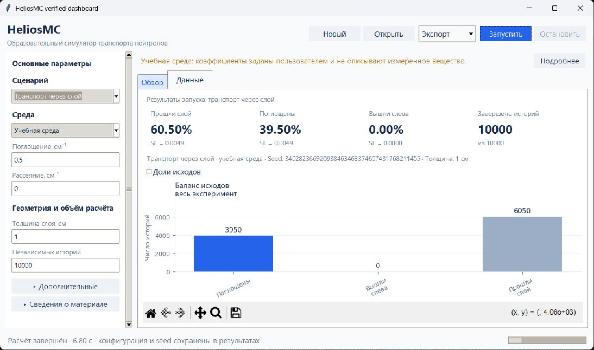

# HeliosMC

Учебный симулятор транспорта нейтронов методом Монте-Карло на Python.
Проект объединяет настольный интерфейс, воспроизводимый экспорт экспериментов
и исследование суррогатных моделей машинного обучения.



## Возможности

- Транспорт независимых историй через один или несколько слоёв: поглощение,
  рассеяние, выход через левую или правую границу.
- Явно заданные учебные коэффициенты среды и отдельный режим справочных
  профилей воды и графита с указанием источников и приближений.
- Экспериментальный сценарий поколений с делением и воспроизводством источника.
- Графики исходов, таблицы параметров и неопределённости, доступные траектории
  и карта зарегистрированных делений.
- Экспорт завершённого эксперимента в JSON/CSV/NPZ, загрузка и проверка архива.
- Сравнение MLP, константной модели и двух вариантов Ridge-регрессии
  на результатах синтетического MC-симулятора.

HeliosMC предназначен для обучения и исследования программных методов.
Программа не прошла инженерную или экспериментальную валидацию для расчёта
реальных установок, критичности и радиационной безопасности.

## Установка и запуск

Нужен Python с Tkinter. Зафиксированное исследование выполнено на Python
3.14.4; версии численных библиотек приведены в
[инструкции воспроизведения](docs/ML_REPRODUCIBILITY.md).

Из корня проекта:

```powershell
python -m venv .venv
.venv\Scripts\python -m pip install -r requirements.txt
.venv\Scripts\python main.py
```

В Linux/macOS используйте `.venv/bin/python`; Tkinter может поставляться
отдельным системным пакетом. Если команда `python` недоступна в Windows,
используйте установленный интерпретатор или launcher `py`.

`requirements.txt` содержит NumPy, SciPy и Matplotlib. Numba необязательна:
без неё используется Python/NumPy. Для ускорения и запуска тестов:

```powershell
.venv\Scripts\python -m pip install numba pytest
```

Numba ускоряет поддерживаемые расчёты; первый вызов включает JIT-компиляцию.
Графический интерфейс использует стандартные Tkinter/ttk и Matplotlib TkAgg.

## Работа с интерфейсом

1. Выберите сценарий, материал или учебную среду и задайте параметры.
2. Укажите seed для воспроизводимости в фиксированном программном окружении.
3. Запустите расчёт и изучите вкладки «Обзор», «Визуализация» и «Данные».
4. Экспортируйте завершённый эксперимент в новый каталог или сохраните график.

Стартовый сценарий — транспорт через слой. Для графита в справочном режиме
нужно указать плотность, описание образца и метод её определения.
Точечное значение при 0.0253 эВ и среднее по заданному спектру обозначаются
отдельно. При отсутствии пространственных данных вкладка визуализации скрыта.

Сценарий поколений показывает отношение воспроизводства источника,
индивидуальные значения по поколениям и их описательный разброс.
Это отношение не является валидированным физическим `k_eff`.
[Обзор поколений](docs/gui_dashboard_legacy.png) и
[карта делений](docs/gui_dashboard_events.png) показывают доступные представления.

Расчёт выполняется в фоновом потоке. Остановка обрабатывается между
поколениями или пакетами историй. Изменение формы помечает показанные результаты
как результаты предыдущего запуска; экспорт использует параметры этого запуска.
Команда открытия принимает `experiment.json` вместе с его CSV/NPZ-файлами.
Загрузка сохраняет конфигурацию для повторного расчёта; новый эксперимент
создаётся отдельной командой.

## Пример расчёта без GUI

```python
from material import MaterialDataset, MaterialQuantity
from physics import simulate_slab

medium = MaterialDataset(
    "example:abstract", "Учебная среда", "synthetic", "Математический пример",
    "1", ("Заданные коэффициенты, не измеренные ядерные данные.",),
    (MaterialQuantity("absorption_rate", "1/cm", 0.5),
     MaterialQuantity("scattering_rate", "1/cm", 0.0)),
)
result = simulate_slab([medium], [0.0, 2.0], n_histories=10000, seed=123)
print(result["outcome_counts"])
print(result["estimates"]["escaped_right"])
```

Координаты и толщины задаются в см, коэффициенты взаимодействия — в см⁻¹.
Математическая проверка, контракты API, профили материалов и происхождение
данных описаны в [архитектуре и модели](docs/ARCHITECTURE_AUDIT.md).

## Исследование машинного обучения

Текущий эксперимент v2 аппроксимирует долю выхода через правую границу
синтетического слоя по трём входам:

| Вход | Диапазон |
| --- | --- |
| Толщина | 0.1–3 см |
| Коэффициент поглощения | 0.02–1.2 см⁻¹ |
| Коэффициент рассеяния | 0–2 см⁻¹ |

В сохранённом полном эксперименте использованы 900 конфигураций и по три
MC-повтора с 8000 историями. Разбиение выполняется по конфигурациям,
чтобы их повторы не попадали одновременно в обучение и тест.
Данные, JSON-модели, метрики и рисунки находятся в
[`benchmarks/results/ml_multivariate_v2/full/`](benchmarks/results/ml_multivariate_v2/full/).

Предсказание готовой модели без обучения:

```powershell
python -B -m benchmarks.ml_baseline predict --output benchmarks/results/ml_multivariate_v2/full --thickness 1.5 --absorption-rate 0.4 --scattering-rate 1.0
```

Новый пробный эксперимент:

```powershell
python -B -m benchmarks.ml_baseline quick --schema v2 --output benchmarks/results/ml_multivariate_v2/quick_new --budget-seconds 300
```

Имя каталога должно быть новым. Бюджет ограничивает один вызов основной
генерации данных; обучение и диагностика имеют отдельные пределы выполнения.
Команды полного исследования, оценки и правила возобновления приведены в
[ML_REPRODUCIBILITY.md](docs/ML_REPRODUCIBILITY.md), методология и измеренные
результаты — в [ML_RESEARCH_REPORT.md](docs/ML_RESEARCH_REPORT.md).

В репозитории сохранены компактные результаты и полные JSON-модели.
Сырые ZIP-архивы экспериментов и крупные checkpoints остаются локально
и исключены из Git. `predict` работает по JSON-модели; `evaluate` дополнительно
требует `experiments.zip`. Для нового полного набора запустите генерацию
в отдельный каталог по инструкции воспроизведения.

## Ограничения и воспроизводимость

- Независимый слоевой транспорт использует постоянные коэффициенты,
  поглощение и изотропное рассеяние без изменения энергии.
- Справочные профили сохраняют источники и условия, но приближение не учитывает
  замедление, термализацию и связанные состояния воды или графита.
- Незавершённые истории явно учитываются. Их нельзя трактовать как полностью
  рассчитанные исходы; полный статистический вывод для них недоступен.
- Биномиальные интервалы описывают MC-выборку, а не ошибки параметров материала
  или физической модели. Разброс отношений по поколениям не является
  стандартной ошибкой для независимых наблюдений.
- Seed воспроизводим при фиксированных backend, коде и окружении.
  Совпадение случайных последовательностей между версиями библиотек,
  платформами и backend не гарантируется.
- Архивы сохраняют хеши исходного кода. Даже правка комментариев меняет хеш:
  старые результаты читаются, но точный replay может потребовать исходный
  снимок. Исторические хеши и измеренные результаты не переписываются.

## Проверки

```powershell
python -B -m pytest -q -p no:cacheprovider
```

Большинство GUI-проверок работает без окна через Agg. Нативный Tk-тест
включается на интерактивном рабочем столе отдельно:

```powershell
$env:HELIOSMC_NATIVE_GUI_TESTS = "1"
python -B -m pytest tests/test_physics.py::test_gui_native_material_bindings_tab_restore_seed_viewer_and_resize -q -p no:cacheprovider
```

Измерения производительности и их ограничения находятся в
[отчёте о производительности](docs/PERFORMANCE_UPGRADE_REPORT.md).
Замороженный `baseline_physics.txt` нужен регрессионным тестам;
`secondary_stage_physics.txt` — историческому сравнению хранения событий.
Они не импортируются приложением.

## Структура проекта

| Путь | Назначение |
| --- | --- |
| `main.py` | Запуск приложения |
| `gui.py` | Интерфейс, графики, открытие и экспорт |
| `physics.py` | Транспорт, поколения, статистика и архивы экспериментов |
| `material.py` | Материалы, схемы данных, справочные профили и источники |
| `neutron.py` | Отдельная частица для учебного использования |
| `numba_compat.py` | Numba и Python fallback |
| `simulation_worker.py` | Фоновый расчёт и кооперативная остановка |
| `tests/` | Регрессионные, математические и интеграционные проверки |
| `benchmarks/` | Измерения производительности и ML-исследование |
| `benchmarks/results/` | Сохранённые измерения и исследовательские результаты |
| `docs/` | Модель, происхождение данных, отчёты и текущие скриншоты |
