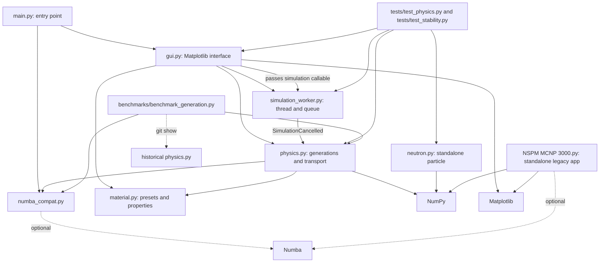

# Architecture and performance audit

Audit date: 2026-10-29. Scope: all Python files in the workspace, including the legacy program, benchmark and tests. This is a static audit: no source or algorithm changes, dependencies, new tests or new benchmarks. Existing benchmark artifacts are historical evidence, not measurements of proposed changes. **Confirmed** means visible in the code; a **suspected bottleneck** requires profiling and benchmarking.

## Key findings

- The batch engine already uses NumPy arrays, with Numba-compiled loops when available. It does not create a `Neutron` object per particle. Positions and directions are separate `(N, 3)` arrays, not a component-wise Structure of Arrays (SoA).
- Confirmed: a Python loop draws an index and copies a position for each secondary neutron (`physics.py:326–328`). NumPy batching is worth testing, but may change random-number consumption.
- Confirmed: transport repeatedly scans the original population and allocates full-size distance and reaction arrays even as particles terminate (`physics.py:172–203`). These loops are compiled with Numba; their share of runtime is unmeasured.
- Confirmed: fission coordinates are individually copied into a list inside transport and converted into an array afterward (`physics.py:209,345`). Sampled paths are already bounded by the configured sample, but fission points and secondary arrays still scale with population and generation count.
- Confirmed: step-limited histories are counted as unfinished, but the next-source ratio includes them in the processed denominator, and the GUI classifies the resulting mean without checking unfinished counts (`physics.py:395–401`, `gui.py:477–502`). The displayed estimate may therefore be incomplete; this audit does not quantify bias. Review how to flag it separately from changing the estimator.
- Physical units and preset-data provenance are not fully documented at the API boundary. No scientific accuracy follows from software tests.
- Any runtime or memory benefit of SoA, vectorization, or another proposed change is **unverified**. The existing compiled loops may be preferable for branch-heavy transport, and conversion costs can dominate.

## Current architecture

`main.main()` constructs `NeutronSimGUI`. The GUI captures controls, starts one worker, and polls its bounded queue via a Matplotlib timer. The worker invokes `estimate_k_full`; the Python generation loop calls the transport wrapper and Numba kernel or Python fallback. GUI rendering remains on the main thread; cancellation is checked between generations. `simulation_worker.py` imports physics for the cancellation exception; physics does not import worker or GUI. The standalone `Neutron` class is not used by the batch engine. The legacy monolith duplicates particle, material, physics, GUI and startup code; it is not imported by `main.py`. The benchmark may execute historical code fetched from Git, while tests target modular code.

### Particle and result representations

- Positions and directions are distinct float64 `(N, 3)` arrays; input is validated and copied before kernel mutation. Noncontiguous arrays are accepted at the public boundary. The standalone `Neutron` holds its own position, direction, energy, alive flag and list of copied positions; it is separate from batch execution.
- Kernel state includes `alive: bool[N]`, `fates: int32[N]` (0 fission, 1 absorption, 2 leak, -1 max steps), and sample-slot indices. Results retain full fission-point arrays per generation, not full paths for all particles.
- Sample scratch is float64 `(S, max_steps + 1, 3)` plus lengths, S = `min(N, max_samples)`. Each returned `(L,3)` path is copied into its own array, avoiding retention of the larger scratch buffer. Source indices are evenly spaced, not randomly sampled.
- `transport_batch` returns five values. `run_generation_batch` returns eight values including sampled `(path, fate-string)` pairs, fission coordinates and outcome counts. `estimate_k_full` returns `k_history`, `k_mean`, `k_std`, `path_frames`, `fiss_frames`, and `generation_stats`. The GUI consumes these contracts; public inputs are not mutated.
- Particle and work arrays scale as O(N); trajectory scratch scales as O(S * (max_steps+1)); retained visualization scales with total fission points and sampled path lengths. The full `int(F * nu)` secondary population is allocated before population control. Arbitrarily large valid input has no memory budget.

## Population loops and execution context

Decorated loops below are Numba compiled when available; the same code runs as Python in fallback mode. No time ranking is asserted without profiling.

| Location | Loop and execution context | Audit assessment |
| --- | --- | --- |
| `physics.py:75–81` | `_sample_reactions_batch` classifies each generated reaction; compiled/fallback. | Compare compiled branch loop with NumPy comparisons and mask temporaries in fallback. |
| `physics.py:91–120` | `_scatter_directions` validates and scatters each direction; compiled/fallback; public helper, not used by transport. | Small temporary arrays per particle; benchmark separately if used. |
| `physics.py:167–170` | Initializes each sampled slot; compiled/fallback. | Scales with S, normally at most 40; likely lower priority, unmeasured. |
| `physics.py:172–238` | Steps, full-population alive reduction and loops for movement, leak, reactions/scattering, then a final termination scan; inner axis loop has three iterations. Compiled/fallback. | Numba is a natural candidate for branching. Compaction or fusion may change RNG draw count/order and requires strict verification. |
| `physics.py:326–328` | Python loop over `n_secondary`, with scalar RNG draw and row assignment. | Candidate for batched integer draws and gather, or compiled gather using precomputed indices; verify RNG state and output. |
| `physics.py:272,339–343` | Python comprehension and loop copy/label sampled paths. | Bounded by S; copies protect ownership. Change only if measurement supports it. |
| `physics.py:382–419` | Python loop over dependent generations, population control and callbacks. | Generations depend on the previous source; measure dispatch overhead rather than assuming they can be vectorized together. |
| `gui.py:340–349` | Python loop over sampled paths, adding a line and marker artist per path. | Suspected redraw bottleneck for large S; measure artist collections and reuse. |
| `gui.py:412–418` | Python loop over fission frames, with NumPy histogram per generation. | Suspected redraw cost; caching bins is a possible experiment. |
| `NSPM MCNP 3000.py:123,137,181–222,283,296,325,623,693,730` | Legacy reaction/scatter/transport loops, secondary and sample loops, generation loop, path drawing, heatmap and sample histogram. | Only relevant when legacy is run directly. Its transport retains all paths; its GUI and histogram are older. Leave it untouched. |
| `neutron.py:14–58` | No population loop; a standalone object copies its path at every move. | Could be expensive for external per-particle callers; not used by batch transport. |
| Tests and benchmark | Test loops iterate over samples, generations and repetitions; benchmark launches modes and creates synthetic arrays. | Not normal application transport work. |

Other GUI loops handle fixed widgets, axes, decorations, legends or bars. Chart comprehensions process generations, not particles. `material.validate` checks six fields. `main.py`, `simulation_worker.py`, and `numba_compat.py` contain no particle-population loops.

## Allocations and performance candidates

The allocations and scans below are confirmed by inspection; their impact is **suspected** until measured.

1. **Secondary generation:** Python calls `rng.integers` and performs a row assignment once per secondary. `new_positions` is zero-initialized before its rows are overwritten; direction generation and normalization also allocate arrays (`physics.py:312–328`). Try batched indices and advanced indexing, or a compiled gather with supplied indices. Compare random outputs and subsequent generator state: vector draws must not be assumed equivalent to repeated scalar draws. Preserve `int(fissions * nu)`, empty cases and selected-site order. Include temporary arrays in memory measurements.
2. **Transport buffers and passes:** every step produces N-sized distance, random-reaction and reaction-code arrays and scans the full population several times. Particles no longer alive still receive distance/reaction draws. Reusable buffers or fewer passes may help, but preserve the existing draw sequence: distances for all, movement, leakage, reactions for all, then scattering draws for surviving particles. Per-particle fusion or only drawing for active particles changes that sequence.
3. **Fission event storage:** each fission copies a position into a growing kernel list and the Python boundary converts it into an array. Try a preallocated event array plus length or event index buffer. Preserve chronological event order: selecting final positions by `fates == 0` instead orders by source index and is not automatically equivalent.
4. **Validation and copies:** `_arrays` is called in both `run_generation_batch` and `transport_batch`, repeating finite and direction checks on the normal path. Public transport intentionally copies inputs to satisfy non-mutation. A private validated path could avoid a repeated scan, while retaining public validation and ownership.
5. **Sampled paths:** scratch reserves the maximum length for each selected trajectory and then copies trimmed paths. This is bounded by S, and the owning copies prevent short paths from retaining scratch. Zero samples still allocate an O(N) slot map and particle buffers. Consider other representations only after measuring short and long histories and establishing equivalent lifetime semantics.
6. **Scatter helper:** `_scatter_directions` constructs small arrays per particle, but the main transport kernel uses scalars and does not call it. Optimize the helper only if its callers and profile justify it.
7. **Visualization:** trajectory redraw clears axes and creates artists for each sampled path; full rendering recomputes histogram bins across all retained fission frames. `np.asarray(path)` normally avoids copying an already compatible array. Try artist reuse/collections or caching histogram bins if GUI timings justify them; preserve colors, endpoints, legends, generation navigation, bin edges and heatmap semantics.
8. **Fallback and concurrency:** without Numba, transport loops execute in Python and may contend for the GIL. `_rng_lock` serializes all transport calls in-process, including Numba calls; the GUI itself blocks overlapping jobs. Native event latency and concurrency costs are not measured.
9. **Retained arrays:** fission coordinates and sampled frames are retained for all generations; the whole secondary population is constructed before its cap. Streaming, pre-binned results, or early sampling may change public data and RNG order, and require a compatibility design. Extremely large populations, `nu`, sample counts or step limits can exhaust memory.

Existing `benchmarks/results/benchmark_v02_results.json` compares pre-v0.2 transport with sampled-path transport for a single scatter-only workload under tracing. It does not compare proposed SoA or establish a general speedup. `benchmarks/results/benchmark_v02_large.json` records only the current performance mode. No proposed improvement is claimed based on those artifacts.

## Proposed component-wise Structure of Arrays

Prototype a private representation with contiguous one-dimensional arrays of equal length; do not replace the existing public API without compatibility adapters.

| Field | Shape / dtype | Meaning |
| --- | --- | --- |
| `x, y, z` | each `(N,) float64` | Position components in the existing length unit. |
| `ux, uy, uz` | each `(N,) float64` | Unit direction components. |
| `alive` | `(N,) bool` | Kernel-local activity. |
| `fate` | `(N,) int32` | Existing fission, absorption, leakage and max-step codes. |
| `sample_slot` | `(N,)` signed integer | Sample index, or -1 when unrecorded. |
| `particle_id` | optional `(N,)` integer | Original index if an active-index list is tested. |

Keep visualization paths and lengths in a separate bounded buffer, fission events in a separate ordered buffer, and aggregate counts independent of samples. The current layout is already field-separated: each `(N,3)` array stores adjacent components per particle. Its columns are strided, so truly contiguous component arrays require conversion/copies. A contiguous `(3,N)` backing array with component row views is an alternative to six allocations. Compare both to the existing layout and retain the simpler layout if costs exceed benefits. Do not introduce unused energy or weight fields.

At the public transport boundary an adapter would validate `(N,3)` inputs, translate to internal arrays, and return the same five-value result, `(N,3)` output shapes, fate dtype/codes, chronological fission points, ordered owning paths, and input non-mutation. Preserve the generation tuple, result dictionary, callback signature, sample defaults and worker/GUI behavior. Count conversion and copies in end-to-end benchmarks. NumPy may suit independent bulk gathers and normalization; compiled loops may suit branch-heavy sequential evolution and recording. Neither choice has been shown faster here.

## Nondeterminism and reproducibility

- `estimate_k_full(seed=None)` starts a `default_rng` from entropy. With an explicit seed it uses a local generator for source directions and selection and derives an explicit seed for each transport generation. Numba has a separate RNG state; seeding NumPy's Python-level global RNG alone is insufficient.
- `run_generation_batch` accepts both `rng` and `seed`: a seeded `rng` without `seed` controls secondary generation but leaves transport unseeded. Direct `transport_batch(seed=None)` and standalone sampler/scatter helpers use backend RNG state. Trajectory sample selection itself uses no random draws.
- With no Numba, seeded transport temporarily seeds NumPy's global legacy RNG and restores it under `_rng_lock`. Unrelated code using that global RNG does not necessarily take the lock, so concurrent external draws can interfere. Unseeded fallback transport uses the global RNG.
- Batching scalar draws, active-index compaction, changed loop order, parallel execution, or a different number of draws may change seeded trajectories and later generations even when marginal distributions match. Thread scheduling changes completion or cancellation timing. Callbacks may introduce external state.
- Results may differ across versions, platforms, floating-point environments and Numba/fallback. Record seed, configuration, backend and dependencies; cross-platform and cross-backend bitwise equality is not established.

## Hardcoded physical parameters and units

| Source | Current behavior | Unit and documentation assessment |
| --- | --- | --- |
| `material.py:49–53` | Four presets with fixed fission, absorption, scatter, multiplicity, density and molar mass. | Data provenance and energy dependence are undocumented. |
| `material.py:35–45` | Uses `6.022e23`, `1e-24`, number density, total cross section and reciprocal macroscopic total. | Arithmetic is consistent with density in g/cm³, molar mass in g/mol, microscopic cross sections in barns and mean free path in cm. These are **inferred conventions**, not an explicit API contract; domain review is needed. Avogadro's value is rounded. |
| `physics.py:56–60` | `-mfp * log(U + 1e-15)`. | Distance uses the same length unit as mfp. The fixed epsilon affects the tail and deserves numerical documentation and validation. |
| `physics.py:65–80,214–228` | Reaction ratios, random angles, scattering, pole threshold `0.9999` and `2*pi`. | Ratios, direction cosines and `nu` are dimensionless; angles are radians. The threshold is numerical; model assumptions should be documented. |
| `physics.py:146–148,351–353` | `max_steps=500`, `max_samples=40`, `n_gen=30`, `n_source=150`, `radius=25`, `n_burnin=8`. | Algorithm/default settings. GUI labels radius and mean free path in cm; array APIs carry no unit metadata. |
| `physics.py:310–328` | `int(fissions * nu)` secondaries and random fission-site selection. | GUI labels nu neutrons per fission. Truncation and selection are existing model rules. |
| `neutron.py:14` | Standalone `energy=1.0`, unused in batch transport. | Energy unit and meaning are unspecified; batch transport has no energy dependence. |
| `gui.py:119–128,323–328,482–492,525–536` | Slider bounds, six displayed rods, k classification at 0.99/1.01 and radius/enrichment hints. | Radius is labeled cm. Rod graphics are schematic, not transport geometry; thresholds and hints are presentation heuristics, not validated physics. |
| `physics.py:422–424` | Mean and population standard deviation of selected generation k values. | Dimensionless quantities; code does not establish an uncertainty estimate accounting for generation correlation or convergence. |

Cross sections, units, geometry and assumptions need qualified domain review before scientific claims. Do not change constants or physics under a performance-only refactor.

## Existing tests and missing coverage

`tests/test_physics.py` covers mocked mixed outcome counts, iteration limits, empty batches, generation accounting and Agg histogram rendering. Its mocked transport fixture supplies one path per input; it does not validate real sampled-index/path-fate mapping. `tests/test_stability.py` covers step limits, sample limits and ownership, seeded runs, different seeds, empty inputs, non-mutation, invalid inputs, tracemalloc repeat/release, worker states and failure handling, overlapping jobs, cancellation, Agg rendering, mocked entry point and a subprocess no-Numba fallback. The prior debug report records 36 tests and two subtests passing in its run. Tests were not rerun during this audit.

Priority gaps before a layout refactor:

- Independent deterministic reference with mixed fission, absorption, leakage and scatter: per-particle final positions/directions, exact fission event order, sample-index/path/fate mapping, outcome counts and subsequent RNG state. Existing direct sampling-independence test is scatter-only; seeded generation tests cover mixed behavior without an independent full-trajectory oracle.
- Distribution checks for free paths, reaction frequencies and scattering, with fixed seeds and predeclared statistical tolerances; direction normalization near the pole threshold; radius equality and crossing; epsilon extremes; finite extreme inputs and overflow/underflow. These validate implementation properties, not reactor safety.
- Deterministic small fixtures for source multiplicity/truncation, fission site selection and population cap ordering, extinction, burn-in and k summary. Exercise incomplete-generation display: unfinished counts are present but the status panel still classifies the calculated k.
- Backend comparison within explicitly defined reproducibility limits; concurrent direct calls; fallback interference from unrelated global NumPy RNG use; cancellation during long generations and first JIT compilation. Agg tests manually poll and do not establish native event-loop responsiveness.
- Actual GUI sample path colors and endpoints, animation, generation navigation, heatmap equivalence, stale plots after failure/cancellation and live control behavior.
- Mixed-outcome and high-fission memory tests, large sample/step combinations, process peak memory and repeated-render retention. Current tracemalloc stress is scatter-only and does not cover every native allocation.
- Invalid dtypes, shapes, noncontiguous arrays and material values across public APIs; callback and result handling errors beyond existing cases.
- **Confirmed code path, untested:** `SimulationWorker.run` catches `Exception`, not `BaseException`. If its callable raises `SystemExit` or `KeyboardInterrupt` in the worker, no result is enqueued and `poll` can leave the worker in RUNNING. Decide desired semantics and test them explicitly; do not silently equate those exceptions with normal cancellation.
- Domain-reviewed validation of material provenance, geometry, model assumptions and estimator/uncertainty is absent. Software tests do not validate reactor behavior.

## Benchmark plan: current versus proposed

1. **Freeze a baseline:** record commit and working-tree patch/hash, harness version, OS, CPU/cores, RAM and power mode, Python/NumPy/Numba/Matplotlib versions, Numba availability, thread settings and seed. Preserve the exact audited implementation. Do not execute untrusted historical code.
2. **Pair workloads:** identical arrays, configuration, seed, sample indices and warmup for both variants. Include N = 150, 2,000, 10,000 and a memory-bounded larger N; short and near-limit paths; scatter-only, mixed, absorption-heavy, leakage-heavy and fission-heavy synthetic materials; sample counts 0, 40 and a controlled larger value; one and multiple generations. Check empty/extinction cases for correctness rather than timing. No real reactor configuration is needed.
3. **Measure stages and end-to-end:** validation and adapter conversions, transport, secondary creation, generation orchestration, result conversion, heatmap/trajectory rendering and GUI response. Include SoA input/output conversion and retained results. Compare existing `(N,3)` transport, component SoA, NumPy secondary gather, and compiled gather with identical supplied indices as independent alternatives. Include Python fallback.
4. **Separate timing from tracing:** use `time.perf_counter` without tracemalloc for timing, and separate fresh processes for tracked peak, process peak working set/RSS using existing OS or standard-library tools, retained memory after collection, sample count and result sizes. State process baseline overhead; tracemalloc does not cover every native allocation. No new measurement dependency is needed.
5. **Separate cold and warm:** report first JIT compilation separately; warm matching signatures before steady-state timings. Run repeated processes in alternating/randomized variant order, report median and range/percentiles plus individual measurements, and control background load. Predefine memory/time limits so the experiment does not exhaust the machine.
6. **Gate on correctness:** where draw order and arithmetic are preserved, compare exact seeded arrays, fate and event order, sampled paths, generation outputs and subsequent RNG state within the same backend/version. Specify tolerances for deliberate floating-point reordering. If a proposal changes RNG streams, explicitly review the reproducibility contract and compare distributions across independent seeds with defined confidence bounds. Only call a variant an improvement if relevant workloads demonstrate benefits without unacceptable correctness, memory, GUI latency or compatibility regressions.

## Numerical and scientific validation requirements

1. **Software invariants:** finite arrays, unit directions, valid fate codes and dtypes, shapes and ownership, processed count reconciliation, explicit step-limit status, input immutability, path/fission mapping and sample bounds. Include boundaries and extreme finite values.
2. **Transport and RNG equivalence:** preserve per-step draw order and count, population and fission-event order, and boundary behavior. Verify fixed-seed reference cases for each backend, check sampling independence and document acceptable floating-point differences. Cross-run RNG interference must be tested under the supported usage model.
3. **Implemented distributions:** compare free-path, reaction and scattering samples to the existing formulas with many independent draws and predeclared tolerances; include ±z directions, epsilon and radius boundaries. Do not replace algorithms as part of the performance work.
4. **Generation semantics:** verify `int(F * nu)`, site selection, population capping, extinction, k ratios, burn-in and population standard deviation. Explicitly flag incomplete generations in presentation. Keep the current estimator unless a separate scientific change is approved.
5. **Independent scientific review:** specify units, data provenance, geometry and angular assumptions, model limits, meaning of k and displayed spread. If scientific claims are desired, qualified reviewers should define independent reference problems, uncertainty/convergence methods and acceptance thresholds. Matching the existing implementation does not establish scientific validity.

## Step-by-step refactoring plan

1. Inventory callers and freeze public contracts, RNG order, units, backend guarantees, event/path ordering and incomplete status. Add deterministic mixed-outcome reference fixtures.
2. Profile and run the baseline benchmark matrix, including allocations, rendering and fallback. Rank candidates by observed cost.
3. Prototype secondary-source gather behind a private boundary. Compare scalar/batched RNG continuation, ordering, dtype and memory; retain current implementation if compatibility or benefit is unproven.
4. If justified by profiling, prototype contiguous fission-event storage and reusable work buffers in the current layout. Preserve event order, random draws and numerical behavior.
5. Prototype SoA as an opt-in private kernel with compatibility adapters; compare full end-to-end cost against the existing `(N,3)` layout with Numba and fallback. Keep the current layout if conversion outweighs benefits.
6. If rendering is measured as limiting, separately evaluate cached histograms and reusable or collection artists, preserving result structures and appearance.
7. Expand regression and numerical tests with each change; run the full suite and native GUI checks after integration. Repeat paired benchmarks for time, peak memory, correctness and latency. Reject candidates that fail agreed criteria.
8. Document evidence and unresolved limits. Keep `main.py`, public signatures and return shapes, and legacy behavior compatible unless a separate reviewed migration explicitly authorizes an API change.
