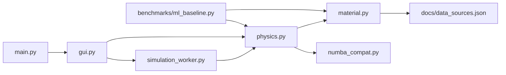

# HeliosMC: архитектура, модель и данные

Документ описывает текущие контракты программы. Численные результаты
исследования приведены в [ML_RESEARCH_REPORT.md](ML_RESEARCH_REPORT.md),
команды — в [ML_REPRODUCIBILITY.md](ML_REPRODUCIBILITY.md), исторические
измерения оптимизации — в [PERFORMANCE_UPGRADE_REPORT.md](PERFORMANCE_UPGRADE_REPORT.md).

## Границы модулей

`physics.py` и `material.py` не зависят от GUI. Основной транспорт использует
массивы NumPy, а не экземпляры `Neutron`; `neutron.py` сохраняет отдельную
учебную модель частицы и её публичный API. Numba оборачивает численные ядра,
а проверка входов, статистика, источники и файловый ввод-вывод остаются в Python.
`numba_compat.py` позволяет запуск без Numba.

`SimulationWorker` исполняет одну задачу и передаёт её результат через очередь.
GUI опрашивает очередь в основном потоке; рабочий поток не обращается к Tk.
Состояния: `IDLE`, `RUNNING`, `COMPLETED`, `FAILED`, `CANCELLED`.
Остановка кооперативная: между поколениями или пакетами независимых историй.
Ошибки и остановка не выдаются за завершённый частичный эксперимент.

## Независимый транспорт через слои

`simulate_slab(layers, edges_cm, ...)` моделирует независимые истории в
плоскопараллельной геометрии. `edges_cm` содержит упорядоченные границы слоёв.
Координата источника задаётся `source_x` в см, направление — `source_mu`,
косинусом относительно нормали слоя. В каждом слое используются постоянные
неотрицательные коэффициенты поглощения и рассеяния в см⁻¹.
Вакуумный слой допустим.

Расстояние до взаимодействия выбирается по экспоненциальному закону.
Учитываются пересечения границ слоёв, поглощение и изотропное рассеяние.
Внешние границы поглощающие: вышедшая история завершается.
Деления, размножения и изменения энергии в этом сценарии нет.

Счётчики исходов: `absorbed`, `escaped_left`, `escaped_right`,
`collision_limit`, `numeric_limit`. Их сумма равна числу запрошенных историй.
Последние два обозначают незавершённые истории из-за лимита столкновений
или численного ограничения; статистические сводки учитывают их как
`unfinished`. Пустой или цензурированный запуск не получает полных
оценок вероятностей и интервалов.

Для полного IID-набора `summarize_binomial` вычисляет долю исхода,
биномиальную стандартную ошибку и точный маргинальный интервал
Клоппера—Пирсона через обращение бета-распределения. Интервалы по исходам
не являются одновременным многомерным доверительным регионом.
`summarize_samples` по умолчанию даёт описательные статистики;
интервал Стьюдента требует явного `assumption="iid_normal"` и не применяется
автоматически к коррелированным поколениям.

В режиме проверки `pure_absorption_v1` аналитическая вероятность выхода
для источника, направленного к правой границе, равна
`exp(-sum(rate_i * distance_i) / abs(source_mu))` на оставшемся пути.
Критерий задаётся до расчёта: двусторонний точный биномиальный p-value
не ниже `1e-6` и отсутствие незавершённых историй.
Это проверка математической задачи с заданными коэффициентами.

## Экспериментальная модель поколений

`transport_batch` принимает позиции и единичные направления формы `(N, 3)`.
Публичная граница проверяет входы и копирует их перед изменениями в ядре.
`run_generation_batch` собирает исходы и вторичный источник;
`estimate_k_full` запускает поколения и ограничивает популяцию.

Коды историй: `-1` — лимит шагов, `0` — деление, `1` — поглощение,
`2` — утечка. Позиции делений возвращаются в хронологическом порядке
как владеющие своей памятью массивы. Сохраняется только ограниченная
выборка траекторий для визуализации; статистика использует всё поколение.
Карта событий показывает число делений, а не поток нейтронов.

Отношение воспроизводства определяется как
`k_g = floor(F_g * nu) / N_g` до ограничения вторичной популяции.
Знаменатель включает истории с лимитом шагов. `k_mean` и `k_std` —
совместимые описательные сводки; стандартное отклонение не является
стандартной ошибкой или критерием сходимости. Burn-in исключается только
при числе поколений больше заданного `n_burnin`; иначе используются все.
Наличие незавершённых историй в любом поколении помечает весь результат
как неполный. Нулевые сводки пустого запуска не означают наличие оценки.

Четыре исторических пресета `MATERIALS` имеют статус `legacy_unverified`.
Их числа сохраняются ради совместимости; они не являются научным эталоном.
Модель и отношение источника не валидированы как расчёт физического `k_eff`.

## Материалы и происхождение данных

`Material` сохраняет исторический интерфейс. `resolve_transport_data`
принимает также неизменяемый `TransportData` или провайдер
`get_transport_data()`. Такой снимок разрешается один раз перед расчётом.
Он содержит постоянные одногрупповые параметры; произвольные энергетические
таблицы не сводятся автоматически к скаляру.

`MaterialDataset` и `MaterialQuantity` хранят идентичность, состав, единицы,
значения, доступность и ограничения. Метаданные включают:

| Тип | Назначение |
| --- | --- |
| `MaterialState` | Температура, давление, плотность и условия состояния |
| `DataOrigin` | Источник, версия, способ получения и исходная ссылка |
| `DataQuality` | Область проверки и её статус |
| `ParameterUncertainty` | Неопределённость входного параметра, если известна |
| `AveragingConditions` | Метод, вес, диапазон и условия усреднения |
| `LocalDataFile` | Размер, SHA256 и независимая контрольная сумма |
| `DataLibrary` | Библиотека, форматы, ссылки и условия использования |

Неизвестные поля остаются `None`. Проверки формы и единиц не доказывают
научной достоверности. `source_checked` относится к указанному свойству
и области его проверки. `require_scientific_reference()` отклоняет
непроверенные записи; декларация проверки сама по себе не включает транспорт.

`get_builtin_dataset(key)` описывает старый пресет без выдуманных метаданных.
`get_reference_dataset(key)` возвращает термофизическую справочную запись;
сама по себе она не содержит всех коэффициентов для транспорта.
`get_reference_transport_dataset(...)` — отдельный явно выбранный адаптер.
В учебном режиме `resolve_medium_rates` принимает синтетические или учебные
`absorption_rate` и `scattering_rate`; переименование научной записи в учебную
не снимает ограничений происхождения.

`load_source_catalog()` читает офлайн-реестр
[data_sources.json](data_sources.json) и ничего не скачивает.
`inspect_local_file()` вычисляет SHA256; проверка целостности требует
независимой ожидаемой суммы и ссылки на неё.
`load_synthetic_table()` принимает только ограниченные локальные JSON
схемы `heliosmc.synthetic-material.v1`: проверяет единицы, формы,
отсутствующие значения и строго возрастающую энергию.
ENDF/ACE/HDF5-парсера и автоматического скачивания ядерных данных нет.
Отдельная PCHIP-интерполяция допускает синтетические таблицы,
запрещает экстраполяцию и не подменяет коэффициенты транспорта.

## Справочные профили

`get_reference_profiles()` возвращает профиль, область доступности,
определение энергии, температуры, источники и ограничения.
Слои одного эксперимента должны использовать совместимый профиль и библиотеку.

| ID | Определение | Материалы |
| --- | --- | --- |
| `jendl5_point_0p0253ev` | Точка 0.0253 эВ | Вода, графит |
| `jendl40_point_0p0253ev` | Контрольная точка 0.0253 эВ, природный C-0 | Графит |
| `jendl40_maxwell_flux_0p0253ev` | Нормированный потоковый вес `E exp(-E/kT)`, `kT=0.0253 эВ`, границы `1e-5..10 эВ` | Графит |

Макроскопический коэффициент получается как `Sigma = sum(N_i * sigma_i)`
в см⁻¹. При переводе сечений используется `1 barn = 1e-24 cm²`.
Для графита обязательны плотность в г/см³ и `density_origin=DataOrigin(...)`
с описанием образца и метода; значение остаётся непроверенным вводом пользователя.
Плотность графита и эталон урана автоматически не подставляются.

Точечный профиль требует `REFERENCE_APPROXIMATION`; групповой —
`REFERENCE_GROUP_APPROXIMATION`. Энергия и коэффициенты заморожены,
рассеяние изотропно в лабораторной системе. Связанные состояния,
`S(alpha,beta)`, замедление и изменение спектра после столкновений не моделируются.
Экспонента среднего коэффициента не равна интегралу спектрального ослабления.
MC-интервалы описывают случайную выборку, а не эту ошибку модели.
Справочные результаты исключены из текущего математически сертифицированного
обучающего поднабора; ML-исследование отдельно описывает собственную постановку.

### Численные источники точечного адаптера

The following point-table transcriptions were documented in the source audit
on 2026-11-10. They are not values inferred from library homepages.
All nuclear entries use a single evaluation family: JAEA JENDL-5, December 2021,
published point summaries processed at 300 K with LINEAR/RECENT/SIGMA1 (PREPRO).
The HTML does not pin processing-software version or raw-file errata revision;
none is invented. No raw ENDF, ACE, HDF5 file, covariance or source checksum was
checked. Local adapter revision is separate from this source identity.

| Nuclide | MT2 elastic (barn) | Disappearance used as sigma_a (barn) | Numerical source / derivation |
| --- | ---: | ---: | --- |
| H1 | 30.27 | 0.3326 | [JAEA H1](https://wwwndc.jaea.go.jp/jendl/j5/elm/Table/z001/T1.html), MT102 |
| H2 | 4.246 | 0.0005500 | [JAEA H2](https://wwwndc.jaea.go.jp/jendl/j5/elm/Table/z001/T2.html), 550.0 microbarn MT102 |
| O16 | 3.986 | 0.0001899 | [JAEA O16](https://wwwndc.jaea.go.jp/jendl/j5/elm/Table/z008/T16.html), 189.9 microbarn MT102 |
| O17 | 3.615 | 0.24447 | [JAEA O17](https://wwwndc.jaea.go.jp/jendl/j5/elm/Table/z008/T17.html), 670.0 microbarn MT102 + 243.8 millibarn MT107; capture alone is insufficient |
| O18 | 3.532 | 0.0001408 | [JAEA O18](https://wwwndc.jaea.go.jp/jendl/j5/elm/Table/z008/T18.html), 140.8 microbarn MT102 |
| C12 | 4.950 | 0.003877 | [JAEA C12](https://wwwndc.jaea.go.jp/jendl/j5/elm/Table/z006/T12.html), 3.877 millibarn MT102 |
| C13 | 5.557 | 0.001488 | [JAEA C13](https://wwwndc.jaea.go.jp/jendl/j5/elm/Table/z006/T13.html), 1.488 millibarn MT102 |

All entries refer to **0.0253 eV**, not the adjacent Maxwellian-average column.
Source checking establishes transcription/scope; independent scientific
validation is unestablished. Other listed reaction thresholds are above this
energy. No artificial fission/nu constants are introduced for this adapter.

| Material/property | Used value and units | Source, conditions and verification |
| --- | --- | --- |
| Representative isotope atom abundances | H1/H2: .99985/.00015; O16/O17/O18: .99762/.00038/.002; C12/C13: .989/.011 | [NIST NCNR table](https://www.ncnr.nist.gov/resources/n-lengths/list.html), Neutron News 3(3), 1992, pp.29-37; percentages explicitly divided by 100; numerical rows source-checked, not sample measurements |
| Water conventional molar mass | 18.0153 g/mol | [NIST SRD69 Water](https://webbook.nist.gov/cgi/cbook.cgi?ID=C7732185&Mask=1), molecular-weight row rechecked |
| Carbon conventional molar mass | 12.0107 g/mol | [NIST SRD69 Graphite](https://webbook.nist.gov/cgi/cbook.cgi?ID=C7782425&Units=SI), molecular-weight row rechecked |
| Water density at 300 K/100000 Pa | 0.9965563072677796 g/cm^3 (derived numeric result) | [IAPWS SR6-08(2011)](https://iapws.org/technical-guidance/release/LiquidWater.download), Eq.2/Eq.4/Table1; only specific-volume correlation implemented and checked against all Table8 density points |
| Graphite density | Required user input, no universal value | DataOrigin must identify sample/grade and acquisition/method at 300 K. Always unverified user input; no source status inferred from a supplied URL |
| Water derived Sigma_a / Sigma_s | 0.022165776780709006 / 2.149247245558249 cm^-1 | Explicit formula above and individually archived source inputs; model coefficients at this point/state, not measured water attenuation |

IAPWS formula constants and coefficients retain their published values, including
the correlation-specific R=461.51805 J/(kg K), TR=10 K, Ta=593 K, Tb=232 K and
p0=100000 Pa. The implemented equation is
`v = R*TR/p0 * (a5 + sum(a_i*alpha**n_i, i=6..10) +
sum(b_i*beta**m_i, i=5..10))`, `alpha=TR/(Ta-T)`, `beta=TR/(T-Tb)`;
`rho(g/cm^3)=1/v/1000`. Bounds are 253.15..383.15 K and include metastable liquid;
the factory fixes stable liquid 300 K. Source density uncertainty has coverage
factor k=2; it is not silently converted to a one-sigma input uncertainty.
The old 298.15 K reference remains unchanged instead of being attached to 300 K
nuclear inputs. Conventional masses and representative isotope abundances are
a declared approximation, not isotope-exact sample masses/composition. IAPWS
ordinary-water state is likewise not a measured assay of that isotope mixture.

### Источник группового профиля графита

The [JAEA JENDL-4.0 C-0 table](https://wwwndc.jaea.go.jp/cgi-bin/Tab80WWW.cgi?iso=C000&lib=J40)
was opened on 2026-11-10, including the numerical columns and MACS equation.
The [official abstract of Namekawa/Katakura, JAEA-Data/Code 2010-017](https://jopss.jaea.go.jp/search/servlet/search?5026620=&language=1)
(September 2010; DOI 10.11484/jaea-data-code-2010-017) explicitly identifies
Maxwellian kT=0.0253 eV. Its full PDFs/errata were not opened. No raw nuclear
library, processing software version, covariance or source checksum was verified.
The JENDL-4.0 profile uses elemental natural-carbon C-0 per atom. It does not
construct a nominally JENDL-4.0 material using JENDL-5 C12/C13 values.

| Preset ID | Type and bounds in eV | Spectrum | Material/processing T | Availability |
| --- | --- | --- | ---: | --- |
| jendl5_point_0p0253ev | Point [.0253,.0253] | Monoenergetic evaluation; no averaging | 300 K | Water and graphite |
| jendl40_point_0p0253ev | Point [.0253,.0253] | Monoenergetic natural-carbon control | 300 K | Graphite |
| jendl40_maxwell_flux_0p0253ev | Flux average [1e-5,10] | w(E)=E exp(-E/.0253 eV), normalized on the stated interval | 300 K | Graphite |

The two point presets share an energy definition but use separately identified
evaluations/composition representations. There are two spectral definitions,
not three independently sampled energy bands. For the group, spectrum kT is
0.0253 eV and its equivalent neutron temperature is 293.5943084752171 K, computed
using scipy.constants.Boltzmann/elementary_charge. That is distinct from the
material/processing temperature, not an assumption of thermal equilibrium.

| C-0 quantity | Published point (barn) | Published MACS (barn) | Normalized flux-group result (barn) |
| --- | ---: | ---: | ---: |
| MT102 disappearance / sigma_a | .003860 (3.860 mb) | .003862 (3.862 mb) | .0034226083860985513 |
| MT2 elastic / sigma_s | 4.942 | 5.575 | 4.940715109399125 |

The published definition is `MACS = (2/sqrt(pi))*integral(sigma*w)/integral(w)`.
Consequently the required group mean is `sigma_group=(sqrt(pi)/2)*MACS` on those
same bounds. No arithmetic point averaging, locally invented sigma(E), or
integration of an unopened nuclear file occurs. Original MACS numbers are kept
as separate quantities before normalization. Derived digits describe floating
calculation/replay, not extra physical precision beyond the printed source.
All selected nonelastic/production thresholds for the C-0 evaluation are above
10 eV; the selected group has elastic scattering and capture disappearance.

Nuclear table transcription status is source_checked; independent scientific
validation remains unverified. Graphite density still must be supplied with a
sample/grade/method DataOrigin at 300 K and remains unverified. Conventional
12.0107 g/mol comes from the existing NIST reference; the nuclear C-0 isotope
fractions are not independently resolved or claimed to assay that sample.
At a purely illustrative caller density of 1.6 g/cm^3, derived group rates are
.00027457423087669366 / .39636233483624206 cm^-1 (absorption/scattering).
This density is a software fixture, not a newly sourced graphite property.

## Экспорт и воспроизводимость

`create_slab_configuration` фиксирует постановку, seed, backend, окружение,
хеши кода и критерий проверки до расчёта. `run_slab_experiment` выполняет её.
`export_slab_experiment` записывает только в новый каталог:

| Файл | Содержимое |
| --- | --- |
| `experiment.json` | Конфигурация, материалы, источники, результат и контрольные суммы |
| `results.csv` | Численные сводки |
| `arrays.npz` | Численные массивы без pickle |

`load_slab_experiment` проверяет версии, хеши, формы, типы, счётчики,
неопределённость и соответствие боковых файлов. Схемы конфигурации v1/v2
читаются вместе с текущей v3. Траектории в исследовательский архив не входят.
Возвращённую контрольную сумму следует сохранять независимо:
владелец всех файлов может заменить данные вместе с их суммами.

Точный replay требует совпадения хешей кода, версий окружения и backend.
Даже комментарии меняют SHA256. При редакционной чистке исходные хеши
сохранённых экспериментов не заменяются хешами новой версии.
Старый архив можно прочитать; для его точного повторения нужен исходный снимок.
Новые расчёты сохраняют собственные хеши и отдельный каталог.

В Python fallback доступ к глобальному генератору NumPy сериализуется
блокировкой с сохранением и восстановлением его состояния. Сторонний код,
использующий тот же глобальный RNG, не обязан соблюдать эту блокировку.
Случайные последовательности не гарантируются между backend и версиями.

`split_slab_groups` объединяет повторы одной математической постановки
независимо от seed и числа историй. Только полные аналитически проверенные
учебные эксперименты проходят этот фильтр; на малом наборе раздел может быть пуст.

## Ресурсы и проверки

`max_memory_bytes` по умолчанию равен 512 MiB; `None` отключает ограничение.
Это консервативная оценка хранения массивов и выборок, а не жёсткий лимит RSS.
Интерпретатор, JIT, аллокатор и память вызывающего кода ограничиваются не полностью.
В сценарии поколений вторичная популяция формируется до её ограничения,
поэтому сильное размножение может потребовать много памяти.

| Файл тестов | Область |
| --- | --- |
| `test_physics.py` | GUI, конфигурации, результаты, экспорт и нативное окно |
| `test_regression.py` | Замороженный baseline, RNG, владение данными, полнота и лимиты |
| `test_stability.py` | Валидация, память, рабочий поток, отмена и Python fallback |
| `test_material_data.py` | Метаданные, источники, единицы, профили и проверка файлов |
| `test_educational_math.py` | Аналитические пределы, интервалы, слои и архивы |
| `test_ml_baseline.py` | Градиенты, модели v1/v2, разбиение, возобновление и CLI |

Нативный Tk-тест включается через `HELIOSMC_NATIVE_GUI_TESTS=1`.
Остальные GUI-тесты используют Agg. Прохождение тестов устанавливает
проверенные программные свойства, но не физическую валидность материалов.

## ?????? ?????????? ???????????

? ??????????? ?????? ??????????, ?????, ??????????? ??????????, ???????????? ?
???????, ?????????? ? ????????????????? ?????. ??????????????? ??????????
benchmark ? ML ????????? ?? Git ? ???????? ???????? ? `benchmarks/results/`.

???????????? ????????? ??? ????????????? ?????? ? ????????????? benchmark
???????? ? `benchmarks/fixtures/`. ???? ????????????? ?????? ML-?????? ??????????
????????? ???????? `tests/fixtures/water_slab_surrogate_v1.json`. ??????? ??????
????????? ? `docs/figures/ml_study/`.
