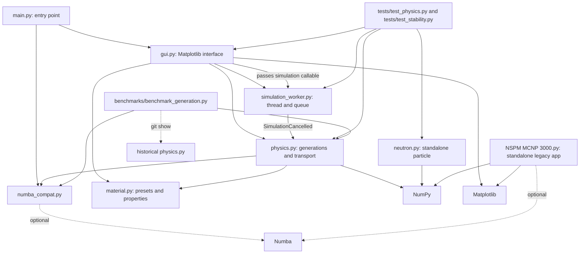

# Architecture and performance audit

## Material provenance audit before changes (2026-10-31)

The working tree was clean at `92a5e7d`. Before changing material.py:

- `Material` stores mutable constant microscopic cross sections (barn), nu (1),
  density (g/cm^3), molar mass (g/mol), name and display color. All four presets
  are hard coded; no primary scientific reference or applicable energy,
  temperature, isotopic mixture or averaging spectrum is known. Color is only
  presentation metadata. Name also appears in run metadata.
- `sigma_total`, `macro_total` and `mean_free_path` compute derived quantities
  using the existing rounded Avogadro constant. `get_builtin_dataset` snapshots
  those quantities together with source constants without describing derivation
  separately. Presets are labelled educational rather than explicitly legacy.
- `TransportData` freezes sigma_f, sigma_a (excluding fission), sigma_s, nu and
  mean_free_path. `resolve_transport_data` resolves one snapshot per run outside
  JIT. GUI passes Material; worker calls physics; neither is a data-file reader.
- `MaterialQuantity` checks units, nonnegative finite scalars/immutable vectors
  and missing/unsupported status. `MaterialDataset` checks identity, normalized
  atom/mass fractions or stoichiometry, K/eV conventions and scalar/pointwise
  shapes. Pointwise tables cannot enter the legacy kernel.
- `resolve_medium_rates` admits only synthetic/educational absorption/scattering
  rates directly in 1/cm. These are not inferred from nuclear cross sections.
  `interpolate_synthetic_quantity` uses PCHIP only on synthetic pointwise data.
- Gaps: no typed processing lineage/state/source uncertainty/validation scope,
  no source catalog or local file/schema/checksum verification, no protection
  against presenting a declared data_kind as scientific validation, and the
  one-group adapter accepts declared experimental/evaluated data without an
  independently reviewed model mapping. Arrays are checked for software
  consistency; this is not validation of scientific data or transport physics.

Plan: extend the existing dataclasses with optional grouped metadata, classify
presets honestly without changing constants/formulas, retain the old transport
snapshot contract, block unsupported scientific-data adaptation, add an offline
source registry and a bounded synthetic-only JSON reader. Reuse this document
for source research, schema specification, test evidence and ML pipeline design.
No ENDF parser, scientific interpolation policy, transport or GUI changes.

## Material provenance schema and source catalog (2026-10-31)

This section supersedes earlier descriptions of presets as educational records.
The preceding audit was recorded before code edits. No material constants,
physical formulas, transport kernels, GUI/worker logic or monolith were changed.

### Schema and compatibility

The existing required/positional constructor fields remain in order. New metadata
is optional and immutable, using the standard library and existing NumPy:

| Structure | Added information and purpose |
| --- | --- |
| `MaterialDataset` | Optional chemical formula, category (`component`, `mixture`, `abstract`, `legacy_preset`, or unspecified), grouped state/origin/quality, actual local-file check |
| `DataOrigin` | Library/release, HTTPS source URL, primary reference, processing description/software/version, upstream file SHA-256, acquisition date |
| `MaterialState` | Optional density in g/cm^3, physical state, origin of state parameters, published density/temperature applicability ranges |
| `DataQuality` | Declared review status/reference, applicability scope, known limitations |
| `MaterialQuantity` | Optional classification override, origin, source uncertainty, applicability notes; inferred scalar/pointwise/unavailable representation |
| `ParameterUncertainty` | Absolute or relative **standard** source-parameter uncertainty plus reference; no fabricated default |
| `LocalDataFile` | Resolved path, observed byte count/hash, optional independent expected hash/reference, supported schema checked, optional recorded acquisition |
| `DataLibrary` | One source/release/processing variant with organization, format list, terms, documentation URLs, source availability and separate local-file checks |

The original `source`, local `version`, free-text `provenance`, composition,
temperature, grid and quantity fields remain. `origin.library_version` describes
the upstream library, not the local dataset revision. Temperature remains on
MaterialDataset for compatibility, in K; its range lives with state. Density can
remain an old scalar quantity; if state also specifies it, both must agree exactly.
No density/temperature law is inferred. Zero density is permitted for an abstract
vacuum; the unchanged legacy Material transport API still requires positive density.

Composition supports atom fractions, mass fractions (sum 1 within absolute 1e-8,
without normalization), and positive-total stoichiometric amounts. Components
must be unique; the `component` category cannot contain multiple components.
Unknown composition stays None/unknown, including named legacy presets. A formula
is descriptive text, not a parsed composition or a source of inferred fractions.

`data_kind` distinguishes synthetic, legacy, experimental, evaluated and derived;
the prior educational label remains supported for existing callers. Quantity kind
None inherits its dataset classification. A derived quantity/dataset requires a
processing description; parent identities/revisions and the derivation belong in
that description/provenance. This is recorded evidence, not proof of its content.

Missing/unsupported quantities retain values=None. Available quantities require
explicit recognized units and nonnegative finite values; vector storage is owned
and immutable. The unit vocabulary remains deliberately limited to barn, 1, cm,
1/cm, g/cm^3 and g/mol; grid energy is eV, temperature K. Other dimensions, signed
observables, covariance matrices, per-channel grids, discontinuous repeated nodes
and multigroup structures need a reviewed schema extension. In particular, ENDF
can encode discontinuities; its raw nodes must not be forced into this strictly
increasing synthetic-table schema by dropping duplicates.

Source uncertainty is optional: absolute standard uncertainty uses the quantity's
unit; relative standard uncertainty is a fraction. Shape must match values, with
no scalar broadcasting to a table. No correlation/independence assumption or
uncertainty propagation is implemented. State density uncertainty, if known, can
be recorded on a scalar density quantity; temperature uncertainty has no dedicated
numeric representation yet and must remain documented/missing until an extension
is justified. MC intervals stay in simulation results, numerical verification
errors in verification records, and future ML errors in model-evaluation records.
They must not be added as though they measured the same uncertainty.

`TransportData` and all its scalar values/fields are unchanged. Material objects
and explicit caller-created snapshots/providers continue to work. Scientific
experimental/evaluated/derived MaterialDataset records are storage-only even if
scalar: no reviewed reduction or model mapping exists. Pointwise records always
fail before kernel entry. Embedded legacy/experimental/evaluated quantities or declared
external-library origins also block relabelling such a dataset as synthetic for
computation. Synthetic/educational scalar fixtures retain the old adapter behavior;
legacy presets retain it for compatibility. The explicit provider/snapshot API
cannot authenticate arbitrary caller-supplied numbers; metadata cannot detect
deliberate mislabelling or prove a cited publication was independently reviewed.

`resolve_medium_rates` still accepts only the two explicit abstract rates in
1/cm for synthetic/educational scalar layers. PCHIP remains synthetic-only and is
never automatically applied during loading or transport. No nuclear interpolation,
one-group averaging, ENDF processing or reaction model is implemented.

All four MATERIALS presets, including water/graphite, keep their exact historical
numbers and are explicitly legacy/unverified. Their scientific references, energy
weighting, temperature and detailed composition remain unknown. Their mean free
path is labelled derived with the existing formula and legacy parent recorded.
The rounded 6.022e23 and 1e-24 conversion remain unchanged. `Material.color` remains
GUI-only. `Material.get_transport_data().data_source` stays `constant_parameters`
for existing API consumers; use dataset metadata for classification.

`require_scientific_reference()` emits UnverifiedDataWarning **and raises** when
an unverified/legacy/synthetic record is requested as a scientific oracle. A
scientifically_validated declaration requires a reference and applicability scope;
legacy/synthetic/educational datasets cannot claim it. Scientific datasets also
need a primary reference when used as an oracle. This is a metadata gate, not
automated independent scientific validation, and never grants transport access.

### Official-source research (documentation inspected 2026-10-31)

No numerical libraries, isotope arrays or archives were downloaded. Versions below
identify inspected offerings, not an assertion that newer means better or sources
are interchangeable. All five catalog entries have no local files and only
`known_source` status. `checked_on` records documentation inspection, not a checksum
verification date. The JSON catalog is a small offline metadata registry; it has
no network client and is not imported by physics/GUI.

| Library | Observed versions/offering | Organization | Distribution format | Verified documentation URL | Actual status |
| --- | --- | --- | --- | --- | --- |
| ENDF/B | VIII.1; VIII.0 and VII.1 also linked | CSEWG; BNL NNDC distributes | ENDF-6 | [NNDC](https://www.nndc.bnl.gov/endf-library/) | Release index readable; no files checked |
| JEFF | 4.0; older releases including 3.3 linked | OECD NEA Data Bank / JEFF project | ENDF-6; ACE, PENDF, HDF5, GENDF, AMPX processed variants | [NEA release](https://databank.io.oecd-nea.org/data/jeff/40/) | Release/processing table readable; no files checked |
| JENDL | 5; older 4.0/3.x releases linked | JAEA NDC with JNDC | ENDF-6; pointwise distributions | [JAEA index](https://wwwndc.jaea.go.jp/jendl/jendl.html) | Index and [release description](https://wwwndc.jaea.go.jp/jendl/j5/j5.html) readable; no files checked |
| OpenMC processed | Selected ENDF/B-VIII.1 / NJOY 2016.78 variant; additional parent libraries listed | OpenMC development team; underlying evaluators remain credited | HDF5, XML index, compressed archive | [OpenMC data](https://openmc.org/data/) | Distribution documentation readable; archive revision/checksum not pinned |
| EXFOR | Rolling entries/subentries with revisions, not one numbered evaluation release | NRDC under IAEA NDS | Fixed-width EXFOR; JSON/XML/CSV retrieval | [IAEA EXFOR](https://www-nds.iaea.org/exfor/) | Main page yielded no readable content; [API guide](https://nds.iaea.org/exfor/x4guide/API/) and [official repository](https://github.com/IAEA-NDS/exfor_master/blob/main/README.md) readable |

**ENDF/B:** evaluated reaction, distribution, decay and covariance records, not
direct measurements or a ready-made material mixture. The release and individual
evaluation references must be retained. The inspected index did not establish an
artifact redistribution license; catalog license stays None.

**JEFF:** evaluated general-purpose sublibraries and separately processed artifacts.
The release table documents NJOY2016.78 processing; available temperatures differ
by format (for example ACE and HDF5 lists differ). The page supplies dataset DOI
10.82555/e9ajn-a3p20 for citation. A single dataset reuse license was not established
from the inspected release page, so None is retained and artifact terms need review.

**JENDL:** JAEA documents evaluated neutron/other-projectile, decay, scattering and
yield sublibraries, plus 0 K and 300 K pointwise offerings. The release asks users
to cite Iwamoto et al., DOI 10.1080/00223131.2022.2141903. Its errata revision must
also be pinned. Redistribution license and pointwise processing recipe/version
were not established from the inspected overview, and are not guessed.

**Shared ENDF-format semantics:** the [ENDF-102 format manual](https://www.nndc.bnl.gov/endfdocs/ENDF-102-2023.pdf)
defines energies in eV and cross sections in barn. MF1/MT451 contains identification,
release/revision and bibliographic metadata, with TEMP in K for Doppler-processed
data; primary evaluations use TEMP=0 as a format convention. It must not be
interpreted as the material's operating temperature. Resonance reconstruction,
temperature processing and per-region interpolation conventions need explicit
lineage. These machine-readable records allow future metadata extraction, but no
ENDF parser was added. Sharing a format does not make evaluations equivalent.

**OpenMC:** derived distributions preserve the parent library and processing chain
(ENDF to NJOY-generated ACE to HDF5). Its documented API can read file metadata
and XML indexes. The selected distribution documents 250/293.6/600/900/1200/2500 K;
thermal tables follow their source temperature lists. The upstream [HDF5 specification](https://docs.openmc.org/en/latest/io_formats/nuclear_data.html)
defines file type/version, nuclide identity, energy grids, reaction metadata and
temperature groups; kT is stored in eV, whereas group labels use rounded K.
Neither those labels nor library family identify an exact processing artifact.
Software licensing is not assumed to license every data archive; dataset terms,
archive hash and processing revision remain to be checked. See also the inspected
[data API](https://docs.openmc.org/en/latest/pythonapi/data.html).

**EXFOR:** experimental records retain bibliographic references, experimental
conditions, unit codes and missing sections. Units/temperatures are entry-specific;
no universal measurement temperature or unit can be inferred. The IAEA API guide
documents JSON/XML/CSV/text and archived entry revisions. Its documentation was
read; API responses were not fetched or validated. The official exfor_master README
states CC BY 4.0 for those master files and requests original publication plus
entry/subentry/revision citation; that is not a blanket license for all related
software/products. Any interpreted/converted export needs its processing lineage.

Access limitations: the exact EXFOR landing page was not readable in this tool.
Supplementary attempts at `/exfor/basics.htm` and JAEA `/jendl/terms.html` and
`/jendl/j5/JENDL-5_2021.pdf` were inaccessible; no conclusions were drawn from
those paths. No claim is made that arbitrary guessed paths exist or that their
access failure proves an entire service unavailable. Dataset-specific license
and redistribution rights remain unresolved where marked None.

### Catalog and file verification

`load_source_catalog` checks versioned fields/HTTPS URL syntax/date/format lists
and unique IDs offline. `register_library` rejects duplicate identifiers; use a
distinct ID for a release or processing variant. A catalog URL is an inert string,
not authenticated provenance. Schema metadata cannot assert local-file checks.
Attach a separately obtained `LocalDataFile` explicitly (for example with
dataclasses.replace) after reading the actual file.

| Claim | Evidence/representation | Does not imply |
| --- | --- | --- |
| Known source | Catalog identification and dated documentation inspection | File acquired |
| Downloaded | Existing local bytes plus explicit recorded acquisition URL/date | Correct checksum, schema or scientific validity |
| Integrity verified | Actual SHA-256 matches an independent expected SHA-256 with checksum reference | Authentic source if the expected checksum itself is untrusted |
| Schema validated | Exact supported schema successfully read and structurally checked | Scientific validity or transport compatibility |
| Scientifically validated | Independent review reference and application scope, still requiring human assessment | Universal applicability or transport support |

`inspect_local_file` streams bytes in 1 MiB chunks, supports arbitrary existing
regular files, and never parses scientific data. A locally generated synthetic
file is not called downloaded. Optional acquisition records are caller-provided
evidence; the function does not authenticate a remote download history. Files can
change afterward; records describe bytes at inspection time, not permanent state.
`load_synthetic_table` checks the hash of the same bytes it parses, avoiding a
separate hash/read race. An observed digest is always recorded; without an
independent expected digest/reference, integrity_verified remains False.

### Local table contract and format choices

JSON was chosen for small self-describing fixtures using only stdlib + NumPy.
The reader accepts UTF-8 (optional BOM), a maximum of 2 MiB by default, exact schema
version/field names, and explicit synthetic classification. Nested duplicate keys,
NaN/Infinity, invalid/mixed numeric types, absent required fields, unknown fields,
wrong units, mismatched arrays, unordered/duplicate energies and invalid composition
are rejected. It never fills missing values, normalizes fractions, converts units,
evaluates formulas or chooses interpolation. Limits can be explicitly adjusted.
Schema and file-integrity status are independent; scientific status is never
granted by the reader. File-controlled local-file check records are forbidden.

Minimal scalar fixture (invented direct rates, not nuclear data):

```json
{
  "schema_version": "heliosmc.synthetic-material.v1",
  "dataset": {
    "material_id": "example:abstract",
    "name": "Invented abstract medium",
    "data_kind": "synthetic",
    "source": "Mathematical teaching definition, not measurements",
    "version": "1",
    "provenance": ["Independent absorption/scattering Poisson rates in 1/cm"],
    "energy_representation": "one_group",
    "energy_unit": "eV",
    "quantities": [
      {"name": "absorption_rate", "unit": "1/cm", "status": "available", "values": 0.5},
      {"name": "scattering_rate", "unit": "1/cm", "status": "available", "values": 0.0}
    ]
  }
}
```

Pointwise fixtures set energy_representation=pointwise and provide energy_grid
and same-length quantity value arrays. Missing/unsupported quantities use explicit
status and values=None/omitted. Such tables are storage/interpolation fixtures,
not executable medium rates. Optional metadata uses the dataclass field names.

| Format | Decision and future requirements |
| --- | --- |
| JSON | Implemented synthetic-only v1 reader; adequate for small fixtures and metadata |
| CSV | Not implemented: needs a versioned sidecar for units, composition, lineage, uncertainty and channel definitions; plain columns are insufficient |
| NPZ | Not implemented: future numeric-array archive plus JSON manifest; require allow_pickle=False, dtype/shape/key checks, compressed-size limits and byte hashes |
| HDF5 | Design only: future read-only adapter validates filetype/version/groups, nuclide/reaction identities, energy units and actual kT/temperature metadata before constructing storage records; no implicit transport mapping. No h5py/OpenMC dependency introduced |

Schema extension and reader implementation for real sources need independent
review, artifact terms, pinned data/processing versions, source-defined grid and
interpolation semantics, threshold/discontinuity handling and uncertainty/covariance
representation. They must not reinterpret arbitrary ENDF/HDF5 as this fixture format.

### Proposed Dataset Pipeline v1 (design only)

1. A versioned scenario manifest admits only synthetic/educational direct abstract
   rates and the mathematically specified slab model. Features are layer rates
   (1/cm), interface positions (cm), source position/direction and scenario family.
   Material IDs are identifiers, not substitutes for numeric physical features.
2. A preflight stage records material schema/version/content hashes, parameter
   classification, units, missing fields and scenario validity. Exclude legacy,
   measured/evaluated/derived nuclear records and all multiplying-system outputs.
3. A runner records algorithm version and code revision, requested/effective seed,
   RNG/backend/dependency versions, history count/limits and elapsed time. No dataset
   runner was implemented here. Store numeric arrays separately from a JSON manifest.
4. Targets are completed-history outcome probabilities/counts from simulate_slab,
   with MC standard errors/interval methods, censoring reasons and bounds. Censored
   results must not be relabelled completed-only estimates. Analytic reference
   residuals are separate mathematical-verification metadata.
5. Keep source-parameter uncertainty, MC sampling error, numerical verification
   error and future ML prediction error in distinct named records. Unknown stays
   unavailable, with a reason; do not assign zeros or merge error budgets implicitly.
6. Split by scenario family and parameter configurations before training; keep
   repeat seeds of the same configuration together to limit train/test leakage.
   Hold out independent reference scenarios, pin preprocessing/features/targets,
   store split and dataset versions and future model version/metrics. Evaluate
   calibration and approximation error against independent synthetic checks.

This pipeline design does not make any real-material transport or k_eff claim.
The legacy one-group model, source generation, isotropic assumptions and unvalidated
generation ratio remain unchanged. Existing mathematical slab checks establish
software/model verification only, not scientific validity for real nuclear media.

### Executed verification for material provenance

Baseline before code edits: 126 passed and 2 subtests passed in 91.30 s. Pytest
reported one inability to write its pre-existing cache directory; no cache was
deleted. Subsequent runs disable only the pytest cache provider, not any tests.
Initial focused new-schema run: 79 passed in 21.31 s. Final evidence follows below.

After adding local-file acquisition checks the full suite passed with Numba:
206 passed and 2 subtests passed in 88.03 s; with Numba import disabled before
module import: 206 passed and 2 subtests passed in 231.72 s. Final URL/control-byte
and embedded-legacy checks raised focused coverage to 82 tests (all passed in
5.28 s). The final full Numba run passed 208 tests and 2 subtests in 31.94 s.
These are suite durations, not performance benchmarks; no speedup is inferred.

Final full fallback run, with `sys.modules['numba'] = None` before importing
pytest/application modules: **208 passed, 2 subtests passed in 227.46 s**.
No failed/skipped tests in either final run. The two subtests are additional to
the 208 counted test items. Final temporary fixture directories were cleaned by
their TemporaryDirectory contexts. The new material-data module contains 82
passing cases; the prior 126 test items remain covered. `git diff --check` and
a separate whitespace check of all six changed/new files passed.

The original TransportData and Material methods were compared as Python ASTs
against HEAD and are identical. Physics, GUI, main, worker, Neutron, Numba
compatibility and the monolith were also checked unchanged (line endings
normalized). All numeric quantities in the four preset snapshots match HEAD
exactly. Two independent before/after adapter comparisons of synthetic slab
scenarios (homogeneous absorption and two-layer scattering/absorption; N=2000,
seed=2026, backend=python) gave identical outcome counts, statistics, warnings,
sampled path fates and coordinates.

Full regression tests exercise Agg rendering, GUI completion/failure/cancellation,
background worker restart/cancel/close, seed reproducibility, backend agreement,
and old provider/snapshot contracts. Native Tk initialization was actually
attempted and failed: TclError, missing usable init.tcl under the installed Python
Tcl directory. Native windows/event-loop behavior therefore remains unverified;
no environment repair or dependency installation was attempted.

Final full-run fixtures use a task-owned standard-library TemporaryDirectory
outside the repository, removed on completion. No new production module, deleted
file, third-party dependency, benchmark output or Git commit/push. Changes are
material.py, this document, README, the preset-classification regression assertion,
one new test module and one small source-catalog JSON file.

**Current-state note (2026-10-31):** the original audit below is historical.
Secondary batching, index-based event storage, the memory guard and incomplete
result presentation were implemented after that audit. The current material
boundary and result contract are described in the addendum at the end.

Audit date: 2026-10-29. Scope: all Python files in the workspace, including the legacy program, benchmark and tests. This is a static audit: no source or algorithm changes, dependencies, new tests or new benchmarks. Existing benchmark artifacts are historical evidence, not measurements of proposed changes. **Confirmed** means visible in the code; a **suspected bottleneck** requires profiling and benchmarking.

## Key findings

- The batch engine already uses NumPy arrays, with Numba-compiled loops when available. It does not create a `Neutron` object per particle. Positions and directions are separate `(N, 3)` arrays, not a component-wise Structure of Arrays (SoA).
- Confirmed: a Python loop draws an index and copies a position for each secondary neutron (`physics.py:326–328`). NumPy batching is worth testing, but may change random-number consumption.
- Confirmed: transport repeatedly scans the original population and allocates full-size distance and reaction arrays even as particles terminate (`physics.py:172–203`). These loops are compiled with Numba; their share of runtime is unmeasured.
- Confirmed: fission coordinates are individually copied into a list inside transport and converted into an array afterward (`physics.py:209,345`). Sampled paths are already bounded by the configured sample, but fission points and secondary arrays still scale with population and generation count.
- Confirmed: step-limited histories are counted as unfinished, but the next-source ratio includes them in the processed denominator, and the GUI classifies the resulting mean without checking unfinished counts (`physics.py:395–401`, `gui.py:477–502`). The displayed estimate may therefore be incomplete; this audit does not quantify bias. Review how to flag it separately from changing the estimator.
- Physical units and preset-data provenance are not fully documented at the API boundary. No scientific accuracy follows from software tests.
- Any runtime or memory benefit of SoA, vectorization, or another proposed change is **unverified**. The existing compiled loops may be preferable for branch-heavy transport, and conversion costs can dominate.

## Current architecture



`main.main()` constructs `NeutronSimGUI`. The GUI captures controls, starts one worker, and polls its bounded queue via a Matplotlib timer. The worker invokes `estimate_k_full`; the Python generation loop calls the transport wrapper and Numba kernel or Python fallback. GUI rendering remains on the main thread; cancellation is checked between generations. `simulation_worker.py` imports physics for the cancellation exception; physics does not import worker or GUI. The standalone `Neutron` class is not used by the batch engine. The legacy monolith duplicates particle, material, physics, GUI and startup code; it is not imported by `main.py`. The benchmark may execute historical code fetched from Git, while tests target modular code.

### Particle and result representations

- Positions and directions are distinct float64 `(N, 3)` arrays; input is validated and copied before kernel mutation. Noncontiguous arrays are accepted at the public boundary. The standalone `Neutron` holds its own position, direction, energy, alive flag and list of copied positions; it is separate from batch execution.
- Kernel state includes `alive: bool[N]`, `fates: int32[N]` (0 fission, 1 absorption, 2 leak, -1 max steps), and sample-slot indices. Results retain full fission-point arrays per generation, not full paths for all particles.
- Sample scratch is float64 `(S, max_steps + 1, 3)` plus lengths, S = `min(N, max_samples)`. Each returned `(L,3)` path is copied into its own array, avoiding retention of the larger scratch buffer. Source indices are evenly spaced, not randomly sampled.
- `transport_batch` returns five values. `run_generation_batch` returns eight values including sampled `(path, fate-string)` pairs, fission coordinates and outcome counts. `estimate_k_full` returns `k_history`, `k_mean`, `k_std`, `path_frames`, `fiss_frames`, and `generation_stats`. The GUI consumes these contracts; public inputs are not mutated.
- Particle and work arrays scale as O(N); trajectory scratch scales as O(S * (max_steps+1)); retained visualization scales with total fission points and sampled path lengths. The full `int(F * nu)` secondary population is allocated before population control. Arbitrarily large valid input has no memory budget.

## Population loops and execution context

Decorated loops below are Numba compiled when available; the same code runs as Python in fallback mode. No time ranking is asserted without profiling.

| Location | Loop and execution context | Audit assessment |
| --- | --- | --- |
| `physics.py:75–81` | `_sample_reactions_batch` classifies each generated reaction; compiled/fallback. | Compare compiled branch loop with NumPy comparisons and mask temporaries in fallback. |
| `physics.py:91–120` | `_scatter_directions` validates and scatters each direction; compiled/fallback; public helper, not used by transport. | Small temporary arrays per particle; benchmark separately if used. |
| `physics.py:167–170` | Initializes each sampled slot; compiled/fallback. | Scales with S, normally at most 40; likely lower priority, unmeasured. |
| `physics.py:172–238` | Steps, full-population alive reduction and loops for movement, leak, reactions/scattering, then a final termination scan; inner axis loop has three iterations. Compiled/fallback. | Numba is a natural candidate for branching. Compaction or fusion may change RNG draw count/order and requires strict verification. |
| `physics.py:326–328` | Python loop over `n_secondary`, with scalar RNG draw and row assignment. | Candidate for batched integer draws and gather, or compiled gather using precomputed indices; verify RNG state and output. |
| `physics.py:272,339–343` | Python comprehension and loop copy/label sampled paths. | Bounded by S; copies protect ownership. Change only if measurement supports it. |
| `physics.py:382–419` | Python loop over dependent generations, population control and callbacks. | Generations depend on the previous source; measure dispatch overhead rather than assuming they can be vectorized together. |
| `gui.py:340–349` | Python loop over sampled paths, adding a line and marker artist per path. | Suspected redraw bottleneck for large S; measure artist collections and reuse. |
| `gui.py:412–418` | Python loop over fission frames, with NumPy histogram per generation. | Suspected redraw cost; caching bins is a possible experiment. |
| `NSPM MCNP 3000.py:123,137,181–222,283,296,325,623,693,730` | Legacy reaction/scatter/transport loops, secondary and sample loops, generation loop, path drawing, heatmap and sample histogram. | Only relevant when legacy is run directly. Its transport retains all paths; its GUI and histogram are older. Leave it untouched. |
| `neutron.py:14–58` | No population loop; a standalone object copies its path at every move. | Could be expensive for external per-particle callers; not used by batch transport. |
| Tests and benchmark | Test loops iterate over samples, generations and repetitions; benchmark launches modes and creates synthetic arrays. | Not normal application transport work. |

Other GUI loops handle fixed widgets, axes, decorations, legends or bars. Chart comprehensions process generations, not particles. `material.validate` checks six fields. `main.py`, `simulation_worker.py`, and `numba_compat.py` contain no particle-population loops.

## Allocations and performance candidates

The allocations and scans below are confirmed by inspection; their impact is **suspected** until measured.

1. **Secondary generation:** Python calls `rng.integers` and performs a row assignment once per secondary. `new_positions` is zero-initialized before its rows are overwritten; direction generation and normalization also allocate arrays (`physics.py:312–328`). Try batched indices and advanced indexing, or a compiled gather with supplied indices. Compare random outputs and subsequent generator state: vector draws must not be assumed equivalent to repeated scalar draws. Preserve `int(fissions * nu)`, empty cases and selected-site order. Include temporary arrays in memory measurements.
2. **Transport buffers and passes:** every step produces N-sized distance, random-reaction and reaction-code arrays and scans the full population several times. Particles no longer alive still receive distance/reaction draws. Reusable buffers or fewer passes may help, but preserve the existing draw sequence: distances for all, movement, leakage, reactions for all, then scattering draws for surviving particles. Per-particle fusion or only drawing for active particles changes that sequence.
3. **Fission event storage:** each fission copies a position into a growing kernel list and the Python boundary converts it into an array. Try a preallocated event array plus length or event index buffer. Preserve chronological event order: selecting final positions by `fates == 0` instead orders by source index and is not automatically equivalent.
4. **Validation and copies:** `_arrays` is called in both `run_generation_batch` and `transport_batch`, repeating finite and direction checks on the normal path. Public transport intentionally copies inputs to satisfy non-mutation. A private validated path could avoid a repeated scan, while retaining public validation and ownership.
5. **Sampled paths:** scratch reserves the maximum length for each selected trajectory and then copies trimmed paths. This is bounded by S, and the owning copies prevent short paths from retaining scratch. Zero samples still allocate an O(N) slot map and particle buffers. Consider other representations only after measuring short and long histories and establishing equivalent lifetime semantics.
6. **Scatter helper:** `_scatter_directions` constructs small arrays per particle, but the main transport kernel uses scalars and does not call it. Optimize the helper only if its callers and profile justify it.
7. **Visualization:** trajectory redraw clears axes and creates artists for each sampled path; full rendering recomputes histogram bins across all retained fission frames. `np.asarray(path)` normally avoids copying an already compatible array. Try artist reuse/collections or caching histogram bins if GUI timings justify them; preserve colors, endpoints, legends, generation navigation, bin edges and heatmap semantics.
8. **Fallback and concurrency:** without Numba, transport loops execute in Python and may contend for the GIL. `_rng_lock` serializes all transport calls in-process, including Numba calls; the GUI itself blocks overlapping jobs. Native event latency and concurrency costs are not measured.
9. **Retained arrays:** fission coordinates and sampled frames are retained for all generations; the whole secondary population is constructed before its cap. Streaming, pre-binned results, or early sampling may change public data and RNG order, and require a compatibility design. Extremely large populations, `nu`, sample counts or step limits can exhaust memory.

Existing `benchmarks/results/benchmark_v02_results.json` compares pre-v0.2 transport with sampled-path transport for a single scatter-only workload under tracing. It does not compare proposed SoA or establish a general speedup. `benchmarks/results/benchmark_v02_large.json` records only the current performance mode. No proposed improvement is claimed based on those artifacts.

## Proposed component-wise Structure of Arrays

Prototype a private representation with contiguous one-dimensional arrays of equal length; do not replace the existing public API without compatibility adapters.

| Field | Shape / dtype | Meaning |
| --- | --- | --- |
| `x, y, z` | each `(N,) float64` | Position components in the existing length unit. |
| `ux, uy, uz` | each `(N,) float64` | Unit direction components. |
| `alive` | `(N,) bool` | Kernel-local activity. |
| `fate` | `(N,) int32` | Existing fission, absorption, leakage and max-step codes. |
| `sample_slot` | `(N,)` signed integer | Sample index, or -1 when unrecorded. |
| `particle_id` | optional `(N,)` integer | Original index if an active-index list is tested. |

Keep visualization paths and lengths in a separate bounded buffer, fission events in a separate ordered buffer, and aggregate counts independent of samples. The current layout is already field-separated: each `(N,3)` array stores adjacent components per particle. Its columns are strided, so truly contiguous component arrays require conversion/copies. A contiguous `(3,N)` backing array with component row views is an alternative to six allocations. Compare both to the existing layout and retain the simpler layout if costs exceed benefits. Do not introduce unused energy or weight fields.

At the public transport boundary an adapter would validate `(N,3)` inputs, translate to internal arrays, and return the same five-value result, `(N,3)` output shapes, fate dtype/codes, chronological fission points, ordered owning paths, and input non-mutation. Preserve the generation tuple, result dictionary, callback signature, sample defaults and worker/GUI behavior. Count conversion and copies in end-to-end benchmarks. NumPy may suit independent bulk gathers and normalization; compiled loops may suit branch-heavy sequential evolution and recording. Neither choice has been shown faster here.

## Nondeterminism and reproducibility

- `estimate_k_full(seed=None)` starts a `default_rng` from entropy. With an explicit seed it uses a local generator for source directions and selection and derives an explicit seed for each transport generation. Numba has a separate RNG state; seeding NumPy's Python-level global RNG alone is insufficient.
- `run_generation_batch` accepts both `rng` and `seed`: a seeded `rng` without `seed` controls secondary generation but leaves transport unseeded. Direct `transport_batch(seed=None)` and standalone sampler/scatter helpers use backend RNG state. Trajectory sample selection itself uses no random draws.
- With no Numba, seeded transport temporarily seeds NumPy's global legacy RNG and restores it under `_rng_lock`. Unrelated code using that global RNG does not necessarily take the lock, so concurrent external draws can interfere. Unseeded fallback transport uses the global RNG.
- Batching scalar draws, active-index compaction, changed loop order, parallel execution, or a different number of draws may change seeded trajectories and later generations even when marginal distributions match. Thread scheduling changes completion or cancellation timing. Callbacks may introduce external state.
- Results may differ across versions, platforms, floating-point environments and Numba/fallback. Record seed, configuration, backend and dependencies; cross-platform and cross-backend bitwise equality is not established.

## Hardcoded physical parameters and units

| Source | Current behavior | Unit and documentation assessment |
| --- | --- | --- |
| `material.py:49–53` | Four presets with fixed fission, absorption, scatter, multiplicity, density and molar mass. | Data provenance and energy dependence are undocumented. |
| `material.py:35–45` | Uses `6.022e23`, `1e-24`, number density, total cross section and reciprocal macroscopic total. | Arithmetic is consistent with density in g/cm³, molar mass in g/mol, microscopic cross sections in barns and mean free path in cm. These are **inferred conventions**, not an explicit API contract; domain review is needed. Avogadro's value is rounded. |
| `physics.py:56–60` | `-mfp * log(U + 1e-15)`. | Distance uses the same length unit as mfp. The fixed epsilon affects the tail and deserves numerical documentation and validation. |
| `physics.py:65–80,214–228` | Reaction ratios, random angles, scattering, pole threshold `0.9999` and `2*pi`. | Ratios, direction cosines and `nu` are dimensionless; angles are radians. The threshold is numerical; model assumptions should be documented. |
| `physics.py:146–148,351–353` | `max_steps=500`, `max_samples=40`, `n_gen=30`, `n_source=150`, `radius=25`, `n_burnin=8`. | Algorithm/default settings. GUI labels radius and mean free path in cm; array APIs carry no unit metadata. |
| `physics.py:310–328` | `int(fissions * nu)` secondaries and random fission-site selection. | GUI labels nu neutrons per fission. Truncation and selection are existing model rules. |
| `neutron.py:14` | Standalone `energy=1.0`, unused in batch transport. | Energy unit and meaning are unspecified; batch transport has no energy dependence. |
| `gui.py:119–128,323–328,482–492,525–536` | Slider bounds, six displayed rods, k classification at 0.99/1.01 and radius/enrichment hints. | Radius is labeled cm. Rod graphics are schematic, not transport geometry; thresholds and hints are presentation heuristics, not validated physics. |
| `physics.py:422–424` | Mean and population standard deviation of selected generation k values. | Dimensionless quantities; code does not establish an uncertainty estimate accounting for generation correlation or convergence. |

Cross sections, units, geometry and assumptions need qualified domain review before scientific claims. Do not change constants or physics under a performance-only refactor.

## Existing tests and missing coverage

`tests/test_physics.py` covers mocked mixed outcome counts, iteration limits, empty batches, generation accounting and Agg histogram rendering. Its mocked transport fixture supplies one path per input; it does not validate real sampled-index/path-fate mapping. `tests/test_stability.py` covers step limits, sample limits and ownership, seeded runs, different seeds, empty inputs, non-mutation, invalid inputs, tracemalloc repeat/release, worker states and failure handling, overlapping jobs, cancellation, Agg rendering, mocked entry point and a subprocess no-Numba fallback. The prior debug report records 36 tests and two subtests passing in its run. Tests were not rerun during this audit.

Priority gaps before a layout refactor:

- Independent deterministic reference with mixed fission, absorption, leakage and scatter: per-particle final positions/directions, exact fission event order, sample-index/path/fate mapping, outcome counts and subsequent RNG state. Existing direct sampling-independence test is scatter-only; seeded generation tests cover mixed behavior without an independent full-trajectory oracle.
- Distribution checks for free paths, reaction frequencies and scattering, with fixed seeds and predeclared statistical tolerances; direction normalization near the pole threshold; radius equality and crossing; epsilon extremes; finite extreme inputs and overflow/underflow. These validate implementation properties, not reactor safety.
- Deterministic small fixtures for source multiplicity/truncation, fission site selection and population cap ordering, extinction, burn-in and k summary. Exercise incomplete-generation display: unfinished counts are present but the status panel still classifies the calculated k.
- Backend comparison within explicitly defined reproducibility limits; concurrent direct calls; fallback interference from unrelated global NumPy RNG use; cancellation during long generations and first JIT compilation. Agg tests manually poll and do not establish native event-loop responsiveness.
- Actual GUI sample path colors and endpoints, animation, generation navigation, heatmap equivalence, stale plots after failure/cancellation and live control behavior.
- Mixed-outcome and high-fission memory tests, large sample/step combinations, process peak memory and repeated-render retention. Current tracemalloc stress is scatter-only and does not cover every native allocation.
- Invalid dtypes, shapes, noncontiguous arrays and material values across public APIs; callback and result handling errors beyond existing cases.
- **Confirmed code path, untested:** `SimulationWorker.run` catches `Exception`, not `BaseException`. If its callable raises `SystemExit` or `KeyboardInterrupt` in the worker, no result is enqueued and `poll` can leave the worker in RUNNING. Decide desired semantics and test them explicitly; do not silently equate those exceptions with normal cancellation.
- Domain-reviewed validation of material provenance, geometry, model assumptions and estimator/uncertainty is absent. Software tests do not validate reactor behavior.

## Benchmark plan: current versus proposed

1. **Freeze a baseline:** record commit and working-tree patch/hash, harness version, OS, CPU/cores, RAM and power mode, Python/NumPy/Numba/Matplotlib versions, Numba availability, thread settings and seed. Preserve the exact audited implementation. Do not execute untrusted historical code.
2. **Pair workloads:** identical arrays, configuration, seed, sample indices and warmup for both variants. Include N = 150, 2,000, 10,000 and a memory-bounded larger N; short and near-limit paths; scatter-only, mixed, absorption-heavy, leakage-heavy and fission-heavy synthetic materials; sample counts 0, 40 and a controlled larger value; one and multiple generations. Check empty/extinction cases for correctness rather than timing. No real reactor configuration is needed.
3. **Measure stages and end-to-end:** validation and adapter conversions, transport, secondary creation, generation orchestration, result conversion, heatmap/trajectory rendering and GUI response. Include SoA input/output conversion and retained results. Compare existing `(N,3)` transport, component SoA, NumPy secondary gather, and compiled gather with identical supplied indices as independent alternatives. Include Python fallback.
4. **Separate timing from tracing:** use `time.perf_counter` without tracemalloc for timing, and separate fresh processes for tracked peak, process peak working set/RSS using existing OS or standard-library tools, retained memory after collection, sample count and result sizes. State process baseline overhead; tracemalloc does not cover every native allocation. No new measurement dependency is needed.
5. **Separate cold and warm:** report first JIT compilation separately; warm matching signatures before steady-state timings. Run repeated processes in alternating/randomized variant order, report median and range/percentiles plus individual measurements, and control background load. Predefine memory/time limits so the experiment does not exhaust the machine.
6. **Gate on correctness:** where draw order and arithmetic are preserved, compare exact seeded arrays, fate and event order, sampled paths, generation outputs and subsequent RNG state within the same backend/version. Specify tolerances for deliberate floating-point reordering. If a proposal changes RNG streams, explicitly review the reproducibility contract and compare distributions across independent seeds with defined confidence bounds. Only call a variant an improvement if relevant workloads demonstrate benefits without unacceptable correctness, memory, GUI latency or compatibility regressions.

## Numerical and scientific validation requirements

1. **Software invariants:** finite arrays, unit directions, valid fate codes and dtypes, shapes and ownership, processed count reconciliation, explicit step-limit status, input immutability, path/fission mapping and sample bounds. Include boundaries and extreme finite values.
2. **Transport and RNG equivalence:** preserve per-step draw order and count, population and fission-event order, and boundary behavior. Verify fixed-seed reference cases for each backend, check sampling independence and document acceptable floating-point differences. Cross-run RNG interference must be tested under the supported usage model.
3. **Implemented distributions:** compare free-path, reaction and scattering samples to the existing formulas with many independent draws and predeclared tolerances; include ±z directions, epsilon and radius boundaries. Do not replace algorithms as part of the performance work.
4. **Generation semantics:** verify `int(F * nu)`, site selection, population capping, extinction, k ratios, burn-in and population standard deviation. Explicitly flag incomplete generations in presentation. Keep the current estimator unless a separate scientific change is approved.
5. **Independent scientific review:** specify units, data provenance, geometry and angular assumptions, model limits, meaning of k and displayed spread. If scientific claims are desired, qualified reviewers should define independent reference problems, uncertainty/convergence methods and acceptance thresholds. Matching the existing implementation does not establish scientific validity.

## Step-by-step refactoring plan

1. Inventory callers and freeze public contracts, RNG order, units, backend guarantees, event/path ordering and incomplete status. Add deterministic mixed-outcome reference fixtures.
2. Profile and run the baseline benchmark matrix, including allocations, rendering and fallback. Rank candidates by observed cost.
3. Prototype secondary-source gather behind a private boundary. Compare scalar/batched RNG continuation, ordering, dtype and memory; retain current implementation if compatibility or benefit is unproven.
4. If justified by profiling, prototype contiguous fission-event storage and reusable work buffers in the current layout. Preserve event order, random draws and numerical behavior.
5. Prototype SoA as an opt-in private kernel with compatibility adapters; compare full end-to-end cost against the existing `(N,3)` layout with Numba and fallback. Keep the current layout if conversion outweighs benefits.
6. If rendering is measured as limiting, separately evaluate cached histograms and reusable or collection artists, preserving result structures and appearance.
7. Expand regression and numerical tests with each change; run the full suite and native GUI checks after integration. Repeat paired benchmarks for time, peak memory, correctness and latency. Reject candidates that fail agreed criteria.
8. Document evidence and unresolved limits. Keep `main.py`, public signatures and return shapes, and legacy behavior compatible unless a separate reviewed migration explicitly authorizes an API change.

## Material boundary and result contract (2026-10-31)

### Current working-tree findings

- `physics.py` imports no GUI/Matplotlib code. Callbacks run on the caller's
  thread; worker and rendering are outside the engine. Numba receives only arrays
  and scalars. This separation is preserved.
- Generation orchestration previously read validation, mean free path, cross
  sections and nu directly from a mutable material. A callback could change
  later generations' parameters. No resolved material/configuration record or
  machine-readable warning list was returned.
- Positions/directions remain separate float64 `(N,3)` arrays. Conversion of
  non-float64 input and copies before kernel mutation preserve input ownership.
  Fission indices become a public list of owning coordinate arrays, then an
  `(F,3)` generation array. That redundant conversion remains; removing it needs
  a reviewed return-contract change. Secondary normalization/capping also allocates.
- Transport still scans the original population and draws for inactive indices.
  Changing this changes RNG consumption. Full secondaries are built before
  capping; retained fission/path arrays grow with generations. The existing
  512 MiB planning guard is not a hard RSS limit.
- Scattering rotation is duplicated in `Neutron.scatter`, `_scatter_directions`
  and inline transport. The first accepts angles, the others draw them. Neutron
  is outside the batch path; its energy has unspecified units and no effect on
  batch transport. Consolidation would touch the compiled loop; first test
  numerical equivalence in a separate refactor.

### Material contract

`material.py` owns frozen `TransportData`, `resolve_transport_data(material)`
and `Material.get_transport_data()`. The adapter accepts an existing Material,
a provider implementing `get_transport_data() -> TransportData`, a TransportData
snapshot, or a legacy object with `validate()`, `mean_free_path()` and
`sigma_f`, `sigma_a`, `sigma_s`, `nu`. Legacy adaptation is centralized.

`estimate_k_full` resolves once before source allocation and passes the snapshot
to every generation. Direct `run_generation_batch` resolves once per call.
The snapshot validates finite nonnegative channels/nu and a positive finite total
and mean free path; an invalid provider return type fails before transport.
Only numeric fields enter the unchanged kernel. Public simulation signatures,
Material fields/methods, tuple lengths and existing result keys are preserved.
Mutating a source material after resolution no longer changes later generations;
providers must themselves read their source safely.

| Snapshot field | Contract |
| --- | --- |
| `sigma_f`, `sigma_a`, `sigma_s` | Microscopic barns, common normalization/state; `sigma_a` excludes fission. |
| `nu` | Dimensionless multiplicity used by the existing truncation rule. |
| `mean_free_path` | Positive cm, consistent with cross sections/number density; the provider is responsible for this consistency. |
| `name`, `data_source` | String identifiers: `constant_parameters`, `legacy_material` or provider-supplied source ID. These do not certify provenance. |

Material retains `N = 6.022e23 * density / molar_mass`,
`Sigma_t = N * (sigma_f + sigma_a + sigma_s) * 1e-24`, `lambda = 1/Sigma_t`.
Density is g/cm^3 and molar mass g/mol. Preset constants/arithmetic are unchanged;
their energy, temperature and evaluation provenance remain unknown. A provider
can supply explicitly reduced constants. This boundary does not evaluate tables
at individual particle energies/temperatures.

### Result contract and physical meaning

All previous fields remain. Added `processed_histories` sums transported histories
across generations, not unique physical neutrons. Per generation and aggregate,
`completed + step_limited = processed`; completed means fission, absorption or
leakage. `outcome_counts.unfinished` remains the step-limit count.
Execution success and history completeness are independent. No secondary source
with unresolved histories does not prove physical extinction. Cancellation and
errors still raise, without returning completed partial results.

`warnings` contains stable codes in this order when applicable:

- `step_limit_reached`: any generation has unfinished histories.
- `no_estimate`: no ratio was calculated; legacy zero summaries are placeholders.
- `burnin_not_applied`: nonzero burn-in requested but too few generations; the
  compatible fallback uses all available ratios. Omitted when there is no estimate.

`estimator` names `source_production_ratio`, records its definition and
`validated_keff=False`, zero-based `active_generation_start`,
`active_generation_count`, and `std_kind="population_standard_deviation"`.
The unchanged formula is `k_g = int(F_g * nu) / N_g` before capping; `N_g` includes
unfinished histories. Dropping those histories changes the estimator. Burn-in
uses the tail only with more than `n_burnin` generations, otherwise all ratios.
`k_std` is not a standard error or validated uncertainty and does not account for
generation correlation or establish convergence.

`run_info` records population/generation/burn-in/sample/step/budget settings,
radius in cm, seed, backend, Python/NumPy/Numba versions and an independent
dictionary of resolved material fields. No GUI objects or timing enter this
deterministic record. `seed=None` does not capture the entropy needed for replay;
callback effects and external state are not captured. This is not a full
experiment archive. GUI still consumes existing generation statistics; headless
callers now receive warnings as well. Complete-run GUI criticality labels and
hints remain educational heuristics.

The model remains a homogeneous sphere with a central initial source, constant
one-group cross sections, no batch energy/weight/temperature, and only fission,
non-fission absorption, scatter and leakage. Free paths retain
`-lambda*log(U+1e-15)` and its numerical offset. Leakage is checked after the full
flight, so plotted endpoints can lie outside the sphere; boundary intersection
is not computed. Scattering uses uniform mu/azimuth without energy transfer;
source directions use normalized Gaussians. Secondary count is `int(F*nu)` with
uniformly selected fission sites and subsequent uniform capping. These assumptions
and preset data are not physically validated by software tests.

### Next processed-data/ENDF and surrogate stage

1. Specify a processed-data schema and reference fixtures: isotope/composition,
   number density, energy unit/grid, channel units, nu, temperature,
   evaluation/release, processing settings and content ID. Separate fission from
   non-fission absorption; validate grid order, shapes, finite/nonnegative values
   and channel accounting. Use approved dependencies; raw ENDF parsing is outside
   this change.
2. Review whether the next model uses explicit one-group reduction or energy
   dependence. A reduction must document weighting and applicability, then return
   TransportData with traceable source ID. Do not silently sample at an arbitrary
   energy to fit the current model.
3. Energy dependence needs a separate physical/kernel/API design: energy arrays,
   source/outgoing spectra, temperature, interpolation/out-of-range policy, and
   collision-dependent cross sections/nu. Resolve validated contiguous NumPy
   tables outside Numba and pass numeric arrays into the kernel; preserve the
   constant path for regression. These substantive changes are not implemented.
4. Define independent reference problems and acceptance tolerances for processing,
   interpolation, reaction rates/spectra and estimator/convergence. Agreement with
   the educational implementation alone does not validate the new physics.
5. Before ML, define training/validation cases and input/output schemas using
   resolved data IDs, parameters, estimator identity, completeness and uncertainty
   semantics. Keep training/inference outside transport. Current metadata provides
   a boundary; no speculative surrogate interface or dependency is introduced.

### Executed checks

Before editing, the working tree passed 83 tests and 2 subtests with Numba
(Python 3.14.4, NumPy 2.4.4, Numba 0.67.0, Matplotlib 3.10.9, pytest 9.1.1).
The baseline is an exact temporary snapshot including the pre-existing
uncommitted GUI/test edits, rather than Git HEAD or the older performance
baseline. Final checks and paired benchmark results follow below.

- Full suite after changes: **96 passed, 2 subtests passed** with Numba in
  37.71 s, and the same **96 passed, 2 subtests passed** with Numba disabled in
  320.00 s. New boundary tests also passed on the final source: 13 passed,
  47 deselected in 9.44 s. No dependencies were installed.
- The full fallback run used a fresh interpreter with `sys.modules['numba']=None`
  before importing pytest/physics. Both runs used `pytest -q -p no:cacheprovider`
  and temporary pytest directories outside the repository.
- An additional temporary compatibility harness ran seven seeded cases in each
  backend: mixed, pure fission, pure absorption, one-step limit, zero steps,
  empty source and zero generations. Every pre-existing result field, including
  arrays/paths/counts and termination state, matched the exact pre-change snapshot
  in that backend; repeated final-source runs matched exactly as well.
- Across backends those seven cases had identical counts, ratios, fates, warnings
  and coordinates (maximum coordinate difference 0; checked at rtol/atol 1e-12).
  This is evidence for those fixtures, not a cross-version/backend guarantee.
- Existing Agg tests exercised GUI rendering, background execution, overlapping
  launches, cancellation, worker/render failures, close and restart. A separate
  native TkAgg event-loop test was attempted but failed during Tk initialization:
  `TclError: Can't find a usable init.tcl`. The installed Python's Tcl/Tk runtime
  could not initialize; native interaction/latency was therefore not verified.
  No environment repair or installation was performed.

For performance, the existing `benchmark_confirmation.py` now accepts optional
`--baseline-source` and `--output` arguments while preserving its defaults and
record structure. This reuses the existing harness and avoids overwriting older
results. The baseline physics SHA256 is
`9467d851447ea28b61b86f9989fba99aec95da99fe06ed61958675fe4da09194`;
the final source SHA256 is
`577e50040633acb9a30771ad6addf8e96a49e7a0d43b7f823767a2df80b87a8d`.
The baseline physics matches `2802f99:physics.py` after newline normalization;
its mutable Material methods
retain their original arithmetic in both variants. The benchmark is a warmed
three-generation run, N=20,000, radius=1e9 cm, seed=2026, 8 steps, zero sampled
paths, two fresh-process batches of five alternating repetitions per
variant/workload (ten measurements each), without tracing or
concurrent test/benchmark jobs. Compilation is excluded from timings. Commands:

```text
<python> -m benchmarks.benchmark_confirmation --baseline-source <pre-change physics.py> --output benchmarks/results/architecture_confirmation_numba.json
<python> -m benchmarks.benchmark_confirmation --fallback --baseline-source <pre-change physics.py> --output benchmarks/results/architecture_confirmation_fallback.json
```

Here `<python>` was the directly invoked installed Python 3.14.4 executable;
the WindowsApps `python`/`py` aliases were unusable in this session.

Both process batches were retained in the two JSON result files; the first five
array entries are batch 1, the next five batch 2. Combined medians are recomputed
from all ten values. `batch_medians` preserves each batch summary and
`paired_ratio_median` is median(after_i / before_i); positive percentage means
slower. Timing variability is substantial, including opposite directions between
batches; neither an overall speedup nor a stable performance regression can be
established from these measurements. For example Numba fission batch medians
were 113.60 -> 128.56 ms and 217.56 -> 183.40 ms. Pooled medians can also reflect
between-batch drift, hence paired ratios are shown separately.

| Backend | Workload | Pooled before median, ms | Pooled after median, ms | Median paired change |
| --- | --- | ---: | ---: | ---: |
| Numba | fission | 146.308 | 144.449 | +4.84% |
| Numba | absorption | 6.309 | 6.067 | -3.79% |
| Numba | mixed | 110.111 | 123.617 | -0.08% |
| Python | fission | 524.173 | 489.895 | -5.18% |
| Python | absorption | 136.387 | 127.927 | +4.93% |
| Python | mixed | 1504.092 | 1506.547 | +5.88% |

All benchmark pairs checked identical k histories and processed/outcome counts.
Transport/sampling function ASTs and all pre-existing Material method ASTs were
also checked against the pre-change snapshot and are identical. No new memory
benchmark was run: the transport arrays were unchanged, while the existing
memory-budget/ownership/retention tests passed in both backends. The temporary
baseline, compatibility harnesses and pytest directories were removed after use.
Only two intentional benchmark JSON artifacts were added; no application modules,
dependencies or directories were created, and no existing files were deleted.

## Structured material data schema (2026-10-31)

### Scope and existing data

This follow-up builds on the earlier TransportData boundary. Existing Material
objects store mutable name, microscopic sigma_f/sigma_a/sigma_s (barn), nu
(dimensionless), density (g/cm^3), molar_mass (g/mol), and GUI color. Cross
sections/nu are constants during transport; total cross section, number density,
macroscopic total and mean free path (cm) are derived. Public Material fields
can still be changed between calls. The engine already freezes TransportData
once per run. The four built-in definitions and their formulas are preserved.
Names such as an enrichment percentage do not supply a documented composition,
temperature, energy weighting or primary scientific reference.

Only `material.py`, the existing regression tests, README and this audit are
changed by this follow-up. No production module, data file, external dependency,
ENDF download/parser, transport process, GUI redesign or ML implementation is
introduced. `physics.py`, worker, GUI and the legacy monolith remain unchanged.

### Unified schema

Two frozen dataclasses are added in `material.py`. MaterialQuantity describes a
quantity/channel; MaterialDataset describes one material data record. They do
not depend on an archive format or data vendor. A future provider can return the
same schema, and an explicit one-group dataset already implements the existing
`get_transport_data() -> TransportData` protocol.

| MaterialDataset field | Meaning and missing-data policy |
| --- | --- |
| `material_id`, `name` | Required nonempty strings. ID has no whitespace; providers/archives must enforce uniqueness in their registry. |
| `data_kind` | Required `educational`, `synthetic`, `experimental` or `evaluated`. Evaluated libraries are distinguished from direct measurements. Labels are declarations, not verification. |
| `source`, `version`, `provenance` | Required source string, explicit version string or None if unknown, and a nonempty tuple of source/processing notes. |
| `composition`, `composition_basis` | Component/amount pairs with basis `atom_fraction`, `mass_fraction` or `stoichiometric`; unknown composition is None with basis `unknown`. Component strings are identifiers, not parsed/verified nuclides. |
| `temperature`, `temperature_unit` | Finite nonnegative K, or None for unknown temperature. No implicit Celsius conversion. |
| `energy_representation`, `energy_grid`, `energy_unit` | `one_group` constants with grid=None, or `pointwise` data on an explicit strictly increasing nonnegative eV grid. No hidden energy lookup, averaging, interpolation or extrapolation. |
| `quantities` | Nonempty tuple of uniquely named MaterialQuantity records; partial scientific records may be stored without being executable. |

MaterialQuantity has `name`, `unit`, `values`, `status`, and optional
`description`. Status is `available`, `missing` or `unsupported`. Available
values require known units and a finite nonnegative real scalar/one-dimensional
numeric NumPy array. Missing/unsupported entries require values=None; unit may
also be None. Zero remains an explicit value and never stands for missing data.
Unsupported means the provider cannot supply that quantity in this representation;
current transport capability is checked separately at adaptation time.

Canonical units currently accepted are barn, 1, cm, 1/cm, g/cm^3 and g/mol.
Known names require their exact unit: sigma_f/sigma_a/sigma_s in barn, nu in 1,
mean_free_path in cm, density in g/cm^3, molar_mass in g/mol. Sigma_a explicitly
excludes fission. Additional channel names can be stored with supported units;
they do not extend transport. Unsupported units require an explicit future
conversion/contract extension, not silent interpretation.

Quantity arrays and the energy grid are owned immutable float64 contiguous
copies; changing source arrays cannot change the dataset, nor can write access
be re-enabled on the stored bytes buffer. Masked/object/complex/bool/string arrays,
NaN/infinity, negative values, non-1D/empty arrays and duplicate/nonmonotonic
energies are rejected. Every available pointwise array must match the grid
length. Scalar pointwise constants and group-edge/bin representations are not
supported by this initial schema; no implicit broadcasting is performed.
Partially missing arrays require an explicit future policy; masks must not be
silently discarded or missing samples filled with zeros.
Dataclasses containing arrays use identity equality; numerical comparison should
explicitly compare fields/arrays rather than infer scientific equivalence.

Composition components must be unique, amounts finite and nonnegative, and
their sum positive/finite. Fractions must sum to 1 within absolute 1e-8; no
automatic normalization occurs. Stoichiometric amounts need not sum to 1.
These are structural checks, not verified chemistry, isotope identities or
cross-section/number-density consistency.

### Compatibility and example

`get_builtin_dataset(key)` reads the current Material values at call time, with
stable IDs `heliosmc:u235-pure`, `heliosmc:u235-3.5`, `heliosmc:water`, and
`heliosmc:graphite`. It labels all four educational, records the project source,
sets version/composition/temperature/grid to None where unknown, and copies all
five transport inputs plus density/molar mass. No numeric registry is duplicated;
the returned record is a snapshot, not a live link. IDs identify presets rather
than content; modified values require version/content tracking when archived.

```python
from material import MaterialDataset, MaterialQuantity, get_builtin_dataset

dataset = get_builtin_dataset("Графит")  # Existing educational constants.
inputs = dataset.get_transport_data()  # Existing scalar transport boundary.

# Invented software fixture ONLY; not experimental or evaluated nuclear data.
fixture = MaterialDataset(
    material_id="example:synthetic-constant", name="Artificial test material",
    data_kind="synthetic", source="invented documentation fixture", version="1",
    provenance=("For software examples only; no scientific validity claimed.",),
    quantities=(
        MaterialQuantity("sigma_f", "barn", 0.),
        MaterialQuantity("sigma_a", "barn", .25),
        MaterialQuantity("sigma_s", "barn", .75),
        MaterialQuantity("nu", "1", 0.),
        MaterialQuantity("mean_free_path", "cm", 1.),
    ),
)
```

For current execution all five transport quantities must be explicitly available
scalars. Additional available channels unknown to the current model are rejected;
density/molar mass may be recorded but are not recomputed or used to override
the supplied mean free path. TransportData retains its existing positive
mean-free-path/total checks. A pointwise dataset raises a clear storage-only error
before transport; no arbitrary table energy is chosen. Old Material objects,
TransportData snapshots and legacy/provider APIs continue to work.

When using a dataset, the existing run_info.material.data_source receives a
compact classification/material-ID/version/source label. It is not an archival
serialization or an identifier to parse. Archive the full scientific record
separately for provenance; current run_info alone does not contain composition,
temperature or full processing history. No serializing loader/writer is added.

### Requirements for the two transport modes

- **Existing one-group mode:** five scalar inputs, existing units and formulas,
  one immutable snapshot per run, unchanged random-number use, no energy/thermal
  state or new interpolation. Unknown metadata remains explicit. Any future
  reduction of tables must document energy weighting, applicability and source;
  it must be a deliberate upstream transformation.
- **Future energy-dependent mode:** require validated particle-energy state and
  source/outgoing spectra, a chosen interpolation/out-of-range policy,
  temperature handling, reaction/absorption conventions, isotope/mixture
  normalization, and consistent cross sections/nu on validated numeric arrays.
  Resolve schemas outside Numba; pass only numeric arrays/scalars to a separately
  reviewed kernel extension. The pointwise container alone implements none of
  these physics. Independent processing/interpolation/transport reference cases
  and convergence/uncertainty criteria are required before scientific claims.

### Proposed future ML dataset archive (documentation only)

Use a versioned UTF-8 JSON manifest for metadata and separate numeric NumPy
arrays (for example NPZ read without pickle) for grids/features/outputs. No new
storage dependency is required for that proposal; file I/O is not implemented.
The manifest should include:

1. Archive schema version, immutable case ID, material/data IDs, source releases,
   processing and content hashes, classification and full units/provenance.
2. Explicit input parameters: composition/basis, temperature, constant data or
   grid/channel array references, geometry/model assumptions and reduction policy.
3. Simulator/physical-model version, code revision, backend/dependency versions,
   seed, source population, generations, burn-in, step/sample/budget settings.
4. Outputs with estimator identity and units, counts, termination/completeness,
   warnings and selected generations. Current source ratio must not be labeled
   validated k_eff in a future training target.
5. Uncertainty records with method, number of independent repetitions, generation
   correlation/burn-in policy, variance/standard-error/confidence-interval meaning
   and coverage where established. Unknown/unimplemented metrics are None;
   existing generation k_std is only population spread, not a standard error.
6. Verification-scenario ID/version, independent reference source, acceptance
   criteria, comparison metrics/results and review status. Record train/validation/
   test split and grouping to prevent correlated cases leaking between splits;
   surrogate version, training-data version and applicability belong to later ML
   artifacts. Software-passed and scientifically validated are separate statuses.

### Follow-up verification

The pre-change working tree was clean at `d200003`. Before editing, exact seeded
results were saved temporarily for all four presets at zero and six transport
steps (eight cases in each backend). New regression coverage uses explicitly
synthetic fixtures and checks schema validation, immutable array ownership,
missing/unsupported data, builtin metadata and worker execution. Executed final
results are recorded below.

- Full final suite with Numba: **102 passed, 2 subtests passed in 23.71 s**.
  This includes existing NumPy/Numba, RNG, memory, GUI Agg rendering, background
  execution, cancellation, failure/restart and legacy/provider compatibility tests,
  plus the six new schema tests. No test failure was observed.
- Focused schema checks passed with Numba (6 passed, 60 deselected in 6.35 s).
  The final full suite also includes the added masked-array rejection case.
  Final schema checks with Numba disabled before import in a fresh interpreter:
  **6 passed, 60 deselected in 1.07 s**. The full suite was not repeated entirely in fallback mode
  for this follow-up; the existing fallback subprocess smoke test also passed
  as part of the full suite.
- The saved pre-change runs matched every result field exactly for all eight
  cases in each backend, including paths, fission arrays, outcome counts, k and
  run metadata. For each backend all four presets also ran through MaterialDataset
  with identical numeric results and metadata except the deliberately new source
  label. Seed=2026, n_source=80, n_gen=4, max_samples=4, steps=0/6.
- Source checks confirmed byte-identical physics.py, GUI, worker, compatibility,
  standalone particle, main and legacy monolith. Existing Material, TransportData
  and resolve_transport_data ASTs are unchanged. `git diff --check` passed.
- Native Tk initialization was attempted and failed with
  `TclError: Can't find a usable init.tcl`. Native desktop interaction therefore
  remains unverified; GUI integration passed with Agg. No Tcl/Tk repair, package
  installation or environment change was performed.
- Python 3.14.4, NumPy 2.4.4, Numba 0.67.0 and pytest 9.1.1 were used via the
  installed interpreter directly. Full command: `<python> -m pytest -q -p
  no:cacheprovider --basetemp <task temporary directory>`. Focused checks selected
  the six new schema tests; fallback set `sys.modules['numba']=None` first.
  Temporary snapshots, trusted local result pickles and pytest artifacts were
  removed after verification. No permanent files were created or deleted, and
  no benchmark was run for this data-schema change.

## Educational mathematics upgrade (2026-10-31)

### Audit completed before implementation

Dependency map: main -> GUI -> worker -> estimate_k_full -> generation ->
transport wrapper -> Numba/Python kernel; physics -> material adapter -> frozen
TransportData; numba_compat selects compilation/fallback. Neutron is a separate
single-particle utility. Physics imports no GUI. Existing GUI calls
estimate_k_full and reads its dictionaries; worker accepts a callable with a
cancel_event keyword. Public sampler signatures, five-/eight-element transport/
generation tuples, fate codes, callbacks and result keys are compatibility points.

The existing model uses a homogeneous sphere, exponential-like flights,
constant channel ratios, uniform cosine/azimuth scattering, truncated secondary
production and population capping. NumPy supplies arrays and source generation;
Numba compiles samplers/scattering/transport. Generation orchestration and
visualization conversion remain Python. The model and formulas below are not
extended into reactor analysis by this task.

Confirmed issues and decisions:

1. `-mfp*log(U+1e-15)` truncates the tail and can produce a tiny negative distance
   at extreme U. Keep the legacy stream for compatibility; the new educational
   algorithm uses `-log1p(-U)` optical depths without an arbitrary epsilon.
2. Sphere leakage is tested after a full flight, not at the intersection. The
   new slab model handles exact interfaces; legacy geometry is not replaced.
3. k uses int(F*nu)/N before capping, including unfinished histories. Its population
   spread ignores generation correlation and is not a standard error. Burn-in
   can fall back to all generations. No IID confidence interval will be attached
   to it and no multiplication/criticality algorithm is added.
4. Existing outcome totals reconcile and warnings cover unfinished histories.
   Censoring can affect future generations. Completed-only renormalization would
   hide bias. The new scenario withholds full-outcome estimates under censoring.
5. Fallback seeding temporarily uses global NumPy state under an application lock;
   unrelated external draws are unprotected. The new path owns a local Generator,
   records replay entropy and carries the same state across batches.
6. Scattering is duplicated in Neutron, the standalone batch sampler and inline
   transport. Consolidation would affect compiled arithmetic/RNG and is deferred.
7. Transport scans/draws for inactive particles. Input ownership copies are
   intentional; fission-index/list/array conversions and full secondary expansion
   remain costs. New nonbranching histories need only aggregate counters, bounded
   sampled paths and layer arrays. No parallel/GPU framework is introduced.
8. Finite legacy inputs can still overflow derived positions/norms; direct scalar
   validation is permissive in places. New APIs validate real scalars, finite
   totals, probability domains and representability; a legacy-wide numerical/API
   rewrite is a separate compatibility project.

Only existing production modules will be extended. New independent mathematical
tests belong in one focused test file, and existing benchmark infrastructure will
be extended rather than duplicated. SciPy was absent at audit time and is being
installed as explicitly requested, without replacing the installed NumPy.

### Implemented mathematical model

`simulate_slab(layers, edges_cm, ...)` is a nonreactive random-flight model, not
an extension of the experimental multiplication calculation. Independent
histories start at x=0 with x-direction cosine mu=1 by default; source_x/source_mu
are explicit bounded parameters. Geometry is infinite transversely and finite
in x. Edges start at zero and strictly increase; x is in cm. Each layer provides
nonnegative finite absorption rate a and scattering rate s in cm^-1. Total rate
is finite; a+s=0 is vacuum. The existing MaterialDataset schema carries IDs,
units, source/version/classification and provenance. No coefficients are inferred
from nuclear cross sections, and no scientific dataset is downloaded.

For each free flight sample U in [0,1), tau=-log1p(-U). Thus
P(tau>t)=exp(-t) for t>=0 in the ideal continuous model. A distance l in a layer
consumes optical depth (a+s)*l, with l=abs(delta_x/mu) to an interface. If tau is
larger, move exactly to that interface, subtract its optical depth and continue
in the next layer. Otherwise the collision occurs at distance tau/(a+s).
Absorption probability is a/(a+s); scattering probability is its complement.
Scattering samples mu=2U-1, the projection of an isotropic 3-D direction. There
is no energy change, multiplication or reaction bookkeeping. Vacuum layers
consume no optical depth and are crossed without artificial collisions. The
algorithm does not approximate a heterogeneous medium by an averaged rate.

Without scattering at normal incidence, transmission is exactly
T=exp(-sum_i a_i*width_i); at cosine mu>0 divide optical depth by mu. The absorbed
fraction is 1-T. Quadrature independently integrates local absorption densities
to verify conservation. Reflection symmetry of a purely scattering slab and
unit-direction/angular moments are additional independent checks. Splitting an
identical homogeneous layer preserves the stochastic problem and random stream
within tested floating-point tolerances.

max_collisions limits executed interactions, not interfaces or free escape:
even a zero-collision budget allows a known ballistic escape. At the next
unexecuted collision the history is censored. Counts distinguish absorbed,
escaped_left, escaped_right, collision_limit and numeric_limit. A grazing vacuum
trajectory or inability to represent a nonzero displacement is recorded as a
numeric limit; no artificial position adjustment hides it. Completed + unfinished
equals processed. Strong/extreme rates can cause numerical censoring even for
otherwise valid finite inputs. Float64 precision cannot represent every scale.

### Statistical processing and SciPy justification

`summarize_binomial` estimates an IID Bernoulli outcome with k/n and plug-in SE
sqrt(p_hat*(1-p_hat)/n). Its Clopper-Pearson interval inverts binomial tails and
retains nonzero width when k=0 or n, even though the plug-in SE is zero. The
[SciPy binomtest/proportion_ci API](https://docs.scipy.org/doc/scipy/reference/generated/scipy.stats.binomtest.html)
provides an independent implementation used in tests. Runtime interval endpoints
use the beta-binomial identity: L=BetaInv(alpha/2;k,n-k+1) and
U=BetaComplementInv(alpha/2;k+1,n-k), with explicit endpoints L=0 at k=0,
U=1 at k=n. These use SciPy
[betaincinv](https://docs.scipy.org/doc/scipy/reference/generated/scipy.special.betaincinv.html)
and [betainccinv](https://docs.scipy.org/doc/scipy/reference/generated/scipy.special.betainccinv.html)
outside JIT, avoiding an unused p-value and repeated scalar root solving. This
optimization was driven by measured statistical overhead and preserves the
Clopper-Pearson definition. Binomial survival/CDF tail equations, endpoint formulas
and enumerated coverage verify the implementation independently. An interval
that cannot be resolved in float64 is explicitly unavailable. Each terminal-outcome
interval is marginal, not a simultaneous
multinomial statement. Repeated adaptive inspection/selection of intervals is
not covered by the fixed-sample interpretation.

If any history is unfinished, full-outcome estimate, SE and CI are None.
Observed fraction remains k/n and possible empirical completion fractions range
from k/n to (k+unfinished)/n. These are NOT confidence limits for the population.
Dropping censored histories or treating them as failures could bias results.
Empty samples also return explicit unavailable reasons. Existing k_mean/k_std
are untouched; no IID interval or bootstrap is attached to correlated generations.

`summarize_samples` reports a mean and unbiased sample variance for finite 1-D
real data. Centering/scaling avoids avoidable overflow and loss from large common
offsets; unrepresentable variance/intervals raise rather than return NaN/infinity.
Descriptive mode asserts neither independence nor a sampling distribution and
does not return SE/CI. With explicit IID normal assumptions and n>=2, SE=s/sqrt(n)
and mean +/- t_(n-1,1-alpha/2)*SE form the standard interval. The
[Student-t inverse survival function](https://docs.scipy.org/doc/scipy/reference/generated/scipy.stats.t.html)
avoids quantile rounding near confidence=1. Zero sample variance does not justify
an unknown-variance t interval here; it is marked unavailable. Assumptions are
declared, not automatically verified. Finite-machine RNG is an approximation to
the continuous distributions, not an infinite-tail exact sampler.
Mean, SE and interval inherit input units; variance has squared input units.
Slab outcome probabilities/intervals are dimensionless, sampled positions are cm.

`interpolate_synthetic_quantity` uses
[SciPy PCHIP](https://docs.scipy.org/doc/scipy/reference/generated/scipy.interpolate.PchipInterpolator.html)
only for explicitly synthetic pointwise tables with at least two nodes. It
preserves the tabulated shape and rejects out-of-range queries. Tests verify
linear reproduction, monotonicity and error against a known quadratic function.
It is not called by transport and is not an ENDF interpolation convention.
[scipy.integrate.quad](https://docs.scipy.org/doc/scipy/reference/generated/scipy.integrate.quad.html)
is used only as an independent check in tests. The inverse-beta special functions
are justified by the measured CI bottleneck; bootstrap is unnecessary for the exact binomial/normal reference
models and unjustified for the retained correlated/censored data.

### RNG, execution and performance design

Each public slab run owns one PCG64 Generator. Explicit seed reproduces its stream;
seed=None records SeedSequence entropy as effective_seed for replay. The same
Generator continues across chunks; no per-chunk reseeding or visualization RNG
draws occur. History order is sequential, making batch/sample count independent
of outcome draws. Numba's supported Generator operations execute in JIT;
[Numba's Generator documentation](https://numba.readthedocs.io/en/stable/reference/numpysupported.html)
describes this shared-state interface. No Generator is shared across concurrent
runs and no global NumPy RNG is modified by the new API. Reproducibility is only
claimed within tested versions/platforms; cross-version guarantees are absent.

Numba compiles the scalar history/interface loops, releasing the GIL. The Python
backend executes the same algorithm with NumPy's Generator for reference/fallback.
No SciPy function occurs inside JIT. Unlike the old full-population stepping loop,
the new algorithm finishes one nonbranching history before the next and retains
aggregate counts only. Sampled paths store x at collisions/outer exit, with at
most max_collisions+2 vertices. No internal-interface vertex is needed for a
straight segment. Storage is O(layers + samples*collision_budget), independent
of population; source arrays for all histories are not allocated. The planning
memory guard includes scratch/owning path copies but is not a hard RSS bound on
Python/JIT/SciPy/allocator metadata. Cancellation is checked between chunks;
chunk/JIT work is not interruptible, so large budgets can delay cancellation.

Sampled path fate codes are 0 absorbed, 1 left escape, 2 right escape,
3 collision limit, 4 numerical limit; sampled histories are the first bounded
subset, without consuming extra random draws.

### Structured results and next work

The new result records algorithm_version=abstract_slab_v1, all input layers and
edges, source state, requested/effective seed, PCG64 name, sample size, limits,
backend/Python/NumPy/Numba/SciPy versions, outcome counts, uncertainty methods,
unavailable reasons, warnings and limitations. Transport and total execution
seconds are separate; the first JIT invocation includes compilation. Timing is
nondeterministic metadata, not a simulation target. Sampled paths are NumPy arrays;
an archive needs numeric array storage plus a JSON manifest, as proposed above.
Code/data content hashes and train/test provenance belong in that archive; no
large dataset generator or ML inference/training code is introduced.

Future work requires independent scientific references before adopting measured
or evaluated data; abstract rates are not nuclear cross sections. Pointwise
energy tables still cannot enter either transport path. Adding energy state,
spectra, physical interpolation/mixture rules or a different geometry is a
separate reviewed model change. Legacy shared-RNG/scattering/overflow/geometry
issues remain documented compatibility debt, not silently fixed under this API.

### Executed verification and benchmarks

Final full suite with Numba: **126 passed, 2 subtests passed in 62.17 s**.
The 24 new mathematical tests also passed on the Python/NumPy fallback with
Numba disabled before import: **24 passed in 10.60 s**. The full old suite was
not rerun entirely in fallback mode; its existing no-Numba subprocess smoke test
passed in the full run. No tests were disabled or old tests removed. Initial
new-test failure from mean rounding was corrected in the implementation by
centering/scaling, without relaxing the reference assertion.

Coverage separates software invariants, mathematical verification and scientific
validity. Checks include analytic homogeneous/heterogeneous/oblique attenuation,
quadrature conservation, layer partition invariance, exponential KS statistics,
isotropic angular moments/reflection symmetry, enumerated exact binomial coverage,
binomial-tail inversion and agreement with SciPy's independent interval API,
independent Gaussian interval coverage, empirical inverse-sqrt(N) error scaling,
PCHIP polynomial error, invalid inputs, censoring/numeric limits, reproducibility,
chunk/sample/backend invariance, global RNG isolation, worker execution/failure
and cancellation while a batch is in progress. Statistical rejection thresholds
and seeds are fixed in tests; passing these is not physical validation.

Eight exact legacy comparisons (four presets, max_steps=0/6, n_gen=4,
n_source=80, samples=4, seed=2026) passed in each backend against the pre-task
working-tree snapshot, including arrays, paths, counts, summary values and
metadata. All pre-existing physics function/class ASTs remain identical.
GUI/worker/main/Neutron/compatibility/monolith bytes and the pre-existing regression
test file were checked unchanged. User GUI branding edits and earlier material/
documentation changes were preserved. `git diff --check` passed.

GUI regressions render with Agg and exercise background completion, cancellation,
failure/restart, close and navigation. Native Tk initialization was attempted
but failed with `TclError: Can't find a usable init.tcl`; desktop interaction and
event-loop latency therefore remain unverified. No Tk/environment repair was made.

The existing benchmark_transport.py gained an opt-in `--educational` mode and
`--baseline-source`; existing default benchmark behavior is preserved. The new
mode does not execute branching workloads. It compares the same straight-flight
absorption problem (rate=1/cm, width=2 cm, source mu=1, one allowed collision)
at N=150/2,000/20,000, 0/40 recorded trajectories, seed=2026 and five alternating
repetitions per variant. Legacy before/current must match counts exactly; new
Numba/Python counts must match exactly. Old/new model RNGs differ, so no paired
trajectory equality is asserted between the two models. Ideal T=exp(-2).

Timing and tracemalloc runs are separate; no tests/other benchmark jobs ran during
timings. `records[].seconds/median_seconds` are untraced full-call times.
`records[].timing` is from the separate traced run and is not a throughput measure.
The before snapshot SHA256 is
`577e50040633acb9a30771ad6addf8e96a49e7a0d43b7f823767a2df80b87a8d`;
final physics source SHA256 is
`7204eb1bc126681420d019266dc4f43594c283914337faed74a5a63eb8bf8e3b`.
Raw data and environment details are in educational_math_numba.json and
educational_math_fallback.json under benchmarks/results. Each also retains the
complete earlier CI implementation measurements in `statistics_before_optimization`;
no slow-run measurements were discarded. All variants use the same parameters.

Warmed medians, zero recorded paths, milliseconds:

| Histories | Legacy before, Numba | Legacy current, Numba | New Python/NumPy | New Numba |
| ---: | ---: | ---: | ---: | ---: |
| 150 | 0.247 | 0.247 | 3.016 | 0.662 |
| 2,000 | 0.490 | 0.530 | 31.586 | 0.903 |
| 20,000 | 2.370 | 1.918 | 253.601 | 1.368 |

The unchanged legacy implementation has timing variability, not a demonstrated
algorithmic speedup. New Numba includes statistical intervals/metadata absent
from the legacy transport return; small jobs cost more despite lower kernel
work. At 20,000 histories with 40 paths, new Numba measured 2.313 ms versus
legacy-before 3.674 ms. In the separate no-Numba process, at 20,000 histories and
zero paths, old/current legacy were 122.023/131.119 ms, new Python 254.557 ms:
fallback is slower here and should not be described as universally improved.

The original general binomtest/proportion_ci route measured 67.187 ms for new
Numba at 20,000 histories/zero paths; inverse-beta endpoints reduced the same
full scenario to 1.368 ms. This is a measured implementation change, not a change
in interval definition. The explicit tail-equation and coverage tests guard it.

At 20,000 histories/zero paths the tracked allocation peak was 1506.97 KiB for
legacy-before and 14.60 KiB for new Numba; with 40 paths, 1509.19 versus 20.58 KiB.
These are tracked allocations, not total process RAM. Windows whole-process peak
working set measured 202.74 MiB for the combined Numba benchmark and 57.68 MiB
for fallback, including imports, allocator retention, all variants and JIT.
It cannot be attributed to one variant. First JIT-call timings (not warmed
throughput) were 10.286 s legacy-before, 2.554 s legacy-current and 1.811 s new
kernel; later calls benefit from shared compiler startup, so these are not fair
standalone compilation-speed ratios. SciPy startup was warmed before them.

SciPy 1.18.1 was installed as explicitly authorized; NumPy 2.4.4 and Numba 0.67.0
were retained. Python 3.14.4/Windows x64 were used. No new requirements file was
created; README records the dependency and tested versions. No new production
module or deleted file, and no commit/push. Added artifacts are one independent
mathematical test module and two benchmark JSON outputs. Task-owned temporary
snapshots/harnesses/test artifacts were removed after verification.

## Scientific material data and research export (2026-11-06)

This addendum is the current contract; earlier dated entries describe previous
stages (including the earlier documentation-only archive proposal). Initial Git
status was clean. AGENTS.md, all of material.py, its stdlib/NumPy dependencies,
physics.py including simulate_slab, worker/GUI use sites, tests, benchmark imports,
README, source catalog and prior architecture reports were inspected before edits.
No new production module, dependency, nuclear parser, ML training, commit or push.

### Source audit

All checks below were made on **2026-11-06**. A page check is not numerical-file
verification, license clearance, independent reproduction or scientific validation.
No nuclear evaluation archive was downloaded, opened, processed or checksummed.
Only the small IAPWS document was opened as a PDF through the web research tool.
Its page title metadata is stale; the document cover identifies SR6-08(2011).

| Source / organization | Version / document actually opened | Data and applicability | Check status and limitations |
| --- | --- | --- | --- |
| [ENDF index](https://www.nndc.bnl.gov/endf/index.html), CSEWG / BNL NNDC | VIII.1, released 2024-08-30; Evaluated Nuclear Data File index | Evaluations, distinct release/evaluation/processing identity | Index opened. [Requested landing page](https://www.nndc.bnl.gov/endf-library/) failed direct fetch; search index listed VIII.1, VIII.0, VII.1. [Release interface](https://www.nndc.bnl.gov/endf-releases/) exposed headings only. Latest file corrections not verified. |
| [ENDF Reports](https://www.nndc.bnl.gov/endfdocs/), BNL NNDC | Report-number catalog, historical entries with dates and cross-references | Publication identifiers and documentation organization | HTML opened. [ENDF-102-2023 manual](https://www.nndc.bnl.gov/endfdocs/ENDF-102-2023.pdf) timed out: **not read** this session. Naming/about URLs also unavailable. No claim to a new ENDF format implementation. |
| [JEFF-4.0](https://databank.io.oecd-nea.org/data/jeff/40/), OECD NEA Data Bank | Official June 2025 release; Joint Evaluated Fission and Fusion Library version 4.0 | ENDF6 evaluations and separately processed ACE, PENDF0K, HDF5, GENDF, AMPX; temperature grids differ | Release/citation tables opened; test-release history link observed, its files not read. Cite JEFF Project (2025), DOI **10.82555/e9ajn-a3p20**, and relevant evaluation/processing. No file/reuse-license verification. |
| [JENDL-5 overview](https://wwwndc.jaea.go.jp/jendl/j5/j5.html) and [errata](https://wwwndc.jaea.go.jp/jendl/j5/JENDL-5_Errata.html), JAEA | December 2021 release; corrections through neutron update-17 and proton update-18 dated 2026-03-21 observed | Evaluated ENDF-6; separate 0 K/300 K pointwise distributions and thermal-scattering sublibrary | Homepage, overview, errata opened. Pin sublibrary and correction revision. Requested citation: Iwamoto et al., JNST 60 (2023), DOI **10.1080/00223131.2022.2141903**; article itself not opened. |
| [OpenMC data](https://openmc.org/data/), OpenMC team | ENDF/B-VIII.1 processed with NJOY2016.78; live download page | ENDF → ACE → HDF5 processing; neutron grids at 250, 293.6, 600, 900, 1200, 2500 K; thermal scattering uses its own tabulated temperatures | Page opened, archives not opened. Its JENDL-5 description says through update-16; do not equate it with the later JAEA revision. Parent evaluation and processing both required. |
| [Data Configuration](https://docs.openmc.org/en/latest/usersguide/data.html) and [Nuclear Data File Formats](https://docs.openmc.org/en/latest/io_formats/nuclear_data.html), OpenMC | Live `latest` documentation; no pinned software release | CE: XML index of HDF5 nuclide files. Multigroup: separate HDF5 contract. Hierarchical groups carry nuclide identity, reactions, eV grids, kT in eV and Kelvin temperature labels | Pages opened. HDF5 is storage, not a provenance/accuracy guarantee. No HDF5 dependency added. |
| [Material Compositions](https://docs.openmc.org/en/latest/usersguide/materials.html) and [Execution Settings](https://docs.openmc.org/en/latest/usersguide/settings.html), OpenMC | Live `latest` documentation | Composition/density/state, material/cell temperature, source position/direction/energy distributions are separate inputs | Pages opened; examples are not measured constants. Water/graphite can require bound-atom thermal-scattering data. None of this physics is imported into HeliosMC. |
| [NRDC](https://www-nds.iaea.org/nrdc/) and [EXFOR API](https://nds.iaea.org/exfor/x4guide/API/), IAEA / NRDC | API v.2023-10-19; continuously revised EXFOR | Experimental measurements plus bibliographic/experimental context; original and interpreted output differ. Evaluations combine assessment/modeling and are a different data product | Both pages opened. [EXFOR front page](https://www-nds.iaea.org/exfor/) returned no readable text. No numerical API response tested. Cite original paper, entry/subentry/pointer and revision, preserve errors/conditions. |
| [Water](https://webbook.nist.gov/cgi/cbook.cgi?ID=C7732185&Mask=1), NIST Chemistry WebBook SRD 69 | Water species page, CAS 7732-18-5; revision not supplied | Formula H2O; published molecular weight 18.0153, represented as conventional molar mass in g/mol | Page opened; copied identity/value checked. No isotope-specific mass, temperature law, density or standard uncertainty inferred from this page. |
| [Graphite](https://webbook.nist.gov/cgi/cbook.cgi?ID=C7782425&Units=SI), NIST SRD 69 | Graphite species page, CAS 7782-42-5; revision not supplied | Formula C; molecular weight 12.0107, conventional molar mass in g/mol | Page opened; species identity does not establish grade, porosity, impurities, density or isotope fractions. |
| [X-Ray Mass Attenuation Table 1](https://physics.nist.gov/PhysRefData/XrayMassCoef/tab1.html), NIST | Material constants assumed in the evaluations; page revision not established | Graphite density 1.700 g/cm³ is an adopted model value | Opened; no matching specimen conditions. **Not adopted as a validated sample density**, even though it numerically matches the legacy preset. |
| [SR6-08(2011) release](https://iapws.org/technical-guidance/release/LiquidWater) and [PDF](https://iapws.org/technical-guidance/release/LiquidWater.download), IAPWS | Revised Supplementary Release on Properties of Liquid Water at 0.1 MPa, September 2011, §2.3 and Table 8 p.11 | Published correlation check density **997.047013 kg/m³ at 298.15 K, 0.1 MPa**. This record uses only that state, not the whole correlation range | PDF text/table opened; conversion to 0.997047013 g/cm³ checked separately. Printed digits exceed uncertainty. §2.3 quotes 0.0001% relative with k=2; not silently converted to one-sigma. Full equation of state not implemented or independently validated. |
| [SciPy constants](https://docs.scipy.org/doc/scipy/reference/constants.html), SciPy | Online 1.18.0 manual / CODATA 2022 | Standard constants include N_A in mol⁻¹ | Page opened. No new number-density/transport conversion is needed. Changing legacy 6.022e23 to scipy.constants.N_A would change results, so it is explicitly deferred. Future independently reviewed derivations should use SciPy constants. |

The nuclear source catalog remains its compatible five-entry v1 registry; its
dates, exact inspected documents, revision differences and failed-access notes
were updated. Property-specific provenance is attached to each reference
quantity, rather than implying that the nuclear library supplies chemical data.
Reference file_checksum stays None: no raw source-file checksum was independently
obtained. Local export checksums describe our serialization only.

### Material audit and parameter classification

Categories: A = directly published property; B = derived; C = scoped average;
D = invented mathematical coefficient; E = historical unknown provenance.
Existing interaction constants cannot be relabelled D merely because a simulator
uses them for education. Their original energy weighting remains unknown.

| Preset | Historical values retained (barn; nu dimensionless; g/cm³; g/mol) | Separate reference record / changes | Unverified or deliberately unchanged |
| --- | --- | --- | --- |
| U-235 pure | sigma_f=1.65, sigma_a=2.71, sigma_s=8.9, nu=2.43, density=19.1, M=235 | E, verification_status=legacy_unverified; explicit ML exclusion/limitations | All numbers, formulas and reactor behavior. No new reference or transport mapping. |
| U-235 (3.5%) | .06, .45, 9.5, 2.43, 10.5, 238 | E, legacy_unverified; name is not a verified isotope composition | Same exclusions; no enrichment/fission/multiplication update. |
| Water | 0, .66, 49, 0, 1.0, 18 | A: NIST H2O and 18.0153 g/mol. A with exact unit conversion: IAPWS density .997047013 g/cm³ at 298.15 K/100000 Pa. New ID heliosmc:reference-water, revision 1 | Old density/mass feed mean_free_path and cannot be replaced without changing transport and assuming unknown old conditions. All legacy values remain E. |
| Graphite | 0, .004, 4.7, 0, 1.7, 12 | A: NIST C and 12.0107 g/mol. New ID heliosmc:reference-graphite, revision 1; density explicitly missing | Grade/porosity/state density unavailable. Nominal NIST 1.7 does not prove legacy provenance. No transport calibration. |

`source_checked` means a scoped transcription check, separate from
`validation_status=scientifically_validated`. Neither new record is labelled
scientifically validated and neither passes require_scientific_reference().
The existing scientific-review declaration API is retained; declarations alone
do not authenticate a publication. Public reference IDs are reserved on export
and load: altered content with those IDs is rejected even after recomputing the
embedded checksum. Custom records remain caller declarations.

Field audit (grouped only where unit/type/source/use/status are the same):

| Field(s) / owner | Unit; type | Source / current use | Reliability / change |
| --- | --- | --- | --- |
| Material.name, TransportData.name | none; str | Preset label / GUI and run metadata | E; preserve, not a composition claim |
| Material.sigma_f, sigma_a, sigma_s; same TransportData fields | barn; real/float | Project constants / channel sampling, total | E; sigma_a excludes fission; unchanged |
| Material.nu; TransportData.nu | 1; real/float | Project constant / legacy secondary production | E; unchanged |
| Material.density | g/cm³; real | Project constant / number density | E; unchanged, separate A references |
| Material.molar_mass | g/mol; real | Project constant / number density | E; unchanged |
| Material.color | none; str | UI palette | Display only; unchanged |
| sigma_total() | barn; float | B: sigma_f+sigma_a+sigma_s | Arithmetic, not independently measured; unchanged |
| macro_total() | 1/cm; float | B: (6.022e23*density/M)*sigma_total*1e-24 | Assumes matching per-particle/formula-unit normalization; unknown for presets; unchanged |
| mean_free_path(); TransportData.mean_free_path | cm; float | B: 1/macro_total; explicit provider input | Legacy derivation or caller declaration; unchanged |
| TransportData.data_source | none; str | Caller/provider label | Not provenance proof; unchanged |
| Material.data_kind, validation_status, verification_status | enum strings | Legacy classification | legacy / unverified retained; legacy_unverified added |
| Dataset.material_id, name | none; str | Caller or reference factory / identity | Immutable, required; reserved reference IDs checked |
| Dataset.chemical_formula | none; str or None | A NIST or caller / reference only | H2O/C confirmed; no chemistry parser |
| Dataset.material_category | enum str | Declared identity | component, compound, mixture, abstract, legacy_preset, unspecified; compound added for water |
| Dataset.composition | basis-dependent; tuple[(str,float)] or None | Published formula or caller / metadata | Finite unique entries; no isotope inference |
| Dataset.composition_basis | enum str | Caller / normalization contract | Fractions sum to 1 ±1e-8 without adjustment; stoichiometric amounts now strictly positive |
| Dataset.temperature, temperature_unit | K; float or None, str | Source state / metadata | Nonnegative finite, checked against applicability range; unknown remains None |
| Dataset.energy_representation | enum str | Provider / storage and adapter guard | one_group, pointwise; not_applicable added for noninteraction properties |
| Dataset.energy_grid, energy_unit | eV; readonly float64 vector or None, str | Explicit table / interpolation storage | Strictly increasing; no automatic group collapse |
| Dataset.quantities | tuple[MaterialQuantity] | Source/caller | Unique names; arrays immutable; no Numba objects |
| Dataset.source, version, provenance | strings / optional str / tuple[str] | Provider / description of local revision | Not identical to external library_version; no guessed revision |
| Dataset.state, origin, quality, local_file | typed records; local_file optional | Source declarations/prior inspection | See rows below; no implicit acquisition on load |
| Quantity.name, unit | strings, unit optional only if unavailable | Field contract | Known units matched to names; no implicit conversion |
| Quantity.values, status | scalar/vector/None; enum | A/B/C/D/E, specified per quantity | Finite nonnegative, molar_mass strictly positive; missing/unsupported must be None |
| Quantity.description, data_kind, applicability_notes | string / optional enum / tuple[str] | Source/caller / scope | Scientific/legacy quantities blocked in relabelled synthetic media |
| Quantity.origin, uncertainty, averaging | typed optional records | Explicit source/error/averaging information | No fabricated uncertainty or averaging |
| State.density, density_unit | g/cm³; float or None, str | Source / metadata only | Must agree with duplicate density quantity and provenance |
| State.physical_state, origin | enum / optional DataOrigin | Source or explicit abstract declaration | Unknown allowed; reference water liquid, graphite solid |
| State.density_range, temperature_range | g/cm³ / K; ordered pair or None | Applicability bounds | Not confidence intervals; no extrapolation law |
| State.pressure, pressure_unit | Pa; float or None, str | Source state | Added; explicit finite nonnegative value, no guessed pressure |
| Origin.source_library, library_version, source_url, original_reference | optional strings | Source identification | HTTPS URL check is structural; source URL/date/reference required for source_checked |
| Origin.processing_description, processing_software, processing_version | optional strings | B / explicit processing lineage | Derived values require method description; version requires software name |
| Origin.file_checksum, retrieval_date | SHA-256 / YYYY-MM-DD or None | Actual acquisition evidence | No source checksum invented; export digest is separate |
| Quality.validation_status, validation_reference | enum / optional str | Declared assessment and scope | Schema validity distinct from scientific review |
| Quality.verification_status | enum str | This audit or caller | Added: unverified / source_checked / legacy_unverified |
| Quality.applicability_notes, known_limitations | tuple[str] | Source and model scope | Required for source_checked; not erased on reload |
| Uncertainty.values, kind, reference | parent units or fraction; scalar/vector, enum, str | Source-parameter standard uncertainty | Shape matches parent; unknown None, never MC error or k=2 treated as k=1 |
| Averaging.method, weighting, reference, assumptions | str, str, str, tuple[str] | C: explicit published method/spectrum/normalization | Added storage contract; no computation or transport activation |
| Averaging.energy_bounds_ev | eV; ordered finite pair | C applicability | Mandatory; range alone does not specify spectrum |
| Averaging.independent_verification, verification_reference | enum / optional str | Separate review declaration | documented requires its own reference; unknown averaging cannot pass nuclear-average reference guard |
| LocalDataFile.path, size_bytes, sha256 | str / bytes int / hex str | Local byte observation | Existing; hash alone does not verify source |
| LocalDataFile.expected_sha256, checksum_reference | optional strings | Independently retained comparison | Pair required; mismatch rejected |
| LocalDataFile.schema_version, acquisition | optional schema / DataOrigin | Prior parsing/acquisition | Existing v1 checks preserved; reload does not re-download |
| DataLibrary.library_id, name, organization, version, source_url | strings | Official catalog metadata | Existing identities preserved; versions/access limitations revised |
| DataLibrary.data_kind, formats, checked_on, documentation_urls | enum / tuple / date / tuple | Source audit | Evaluated vs experimental vs processed distinguished |
| DataLibrary.license, usage_notes, availability_status, local_files | optional str / str / enum / tuple | Source/file inspection declarations | Unknown license remains unknown; no file checks invented |
| Slab absorption_rate, scattering_rate | 1/cm; explicit scalars | D: chosen mathematical rates | Finite nonnegative, zero is vacuum; no density/cross-section conversion |
| Slab edges_cm, source_x, source_mu | cm / cm / 1; arrays/scalars | Mathematical geometry/source | Known before run; features, not material properties |
| n_histories, seed, max_collisions, max_samples, batch_size, backend, max_memory_bytes | counts/seed/bytes/enums | Algorithm controls | Separated from materials. Limits/sample/backend are not physics constants |
| confidence, verification alpha | probability; float | Statistical protocol | Fixed before run; not a source-parameter uncertainty |

There is no general validated one-group constant for water, graphite or uranium.
The mathematical form of an average would be integral(q(E)*w(E)dE)/integral(w(E)dE),
with a nonzero denominator and specified domain, weighting, normalization, state,
composition, source and processing. AveragingConditions records these declarations;
it does **not** perform this reduction. Temperature/composition belong to the
enclosing dataset and limitations belong to its quality/applicability metadata.
No averaged nuclear value was created. A nuclear one-group dataset without
explicit temperature/composition and documented independent averaging review
cannot be labelled scientifically_validated; its reference guard also rejects it.

### Implementation and export contracts

Changes are confined to existing material.py, physics.py, two existing test files,
README, this audit and docs/data_sources.json. Public signatures remain compatible;
dataclass additions have defaults at the end. Added APIs are additive, as requested.
The synthetic v1 reader uses the shared material_from_dict decoder while retaining
its original envelope, explicit synthetic restriction and immutable-array checks.
material_to_dict/material_from_dict preserve explicit nulls and optional metadata.

Material exports use `heliosmc.material.v2`. export_material_reference accepts any
classification without changing it; load_material_reference validates the schema
and reserved reference IDs. No import initiates networking. Dataset and transport
remain separate; only synthetic/educational scalar rates enter slab, only the old
explicit scalar contract enters legacy transport. No hidden normalization,
interpolation, energy reduction, density adjustment or new coefficients occur.

create_slab_configuration freezes inputs before simulation, resolves seed=None to
recorded PCG64 entropy and stores a predeclared verification protocol. It uses a
zero-history call to the unchanged simulator for input checks. Actual sample
storage/resource checks still run before the real simulation. Configuration IDs
hash the complete configuration; timing/results/export time are excluded.
Code SHA-256 covers physics.py, material.py and numba_compat.py; environment pins
Python/NumPy/SciPy/Numba versions and resolved backend. run_slab_experiment checks
these before replay. Cross-platform floating-point/PRNG equality is not guaranteed
merely by version strings. Failed/cancelled calls propagate instead of fabricating
completed records; persistent failure-job logs are a future pipeline concern.

Each `heliosmc.slab-experiment.v1` bundle contains:

| File / section | Contract |
| --- | --- |
| experiment.json / configuration | `heliosmc.slab-configuration.v1`, material schema version, scenario/config/group IDs, layers with full provenance, geometry/source, histories, seed, limits, confidence, algorithm/code/environment versions |
| experiment.json / result | Completed execution status, all five fate counts, completed/unfinished totals, probabilities/SE/CI/unavailable reasons, timing seconds, warnings, limitations, run configuration; trajectories omitted explicitly |
| experiment.json / verification | Problem ID, assumptions, analytical probability, MC estimate/SE/CI, absolute error, fixed alpha/criterion, binomial p-value and passed/failed/inconclusive; scope mathematical only |
| experiment.json / ml_record | Explicit feature whitelist, targets, separate uncertainty/source/version/seed/verification/group metadata |
| results.csv | Five outcome rows with configuration ID, count, estimate, SE, CI endpoints and unavailable reason; blank numeric cells mean unavailable, not zero |
| arrays.npz | Only float64 edges/rates and int64 five-element counts; fixed member names, no trajectories/object arrays |

The JSON envelope includes UTC export timestamp and SHA-256 of its canonical
content excluding the hash field, plus exact sidecar hashes. Writers refuse
overwrite. Experiment files stage in an automatically cleaned temporary directory
beside the destination and publish as a directory only after serialization succeeds.
Readers bound JSON/compressed and expanded NPZ size to 2 MiB, reject duplicate JSON
keys/nonfinite numbers/unknown fields/versions, inspect NPY headers before array
allocation and use allow_pickle=False. Exact CSV/array values must match JSON.
Counts, warning flags, statistics, analytical verification, ML fields and IDs are
recomputed/checked without changing the loaded values. A load is not scientific
validation. Old recorded local-file acquisition is a declaration of a prior check.

Self-checksums cannot detect an author who changes all content and recomputes all
hashes. Callers should retain the writer's returned **exact file digest** elsewhere
and supply expected_sha256 on load. Reserved built-in reference contents have an
additional comparison to the audited factory. Arbitrary custom source declarations
cannot be authenticated without independent evidence; no digital signature system
or unsafe deserialization is introduced.

Features are rates_per_cm, edges_cm, source_x_cm, source_mu, n_histories and
max_collisions. Targets are the three terminal-outcome probabilities. No counts,
uncertainty, runtime, seed, p-value or target-derived information enters features.
Group ID hashes the exact rate/geometry/source problem and algorithm version,
excluding seed, sample/population/budget/backend and descriptive material labels.
It groups repeated configurations conservatively. It does not identify all
mathematically equivalent re-partitionings or near-neighbor configurations; future
generalization studies should also define parameter-domain holdouts.
split_slab_groups uses only group hashes for deterministic holdout; no target-aware
selection. All repeats stay together. Tiny demonstrations can have an empty split.
Only complete mathematically passed synthetic/educational runs are accepted for
training preparation. Scattering runs export normally with verification=None but
are not promoted into this analytically certified subset. No model was trained.

### Predeclared verification and interpretation

The oracle handles zero-scattering layers, positive/negative source direction and
arbitrary supported starting positions: escape along the initial direction has
probability exp(-sum(a_i * traversed_width_i)/abs(mu)). It computes this independently
from the kernel. The acceptance criterion fixed in configuration is a two-sided
exact binomial p-value >= 1e-6 with no unfinished histories. Empty/censored runs
are inconclusive; their full-outcome estimates and errors stay None. An exact
endpoint test still has meaningful interval bounds even with zero plug-in SE.

| Check | Criteria fixed before execution |
| --- | --- |
| Pure absorption / heterogeneous / oblique / left exit | Exact binomial alpha=1e-6; independent exponential oracle; zero impossible opposite exits |
| Vacuum / interfaces / boundaries | Deterministic escape and exact history accounting, including zero collision budget |
| Statistical convergence through simulate_slab | 48 fixed-seed repetitions at N=128 and 2048; RMSE ratio within 35% of sqrt(2048/128)=4; no demand for monotonic error in every run |
| Coefficient changes | Rates 0, .2, 1 at N=4000, seed=77; each compared to exp(-rate) at alpha=1e-6 |
| Reproducibility | Exact counts/statistics on replay, chunk/sample invariance; Python/Numba comparison in installed environment |
| Limits / warnings | Collision and numeric limits counted; no completed-only renormalization; no_histories/collision_limit_reached/numerical_resolution_limit checked |
| Archive integrity / scientific separation | Roundtrip equality, corrupted JSON/CSV/NPZ rejection, no pickle/object arrays, immutable tables, checksum/identity checks, reference and legacy exclusion from slab/ML |
| Leakage / grouping | Fixed feature whitelist; rejected injected target; repeated seeds/populations/labels share group and cannot cross split |

Code verification tests software contracts. Mathematical verification tests the
implementation against solutions of the **stated abstract model**. Scientific
validation would compare an appropriate physical model to independent experiments
with matching state/composition/source and defensible uncertainty. Statistical
uncertainty here quantifies finite-history sampling under IID assumptions, not
source-property uncertainty, discretization error or model discrepancy. Passing
these tests and transcribing a density correctly do not validate reactor physics.

### Research readiness

Dataset Pipeline: a small safe archive/replay/grouping foundation is implemented;
large generation, persistent failure handling, registry/distribution and versioned
split manifests remain future work. ML baseline: ready for a separately authorized
small synthetic study with fixed holdouts and uncertainty-aware evaluation.
PyTorch surrogate: not implemented and no dependency added; requires approval
and evidence that a simple baseline is insufficient. Statistical comparison:
analytic cases and complete-run uncertainties are available; multiplicity,
correlated repetitions and distribution-shift evaluation require a study protocol.
Computational payoff: no claim yet; measure dataset-generation cost, training,
inference, amortization and target error on the same supported workloads. No
performance benchmark was run for this data/export task.

### Executed export demonstration

The small demonstration bundle was generated and roundtripped during verification
as JSON, CSV, NPZ, and two reference exports. It was not retained in this commit;
the tests separately exercise the export contract and a three-repeat group. No
training corpus or new script/module was added.

Configuration: invented absorption rate .5/cm, scattering 0/cm, edges [0,2] cm,
source x=0 and mu=1, N=4000, seed=123, abstract_slab_v1, Numba backend,
pure_absorption_v1 criterion fixed before execution. Export, strict reload and
replay were actually executed; counts/statistics matched. Reference files also
roundtripped with all values/metadata preserved.

| Observation | Value |
| --- | ---: |
| Absorbed / right escape / left escape | 2597 / 1403 / 0 |
| Completed / unfinished histories | 4000 / 0 |
| Analytical transmission exp(-1) | 0.36787944117144233 |
| MC transmission | 0.35075 |
| Plug-in standard error | 0.007545270662805941 |
| Marginal exact 95% interval | [0.33595003150167047, 0.3657682893624801] |
| Absolute error | 0.017129441171442328 |
| Two-sided exact p-value | 0.024702748714846897 |
| Predeclared alpha / status | 0.000001 / passed |

The 95% interval **does not include** the analytical value in this particular
random sample. That is reported, not hidden by selecting another seed. The
predeclared regression threshold alpha=1e-6 is different from a 95% interval;
passing that conservative check is not evidence of physical validation or of
95% coverage in this one realization. Criteria were not adjusted after the run.

Independently retain these exact export digests when using the example:

| File | SHA-256 |
| --- | --- |
| experiment.json | `6edd3cd434b3df73ee78e9155705dd9a5c2a276129488d305ea322f44de2943c` |
| water-reference.json | `64f2cdb4a02cc5dd19aa98404756ddbcb1f1258e88cfdb9296a1d9f78a5f6f5a` |
| graphite-reference.json | `5ecce4050f0e7cb7c56371923aafaf5dc548e871c0911b57206e747c212f9900` |

The same reload pattern from the repository root (after exporting a new bundle):

```python
from physics import load_slab_experiment, run_slab_experiment
case = load_slab_experiment("my-new-experiment", expected_sha256=digest)
replayed = run_slab_experiment(case["configuration"])
assert replayed["result"]["outcome_counts"] == case["result"]["outcome_counts"]
```

Replay intentionally refuses a different code hash/environment; loading and
inspecting a compatible old archive remains possible. A file revision changes
the hash even if its algorithm is unchanged, so later revisions should retain
this source revision for exact replay rather than disable the guard silently.

### Executed tests and compatibility

Installed environment: Python 3.14.4, NumPy 2.4.4, SciPy 1.18.1,
Numba 0.67.0, pytest 9.1.1 on Windows. Existing interpreter used directly;
WindowsApps python/py launchers were inaccessible. Nothing was installed.

| Execution | Result |
| --- | --- |
| Final full suite, Numba available | **237 passed, 2 subtests passed**, 35.77 s |
| Full suite, Numba disabled before importing pytest/application | **237 passed, 2 subtests passed**, 224.55 s |
| Final averaging-status guard and material suite, Python fallback | **91 passed**, 1.46 s |
| Export, strict reload, replay, reference roundtrips | Passed; actual values and hashes above |
| AST preservation and diff checks | All prior physics function/class ASTs unchanged; git diff --check passed |

The final fallback material rerun covers the last schema-only guard tightening
after the full fallback process had imported its modules. Final full Numba run
includes that tightening. No thresholds, old reference values or old tests were
changed to obtain these results. No failing unit/regression test was observed.
These are verification runs, not controlled performance benchmarks.

Full suites used `pytest -q -p no:cacheprovider --basetemp <temporary directory>`
inside automatically cleaned TemporaryDirectory contexts and disabled bytecode
writes. The fallback set `sys.modules['numba']=None` before importing pytest.
GUI Agg rendering, worker execution/cancellation/failure/restart, legacy providers,
empty/limited scenarios and optional-Numba subprocess tests passed. Native desktop
Tk interaction was not exercised in this stage; earlier Tk setup limitations are
not claimed fixed. No GUI-facing flow or new import-time GUI dependency was added.

All historical Material method ASTs, TransportData and MATERIALS assignments were
checked identical to HEAD. GUI, worker, Neutron, main, numba_compat and monolith
content remained unchanged (normalizing repository CRLF/LF). Existing slab kernel
and simulate_slab ASTs are identical; research functions are appended outside them.
No fission, multiplication, reactor algorithm or legacy transport number changed.

Modified files: material.py, physics.py, tests/test_material_data.py,
tests/test_educational_math.py, README.md, docs/ARCHITECTURE_AUDIT.md and
docs/data_sources.json. Retained demo data: **none**. Deleted existing files: **none**. Added
dependencies/production modules: **none**. No requirements file changed.
Remaining limitations: no independently validated real-material transport,
unknown graphite density/state and isotope fractions, limited ENDF source access,
no large dataset/training/failure-job registry, no native GUI verification and
no measured ML computational payoff. None is concealed by a schema-valid or
mathematical-test-passed label.

## Reference Material Model (2026-11-10)

This section supersedes the earlier storage-only restriction **for the explicit
nonreactive slab adapter only**. Existing thermophysical references keep their
identities/content. A separate executable record in the same MaterialDataset
schema carries point nuclear inputs and a compulsory approximation declaration.
No production module, dependency, GUI change, reactor mechanism, commit or push
is part of this stage. The previously untracked research_demo directory was
present at initial Git audit and was not modified.

### Audit and integration contract

AGENTS.md, Git status, material.py, physics.py, tests, source catalog, prior audit,
research export/replay and GUI/worker/benchmark use sites were inspected first.

| Existing input | Actual use and scientific status | Decision |
| --- | --- | --- |
| Material.sigma_f/a/s (barn), nu | Historical sphere reaction ratios and secondary count; sources/energy unknown | All four presets and semantics retained |
| Material.density (g/cm^3), molar_mass (g/mol) | Historical number-density normalization with rounded 6.022e23 | Formula and numbers retained for legacy |
| Material.mean_free_path(), macro_total() | Derived legacy length/rate, used by sphere flight sampler | Retained; not used by new reference adapter |
| name/color | Identity and GUI | Retained |
| Slab absorption_rate/scattering_rate (1/cm) | Explicit mathematical rates; no energy state | Default `material_mode="legacy"` preserves this contract |
| Reference water/graphite thermophysical records | Formula/molar mass; water density at 298.15 K, graphite density missing | Retained, still insufficient to execute transport |
| Energy/temperature/density metadata | Formerly storage only | Reference point adapter checks a specific 300 K state/energy/composition before calculating rates |
| Geometry, seed, histories, limits, backend | Algorithm/source inputs, not material properties | Existing meaning retained; no data calibration |

`get_reference_transport_dataset(key, approximation=REFERENCE_APPROXIMATION, ...)`
returns a MaterialDataset. The required approximation is
`free_gas_point_isotropic_v1`. Supported materials are conventional ordinary
water at 300 K/100000 Pa and graphite at 300 K with caller density/lineage.
These are fixed-energy/free-gas educational approximations, not full thermal
material models. Uranium reference construction raises a diagnostic error:
neither an isotope name nor 3.5% enrichment identifies a chemical form/state/
complete isotopic composition. No uranium number or reaction mechanism changed.

The calculation path is:

`MaterialDataset -> create_slab_configuration(material_mode="reference") ->
resolve_medium_rates(mode="reference") -> resolve_reference_rates -> float64
absorption/scattering arrays -> unchanged _slab_batch -> statistics -> existing
JSON/CSV/NPZ export/reload`.

No reference object is sent to Numba. `MaterialDataset.get_transport_data()` and
the multiplying sphere API continue to reject scientific datasets. Default slab
calls keep the explicit-rate contract; they did not previously accept historical
Material objects and do not acquire that interpretation. Reference/legacy layers
cannot mix and there is no fallback. Modified values, sources, units, state,
composition, point energy or reserved identity fail the adapter's canonical
comparison. Custom scientific records require a separate reviewed adapter;
merely writing an official URL does not authorize transport.

For water the formula-unit number density is `rho*N_A/M`; each H isotope amount
is twice its atom abundance, O amounts sum to one. For graphite the amounts are
carbon atom fractions, summing to one. Each channel obeys
`Sigma_x = (rho*N_A/M) * sum(amount_i*sigma_x_i) * 1e-24` cm^-1.
`N_A` is scipy.constants.Avogadro, exactly 6.02214076e23 mol^-1;
1 barn = 1e-24 cm^2. No mass fraction is interpreted as an atom fraction. This
reviewed adapter admits its fixed stoichiometric/atom-fraction compositions;
mass-fraction/custom-isotope conversions are deliberately unsupported.

### Scientific Data Provenance

The following are **numerical HTML table transcriptions actually opened on
2026-11-10**, rather than numerical values inferred from a library homepage.
All nuclear entries use a single evaluation family: JAEA JENDL-5, December 2021,
published point summaries processed at 300 K with LINEAR/RECENT/SIGMA1 (PREPRO).
The HTML does not pin processing-software version or raw-file errata revision;
none is invented. No raw ENDF, ACE, HDF5 file, covariance or source checksum was
checked. Local adapter revision is separate from this source identity.

| Nuclide | MT2 elastic (barn) | Disappearance used as sigma_a (barn) | Numerical source / derivation |
| --- | ---: | ---: | --- |
| H1 | 30.27 | 0.3326 | [JAEA H1](https://wwwndc.jaea.go.jp/jendl/j5/elm/Table/z001/T1.html), MT102 |
| H2 | 4.246 | 0.0005500 | [JAEA H2](https://wwwndc.jaea.go.jp/jendl/j5/elm/Table/z001/T2.html), 550.0 microbarn MT102 |
| O16 | 3.986 | 0.0001899 | [JAEA O16](https://wwwndc.jaea.go.jp/jendl/j5/elm/Table/z008/T16.html), 189.9 microbarn MT102 |
| O17 | 3.615 | 0.24447 | [JAEA O17](https://wwwndc.jaea.go.jp/jendl/j5/elm/Table/z008/T17.html), 670.0 microbarn MT102 + 243.8 millibarn MT107; capture alone is insufficient |
| O18 | 3.532 | 0.0001408 | [JAEA O18](https://wwwndc.jaea.go.jp/jendl/j5/elm/Table/z008/T18.html), 140.8 microbarn MT102 |
| C12 | 4.950 | 0.003877 | [JAEA C12](https://wwwndc.jaea.go.jp/jendl/j5/elm/Table/z006/T12.html), 3.877 millibarn MT102 |
| C13 | 5.557 | 0.001488 | [JAEA C13](https://wwwndc.jaea.go.jp/jendl/j5/elm/Table/z006/T13.html), 1.488 millibarn MT102 |

All entries refer to **0.0253 eV**, not the adjacent Maxwellian-average column.
Source checking establishes transcription/scope; independent scientific
validation is unestablished. Other listed reaction thresholds are above this
energy. No artificial fission/nu constants are introduced for this adapter.

| Material/property | Used value and units | Source, conditions and verification |
| --- | --- | --- |
| Representative isotope atom abundances | H1/H2: .99985/.00015; O16/O17/O18: .99762/.00038/.002; C12/C13: .989/.011 | [NIST NCNR table](https://www.ncnr.nist.gov/resources/n-lengths/list.html), Neutron News 3(3), 1992, pp.29-37; percentages explicitly divided by 100; numerical rows source-checked, not sample measurements |
| Water conventional molar mass | 18.0153 g/mol | [NIST SRD69 Water](https://webbook.nist.gov/cgi/cbook.cgi?ID=C7732185&Mask=1), molecular-weight row rechecked |
| Carbon conventional molar mass | 12.0107 g/mol | [NIST SRD69 Graphite](https://webbook.nist.gov/cgi/cbook.cgi?ID=C7782425&Units=SI), molecular-weight row rechecked |
| Water density at 300 K/100000 Pa | 0.9965563072677796 g/cm^3 (derived numeric result) | [IAPWS SR6-08(2011)](https://iapws.org/technical-guidance/release/LiquidWater.download), Eq.2/Eq.4/Table1; only specific-volume correlation implemented and checked against all Table8 density points |
| Graphite density | Required user input, no universal value | DataOrigin must identify sample/grade and acquisition/method at 300 K. Always unverified user input; no source status inferred from a supplied URL |
| Water derived Sigma_a / Sigma_s | 0.022165776780709006 / 2.149247245558249 cm^-1 | Explicit formula above and individually archived source inputs; model coefficients at this point/state, not measured water attenuation |

IAPWS formula constants and coefficients retain their published values, including
the correlation-specific R=461.51805 J/(kg K), TR=10 K, Ta=593 K, Tb=232 K and
p0=100000 Pa. The implemented equation is
`v = R*TR/p0 * (a5 + sum(a_i*alpha**n_i, i=6..10) +
sum(b_i*beta**m_i, i=5..10))`, `alpha=TR/(Ta-T)`, `beta=TR/(T-Tb)`;
`rho(g/cm^3)=1/v/1000`. Bounds are 253.15..383.15 K and include metastable liquid;
the factory fixes stable liquid 300 K. Source density uncertainty has coverage
factor k=2; it is not silently converted to a one-sigma input uncertainty.
The old 298.15 K reference remains unchanged instead of being attached to 300 K
nuclear inputs. Conventional masses and representative isotope abundances are
a declared approximation, not isotope-exact sample masses/composition. IAPWS
ordinary-water state is likewise not a measured assay of that isotope mixture.

ENDF/B-VIII.1's requested [landing page](https://www.nndc.bnl.gov/endf-library/)
was accessible this time; [JEFF-4.0](https://databank.io.oecd-nea.org/data/jeff/40/)
and [JENDL overview/errata](https://wwwndc.jaea.go.jp/jendl/j5/JENDL-5_Errata.html)
were opened. ENDF/B and JEFF numerical evaluations were not processed; their
landing pages supply no adapter number. JENDL was selected for its accessible
official numerical point summaries. An attempted NIST fluid-service query could
not be opened and supplies no value. The catalog records these distinctions.

### Approximations and Limitations

No spectral weighting function is inferred. The supported reduction is
`point_evaluation` at E0=.0253 eV: the Dirac point notation identifies a point
evaluation, with no finite-range integral performed. In AveragingConditions,
equal positive endpoints are permitted only for this method. For an actual
group mean, `integral(sigma*w)/integral(w)` still requires a nonzero normalized
weight and explicit domain. Neither arithmetic energy-point averaging nor the
JAEA Maxwellian column is substituted. The [calculation-details page](https://wwwndc.jaea.go.jp/jendl/j5/elm/calc.html)
uses a MACS normalization that must not be confused with an arbitrary normalized
flux-group average. No broad-spectrum or multigroup support is claimed.

The unchanged solver performs exponential flights, disappearance and isotropic
laboratory scattering at frozen coefficients. It does not evolve energy, model
moderation, sample evaluated angle-energy laws, follow thermal target velocities,
or implement molecular/crystal S(alpha,beta). [OpenMC Neutron Physics](https://docs.openmc.org/en/latest/methods/neutron_physics.html)
explains why binding/crystalline effects affect thermal scattering. Free-gas
point values do not become real-water/graphite cross sections through density
conversion. The opt-in approximation records this model discrepancy in every
result. No bound scattering numbers from the NIST table are misused as free-gas
material scattering. There is no physical calibration of the kernel.

The separate published MT1 summaries do not fully reconcile with MT2 plus
disappearance: H1 gives 30.63 vs 30.6026 barn. The discrepancy is not silently
called rounding, resolved by changing a channel, or used to rescale rates. The
adapter documents and uses the selected channel summaries consistently. Their
limited precision, unpinned processing revision and missing covariances limit
interpretation. MC SE/CI quantify sampling alone; parameter uncertainties and
model discrepancy remain unknown. Unit tests do not validate a real specimen.

### Export, reproducibility and ML

New configuration schema is `heliosmc.slab-configuration.v2`; it explicitly
stores material_mode (`legacy`/`reference`) and material_model_version
(`explicit_rates_v1`/`free_gas_point_isotropic_v1`). The unchanged v1 experiment
envelope/CSV/NPZ layout can carry either configuration version; strict readers
accept old v1 configurations without silently rewriting them. Material schema
v2 is retained. Every reference layer includes original microscopic numbers,
units, isotope basis/amounts, T/P/density, origins/processing, point definition,
quality and limitations. Derived rate arrays are recomputed and cross-checked
against numeric NPZ members. Seed/PCG64, source, geometry, limits, model/kernel
version, code hashes, environment, counts and MC uncertainty retain the previous
export contract. Checksums, reserved-identity checks and safe NPZ loading remain.
Exact replay still requires the archived source revision/environment; a schema
upgrade does not waive that guard.

Features remain the pre-run rate/geometry/source/population/limit whitelist.
Targets/uncertainties/verification remain separate. Material mode/model version,
parameter verification and unestablished scientific validation are metadata.
Same-rate/geometry/source repeats, including different seeds or sample counts,
share a group and cannot split across train/test via split_slab_groups.
Reference scattering experiments can be exported for later scoped studies but
are not automatically eligible for the existing analytically certified training
subset. User-density graphite is visibly unverified; neither it nor legacy
uranium can be mistaken for a validated training oracle. A surrogate could
approximate this educational solver, subject to an explicit future statistical
verification protocol; real-material predictive accuracy is unestablished.
No dataset corpus, training or ML framework was added.

### Validation Results

Predeclared independent first-flight test: at width .3 cm, source mu=1, N=5000
and zero collision budget, ballistic escape probability is
`exp(-(.022165776780709006+2.149247245558249)*.3)` = .521302961256.
Each of five fixed independent seeds and their pooled sample must have two-sided
exact binomial p >= 1e-6. Histories reaching an unexecuted collision remain
censored; their full-outcome estimates remain unavailable.

| Seed | Ballistic right escapes / 5000 | Two-sided p-value |
| --- | ---: | ---: |
| 101 | 2615 | .820831104299 |
| 202 | 2618 | .755492790451 |
| 303 | 2582 | .487978346435 |
| 404 | 2602 | .898638190427 |
| 505 | 2583 | .505909633950 |

Pooled 13000/25000 has p=.680732943885. No seed/criterion was selected after
observing results. These tests check flights using the reference-derived rate;
they do not compare multiple-scattering water/graphite with an experiment.
IAPWS density independently matches printed Table8 points at 260/298.15/375 K
within 5e-7 kg/m^3; conversion, isotope stoichiometry, O17 alpha absorption,
point/state mismatch, missing data, forbidden mode mixtures, reserved-ID forgery,
graphite density scaling, warning/uncertainty integrity and feature separation
are covered. Completed reference exports at seeds 701/702 roundtrip exactly and
replay the same counts/SE/CI; JSON/CSV/NPZ values and group IDs agree. A v1
configuration roundtrip also passes the same public reader.

AST comparisons with starting HEAD confirm Material, TransportData, MATERIALS,
_slab_batch, _transport_batch, run_generation_batch and estimate_k_full unchanged.
A prior default slab call at seed42/N600 (.4/.6 per cm, width2) reproduced all
outputs/trajectories except timing: absorbed366, left96, right138, unfinished0.
Reference and direct-rate inputs give identical kernel outcomes/paths; Python
and Numba outcomes/uncertainties agree. GUI/worker/monolith files are untouched.

The first focused run passed 168 tests. A subsequent full run found one catalog
test still asserting the previous five-source count (269 passed, one failure,
two subtests passed); it was corrected to check the eight explicit source IDs
and registration growth. No physical expected number or statistical criterion
was changed. Final full-suite evidence is recorded after execution below.

The README example was additionally executed in an automatically cleaned external
temporary directory: water, width .2 cm, 1000 histories, seed701, Python backend;
absorbed6, left186, right808, no unfinished histories. Right-exit estimate .808,
SE .01245536029185828 and marginal 95% CI
[.7821951822437158, .8319766825284644] survive exact JSON/CSV/NPZ roundtrip and
replay. Material-reference export/reload also preserves all fields. These data
are demonstration outputs for the stated closure, not experimental observations.
No extra persistent bundle was created. The pre-existing original v1 demo
archive was also actually opened with its independently recorded SHA-256:
`6edd3cd434b3df73ee78e9155705dd9a5c2a276129488d305ea322f44de2943c`.
Its configuration/seed123/counts(2597 absorbed,1403 right) and both original
thermophysical reference files loaded successfully without conversion.

Final executed checks (same installed Python 3.14.4, NumPy 2.4.4, SciPy 1.18.1,
Numba 0.67.0, pytest 9.1.1; Windows):

| Check | Observed result |
| --- | --- |
| Initial focused material/math suite | 168 passed, 20.97 s |
| Initial full Numba suite, before catalog assertion update | 269 passed, 1 catalog-count assertion failed, 2 subtests passed, 49.33 s |
| Initial full fallback suite, imported before that update | Same catalog-count assertion only; 269 passed, 2 subtests passed, 296.04 s |
| Final full suite, Numba available | **270 passed, 2 subtests passed**, 58.85 s |
| Final full suite, Numba disabled before all application/test imports | **270 passed, 2 subtests passed**, 322.47 s |
| AST/default-result compatibility, original v1 archive load, export demonstration | Passed, details above |
| git diff --check | Passed |

Suites ran via the existing installed interpreter, `pytest -q -p no:cacheprovider
--basetemp <external temporary directory>`, with bytecode writes disabled. Each
temporary directory was cleaned by TemporaryDirectory after the process. The
fallback sets `sys.modules['numba']=None` before importing pytest/application;
the new reference tests also explicitly compare Python/Numba when available.
No tests were skipped or old physical reference results changed. Existing Agg
GUI rendering/worker lifecycle checks passed; native interactive Tk was not
manually exercised. These elapsed times are test evidence, not benchmarks.

Changed files: material.py (point adapter and units), physics.py (explicit mode
routing and versioned archive metadata), tests/test_material_data.py,
tests/test_educational_math.py, docs/data_sources.json, README.md and this audit.
Created/deleted files or production modules: none. Dependencies installed/added:
none. Existing unrelated/untracked demo files preserved. No commit/push.

Remaining unsupported work: physical S(alpha,beta) water/graphite transport,
energy redistribution/evaluated angular kernels, spectrum-weighted group
processing with a justified incident spectrum, independent raw-file/covariance
checks, specimen-specific composition/density validation, and statistically
qualified reference-surrogate training targets. These limitations do not prevent
the implemented point-data coefficients from being used and archived by the
current educational calculation; they limit its physical interpretation.
