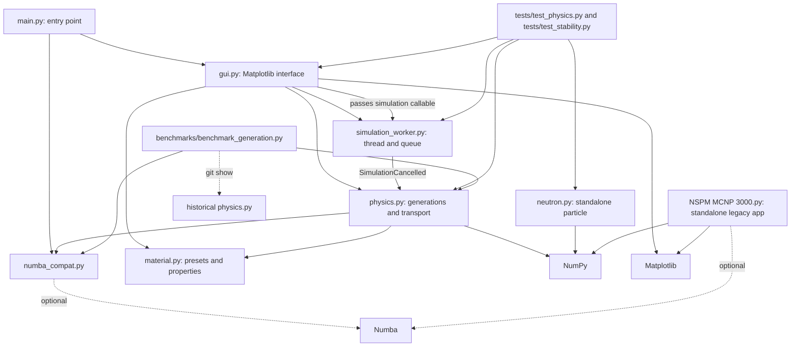

# Architecture and performance audit

**Current-state note (2026-10-31):** the original audit below is historical.
Secondary batching, index-based event storage, the memory guard and incomplete
result presentation were implemented after that audit. The current material
boundary and result contract are described in the addendum at the end.

Audit date: 2026-10-29. Scope: all Python files in the workspace, including the legacy program, benchmark and tests. This is a static audit: no source or algorithm changes, dependencies, new tests or new benchmarks. Existing benchmark artifacts are historical evidence, not measurements of proposed changes. **Confirmed** means visible in the code; a **suspected bottleneck** requires profiling and benchmarking.

## Key findings

- The batch engine already uses NumPy arrays, with Numba-compiled loops when available. It does not create a `Neutron` object per particle. Positions and directions are separate `(N, 3)` arrays, not a component-wise Structure of Arrays (SoA).
- Confirmed: a Python loop draws an index and copies a position for each secondary neutron (`physics.py:326–328`). NumPy batching is worth testing, but may change random-number consumption.
- Confirmed: transport repeatedly scans the original population and allocates full-size distance and reaction arrays even as particles terminate (`physics.py:172–203`). These loops are compiled with Numba; their share of runtime is unmeasured.
- Confirmed: fission coordinates are individually copied into a list inside transport and converted into an array afterward (`physics.py:209,345`). Sampled paths are already bounded by the configured sample, but fission points and secondary arrays still scale with population and generation count.
- Confirmed: step-limited histories are counted as unfinished, but the next-source ratio includes them in the processed denominator, and the GUI classifies the resulting mean without checking unfinished counts (`physics.py:395–401`, `gui.py:477–502`). The displayed estimate may therefore be incomplete; this audit does not quantify bias. Review how to flag it separately from changing the estimator.
- Physical units and preset-data provenance are not fully documented at the API boundary. No scientific accuracy follows from software tests.
- Any runtime or memory benefit of SoA, vectorization, or another proposed change is **unverified**. The existing compiled loops may be preferable for branch-heavy transport, and conversion costs can dominate.

## Current architecture



`main.main()` constructs `NeutronSimGUI`. The GUI captures controls, starts one worker, and polls its bounded queue via a Matplotlib timer. The worker invokes `estimate_k_full`; the Python generation loop calls the transport wrapper and Numba kernel or Python fallback. GUI rendering remains on the main thread; cancellation is checked between generations. `simulation_worker.py` imports physics for the cancellation exception; physics does not import worker or GUI. The standalone `Neutron` class is not used by the batch engine. The legacy monolith duplicates particle, material, physics, GUI and startup code; it is not imported by `main.py`. The benchmark may execute historical code fetched from Git, while tests target modular code.

### Particle and result representations

- Positions and directions are distinct float64 `(N, 3)` arrays; input is validated and copied before kernel mutation. Noncontiguous arrays are accepted at the public boundary. The standalone `Neutron` holds its own position, direction, energy, alive flag and list of copied positions; it is separate from batch execution.
- Kernel state includes `alive: bool[N]`, `fates: int32[N]` (0 fission, 1 absorption, 2 leak, -1 max steps), and sample-slot indices. Results retain full fission-point arrays per generation, not full paths for all particles.
- Sample scratch is float64 `(S, max_steps + 1, 3)` plus lengths, S = `min(N, max_samples)`. Each returned `(L,3)` path is copied into its own array, avoiding retention of the larger scratch buffer. Source indices are evenly spaced, not randomly sampled.
- `transport_batch` returns five values. `run_generation_batch` returns eight values including sampled `(path, fate-string)` pairs, fission coordinates and outcome counts. `estimate_k_full` returns `k_history`, `k_mean`, `k_std`, `path_frames`, `fiss_frames`, and `generation_stats`. The GUI consumes these contracts; public inputs are not mutated.
- Particle and work arrays scale as O(N); trajectory scratch scales as O(S * (max_steps+1)); retained visualization scales with total fission points and sampled path lengths. The full `int(F * nu)` secondary population is allocated before population control. Arbitrarily large valid input has no memory budget.

## Population loops and execution context

Decorated loops below are Numba compiled when available; the same code runs as Python in fallback mode. No time ranking is asserted without profiling.

| Location | Loop and execution context | Audit assessment |
| --- | --- | --- |
| `physics.py:75–81` | `_sample_reactions_batch` classifies each generated reaction; compiled/fallback. | Compare compiled branch loop with NumPy comparisons and mask temporaries in fallback. |
| `physics.py:91–120` | `_scatter_directions` validates and scatters each direction; compiled/fallback; public helper, not used by transport. | Small temporary arrays per particle; benchmark separately if used. |
| `physics.py:167–170` | Initializes each sampled slot; compiled/fallback. | Scales with S, normally at most 40; likely lower priority, unmeasured. |
| `physics.py:172–238` | Steps, full-population alive reduction and loops for movement, leak, reactions/scattering, then a final termination scan; inner axis loop has three iterations. Compiled/fallback. | Numba is a natural candidate for branching. Compaction or fusion may change RNG draw count/order and requires strict verification. |
| `physics.py:326–328` | Python loop over `n_secondary`, with scalar RNG draw and row assignment. | Candidate for batched integer draws and gather, or compiled gather using precomputed indices; verify RNG state and output. |
| `physics.py:272,339–343` | Python comprehension and loop copy/label sampled paths. | Bounded by S; copies protect ownership. Change only if measurement supports it. |
| `physics.py:382–419` | Python loop over dependent generations, population control and callbacks. | Generations depend on the previous source; measure dispatch overhead rather than assuming they can be vectorized together. |
| `gui.py:340–349` | Python loop over sampled paths, adding a line and marker artist per path. | Suspected redraw bottleneck for large S; measure artist collections and reuse. |
| `gui.py:412–418` | Python loop over fission frames, with NumPy histogram per generation. | Suspected redraw cost; caching bins is a possible experiment. |
| `NSPM MCNP 3000.py:123,137,181–222,283,296,325,623,693,730` | Legacy reaction/scatter/transport loops, secondary and sample loops, generation loop, path drawing, heatmap and sample histogram. | Only relevant when legacy is run directly. Its transport retains all paths; its GUI and histogram are older. Leave it untouched. |
| `neutron.py:14–58` | No population loop; a standalone object copies its path at every move. | Could be expensive for external per-particle callers; not used by batch transport. |
| Tests and benchmark | Test loops iterate over samples, generations and repetitions; benchmark launches modes and creates synthetic arrays. | Not normal application transport work. |

Other GUI loops handle fixed widgets, axes, decorations, legends or bars. Chart comprehensions process generations, not particles. `material.validate` checks six fields. `main.py`, `simulation_worker.py`, and `numba_compat.py` contain no particle-population loops.

## Allocations and performance candidates

The allocations and scans below are confirmed by inspection; their impact is **suspected** until measured.

1. **Secondary generation:** Python calls `rng.integers` and performs a row assignment once per secondary. `new_positions` is zero-initialized before its rows are overwritten; direction generation and normalization also allocate arrays (`physics.py:312–328`). Try batched indices and advanced indexing, or a compiled gather with supplied indices. Compare random outputs and subsequent generator state: vector draws must not be assumed equivalent to repeated scalar draws. Preserve `int(fissions * nu)`, empty cases and selected-site order. Include temporary arrays in memory measurements.
2. **Transport buffers and passes:** every step produces N-sized distance, random-reaction and reaction-code arrays and scans the full population several times. Particles no longer alive still receive distance/reaction draws. Reusable buffers or fewer passes may help, but preserve the existing draw sequence: distances for all, movement, leakage, reactions for all, then scattering draws for surviving particles. Per-particle fusion or only drawing for active particles changes that sequence.
3. **Fission event storage:** each fission copies a position into a growing kernel list and the Python boundary converts it into an array. Try a preallocated event array plus length or event index buffer. Preserve chronological event order: selecting final positions by `fates == 0` instead orders by source index and is not automatically equivalent.
4. **Validation and copies:** `_arrays` is called in both `run_generation_batch` and `transport_batch`, repeating finite and direction checks on the normal path. Public transport intentionally copies inputs to satisfy non-mutation. A private validated path could avoid a repeated scan, while retaining public validation and ownership.
5. **Sampled paths:** scratch reserves the maximum length for each selected trajectory and then copies trimmed paths. This is bounded by S, and the owning copies prevent short paths from retaining scratch. Zero samples still allocate an O(N) slot map and particle buffers. Consider other representations only after measuring short and long histories and establishing equivalent lifetime semantics.
6. **Scatter helper:** `_scatter_directions` constructs small arrays per particle, but the main transport kernel uses scalars and does not call it. Optimize the helper only if its callers and profile justify it.
7. **Visualization:** trajectory redraw clears axes and creates artists for each sampled path; full rendering recomputes histogram bins across all retained fission frames. `np.asarray(path)` normally avoids copying an already compatible array. Try artist reuse/collections or caching histogram bins if GUI timings justify them; preserve colors, endpoints, legends, generation navigation, bin edges and heatmap semantics.
8. **Fallback and concurrency:** without Numba, transport loops execute in Python and may contend for the GIL. `_rng_lock` serializes all transport calls in-process, including Numba calls; the GUI itself blocks overlapping jobs. Native event latency and concurrency costs are not measured.
9. **Retained arrays:** fission coordinates and sampled frames are retained for all generations; the whole secondary population is constructed before its cap. Streaming, pre-binned results, or early sampling may change public data and RNG order, and require a compatibility design. Extremely large populations, `nu`, sample counts or step limits can exhaust memory.

Existing `benchmarks/results/benchmark_v02_results.json` compares pre-v0.2 transport with sampled-path transport for a single scatter-only workload under tracing. It does not compare proposed SoA or establish a general speedup. `benchmarks/results/benchmark_v02_large.json` records only the current performance mode. No proposed improvement is claimed based on those artifacts.

## Proposed component-wise Structure of Arrays

Prototype a private representation with contiguous one-dimensional arrays of equal length; do not replace the existing public API without compatibility adapters.

| Field | Shape / dtype | Meaning |
| --- | --- | --- |
| `x, y, z` | each `(N,) float64` | Position components in the existing length unit. |
| `ux, uy, uz` | each `(N,) float64` | Unit direction components. |
| `alive` | `(N,) bool` | Kernel-local activity. |
| `fate` | `(N,) int32` | Existing fission, absorption, leakage and max-step codes. |
| `sample_slot` | `(N,)` signed integer | Sample index, or -1 when unrecorded. |
| `particle_id` | optional `(N,)` integer | Original index if an active-index list is tested. |

Keep visualization paths and lengths in a separate bounded buffer, fission events in a separate ordered buffer, and aggregate counts independent of samples. The current layout is already field-separated: each `(N,3)` array stores adjacent components per particle. Its columns are strided, so truly contiguous component arrays require conversion/copies. A contiguous `(3,N)` backing array with component row views is an alternative to six allocations. Compare both to the existing layout and retain the simpler layout if costs exceed benefits. Do not introduce unused energy or weight fields.

At the public transport boundary an adapter would validate `(N,3)` inputs, translate to internal arrays, and return the same five-value result, `(N,3)` output shapes, fate dtype/codes, chronological fission points, ordered owning paths, and input non-mutation. Preserve the generation tuple, result dictionary, callback signature, sample defaults and worker/GUI behavior. Count conversion and copies in end-to-end benchmarks. NumPy may suit independent bulk gathers and normalization; compiled loops may suit branch-heavy sequential evolution and recording. Neither choice has been shown faster here.

## Nondeterminism and reproducibility

- `estimate_k_full(seed=None)` starts a `default_rng` from entropy. With an explicit seed it uses a local generator for source directions and selection and derives an explicit seed for each transport generation. Numba has a separate RNG state; seeding NumPy's Python-level global RNG alone is insufficient.
- `run_generation_batch` accepts both `rng` and `seed`: a seeded `rng` without `seed` controls secondary generation but leaves transport unseeded. Direct `transport_batch(seed=None)` and standalone sampler/scatter helpers use backend RNG state. Trajectory sample selection itself uses no random draws.
- With no Numba, seeded transport temporarily seeds NumPy's global legacy RNG and restores it under `_rng_lock`. Unrelated code using that global RNG does not necessarily take the lock, so concurrent external draws can interfere. Unseeded fallback transport uses the global RNG.
- Batching scalar draws, active-index compaction, changed loop order, parallel execution, or a different number of draws may change seeded trajectories and later generations even when marginal distributions match. Thread scheduling changes completion or cancellation timing. Callbacks may introduce external state.
- Results may differ across versions, platforms, floating-point environments and Numba/fallback. Record seed, configuration, backend and dependencies; cross-platform and cross-backend bitwise equality is not established.

## Hardcoded physical parameters and units

| Source | Current behavior | Unit and documentation assessment |
| --- | --- | --- |
| `material.py:49–53` | Four presets with fixed fission, absorption, scatter, multiplicity, density and molar mass. | Data provenance and energy dependence are undocumented. |
| `material.py:35–45` | Uses `6.022e23`, `1e-24`, number density, total cross section and reciprocal macroscopic total. | Arithmetic is consistent with density in g/cm³, molar mass in g/mol, microscopic cross sections in barns and mean free path in cm. These are **inferred conventions**, not an explicit API contract; domain review is needed. Avogadro's value is rounded. |
| `physics.py:56–60` | `-mfp * log(U + 1e-15)`. | Distance uses the same length unit as mfp. The fixed epsilon affects the tail and deserves numerical documentation and validation. |
| `physics.py:65–80,214–228` | Reaction ratios, random angles, scattering, pole threshold `0.9999` and `2*pi`. | Ratios, direction cosines and `nu` are dimensionless; angles are radians. The threshold is numerical; model assumptions should be documented. |
| `physics.py:146–148,351–353` | `max_steps=500`, `max_samples=40`, `n_gen=30`, `n_source=150`, `radius=25`, `n_burnin=8`. | Algorithm/default settings. GUI labels radius and mean free path in cm; array APIs carry no unit metadata. |
| `physics.py:310–328` | `int(fissions * nu)` secondaries and random fission-site selection. | GUI labels nu neutrons per fission. Truncation and selection are existing model rules. |
| `neutron.py:14` | Standalone `energy=1.0`, unused in batch transport. | Energy unit and meaning are unspecified; batch transport has no energy dependence. |
| `gui.py:119–128,323–328,482–492,525–536` | Slider bounds, six displayed rods, k classification at 0.99/1.01 and radius/enrichment hints. | Radius is labeled cm. Rod graphics are schematic, not transport geometry; thresholds and hints are presentation heuristics, not validated physics. |
| `physics.py:422–424` | Mean and population standard deviation of selected generation k values. | Dimensionless quantities; code does not establish an uncertainty estimate accounting for generation correlation or convergence. |

Cross sections, units, geometry and assumptions need qualified domain review before scientific claims. Do not change constants or physics under a performance-only refactor.

## Existing tests and missing coverage

`tests/test_physics.py` covers mocked mixed outcome counts, iteration limits, empty batches, generation accounting and Agg histogram rendering. Its mocked transport fixture supplies one path per input; it does not validate real sampled-index/path-fate mapping. `tests/test_stability.py` covers step limits, sample limits and ownership, seeded runs, different seeds, empty inputs, non-mutation, invalid inputs, tracemalloc repeat/release, worker states and failure handling, overlapping jobs, cancellation, Agg rendering, mocked entry point and a subprocess no-Numba fallback. The prior debug report records 36 tests and two subtests passing in its run. Tests were not rerun during this audit.

Priority gaps before a layout refactor:

- Independent deterministic reference with mixed fission, absorption, leakage and scatter: per-particle final positions/directions, exact fission event order, sample-index/path/fate mapping, outcome counts and subsequent RNG state. Existing direct sampling-independence test is scatter-only; seeded generation tests cover mixed behavior without an independent full-trajectory oracle.
- Distribution checks for free paths, reaction frequencies and scattering, with fixed seeds and predeclared statistical tolerances; direction normalization near the pole threshold; radius equality and crossing; epsilon extremes; finite extreme inputs and overflow/underflow. These validate implementation properties, not reactor safety.
- Deterministic small fixtures for source multiplicity/truncation, fission site selection and population cap ordering, extinction, burn-in and k summary. Exercise incomplete-generation display: unfinished counts are present but the status panel still classifies the calculated k.
- Backend comparison within explicitly defined reproducibility limits; concurrent direct calls; fallback interference from unrelated global NumPy RNG use; cancellation during long generations and first JIT compilation. Agg tests manually poll and do not establish native event-loop responsiveness.
- Actual GUI sample path colors and endpoints, animation, generation navigation, heatmap equivalence, stale plots after failure/cancellation and live control behavior.
- Mixed-outcome and high-fission memory tests, large sample/step combinations, process peak memory and repeated-render retention. Current tracemalloc stress is scatter-only and does not cover every native allocation.
- Invalid dtypes, shapes, noncontiguous arrays and material values across public APIs; callback and result handling errors beyond existing cases.
- **Confirmed code path, untested:** `SimulationWorker.run` catches `Exception`, not `BaseException`. If its callable raises `SystemExit` or `KeyboardInterrupt` in the worker, no result is enqueued and `poll` can leave the worker in RUNNING. Decide desired semantics and test them explicitly; do not silently equate those exceptions with normal cancellation.
- Domain-reviewed validation of material provenance, geometry, model assumptions and estimator/uncertainty is absent. Software tests do not validate reactor behavior.

## Benchmark plan: current versus proposed

1. **Freeze a baseline:** record commit and working-tree patch/hash, harness version, OS, CPU/cores, RAM and power mode, Python/NumPy/Numba/Matplotlib versions, Numba availability, thread settings and seed. Preserve the exact audited implementation. Do not execute untrusted historical code.
2. **Pair workloads:** identical arrays, configuration, seed, sample indices and warmup for both variants. Include N = 150, 2,000, 10,000 and a memory-bounded larger N; short and near-limit paths; scatter-only, mixed, absorption-heavy, leakage-heavy and fission-heavy synthetic materials; sample counts 0, 40 and a controlled larger value; one and multiple generations. Check empty/extinction cases for correctness rather than timing. No real reactor configuration is needed.
3. **Measure stages and end-to-end:** validation and adapter conversions, transport, secondary creation, generation orchestration, result conversion, heatmap/trajectory rendering and GUI response. Include SoA input/output conversion and retained results. Compare existing `(N,3)` transport, component SoA, NumPy secondary gather, and compiled gather with identical supplied indices as independent alternatives. Include Python fallback.
4. **Separate timing from tracing:** use `time.perf_counter` without tracemalloc for timing, and separate fresh processes for tracked peak, process peak working set/RSS using existing OS or standard-library tools, retained memory after collection, sample count and result sizes. State process baseline overhead; tracemalloc does not cover every native allocation. No new measurement dependency is needed.
5. **Separate cold and warm:** report first JIT compilation separately; warm matching signatures before steady-state timings. Run repeated processes in alternating/randomized variant order, report median and range/percentiles plus individual measurements, and control background load. Predefine memory/time limits so the experiment does not exhaust the machine.
6. **Gate on correctness:** where draw order and arithmetic are preserved, compare exact seeded arrays, fate and event order, sampled paths, generation outputs and subsequent RNG state within the same backend/version. Specify tolerances for deliberate floating-point reordering. If a proposal changes RNG streams, explicitly review the reproducibility contract and compare distributions across independent seeds with defined confidence bounds. Only call a variant an improvement if relevant workloads demonstrate benefits without unacceptable correctness, memory, GUI latency or compatibility regressions.

## Numerical and scientific validation requirements

1. **Software invariants:** finite arrays, unit directions, valid fate codes and dtypes, shapes and ownership, processed count reconciliation, explicit step-limit status, input immutability, path/fission mapping and sample bounds. Include boundaries and extreme finite values.
2. **Transport and RNG equivalence:** preserve per-step draw order and count, population and fission-event order, and boundary behavior. Verify fixed-seed reference cases for each backend, check sampling independence and document acceptable floating-point differences. Cross-run RNG interference must be tested under the supported usage model.
3. **Implemented distributions:** compare free-path, reaction and scattering samples to the existing formulas with many independent draws and predeclared tolerances; include ±z directions, epsilon and radius boundaries. Do not replace algorithms as part of the performance work.
4. **Generation semantics:** verify `int(F * nu)`, site selection, population capping, extinction, k ratios, burn-in and population standard deviation. Explicitly flag incomplete generations in presentation. Keep the current estimator unless a separate scientific change is approved.
5. **Independent scientific review:** specify units, data provenance, geometry and angular assumptions, model limits, meaning of k and displayed spread. If scientific claims are desired, qualified reviewers should define independent reference problems, uncertainty/convergence methods and acceptance thresholds. Matching the existing implementation does not establish scientific validity.

## Step-by-step refactoring plan

1. Inventory callers and freeze public contracts, RNG order, units, backend guarantees, event/path ordering and incomplete status. Add deterministic mixed-outcome reference fixtures.
2. Profile and run the baseline benchmark matrix, including allocations, rendering and fallback. Rank candidates by observed cost.
3. Prototype secondary-source gather behind a private boundary. Compare scalar/batched RNG continuation, ordering, dtype and memory; retain current implementation if compatibility or benefit is unproven.
4. If justified by profiling, prototype contiguous fission-event storage and reusable work buffers in the current layout. Preserve event order, random draws and numerical behavior.
5. Prototype SoA as an opt-in private kernel with compatibility adapters; compare full end-to-end cost against the existing `(N,3)` layout with Numba and fallback. Keep the current layout if conversion outweighs benefits.
6. If rendering is measured as limiting, separately evaluate cached histograms and reusable or collection artists, preserving result structures and appearance.
7. Expand regression and numerical tests with each change; run the full suite and native GUI checks after integration. Repeat paired benchmarks for time, peak memory, correctness and latency. Reject candidates that fail agreed criteria.
8. Document evidence and unresolved limits. Keep `main.py`, public signatures and return shapes, and legacy behavior compatible unless a separate reviewed migration explicitly authorizes an API change.

## Material boundary and result contract (2026-10-31)

### Current working-tree findings

- `physics.py` imports no GUI/Matplotlib code. Callbacks run on the caller's
  thread; worker and rendering are outside the engine. Numba receives only arrays
  and scalars. This separation is preserved.
- Generation orchestration previously read validation, mean free path, cross
  sections and nu directly from a mutable material. A callback could change
  later generations' parameters. No resolved material/configuration record or
  machine-readable warning list was returned.
- Positions/directions remain separate float64 `(N,3)` arrays. Conversion of
  non-float64 input and copies before kernel mutation preserve input ownership.
  Fission indices become a public list of owning coordinate arrays, then an
  `(F,3)` generation array. That redundant conversion remains; removing it needs
  a reviewed return-contract change. Secondary normalization/capping also allocates.
- Transport still scans the original population and draws for inactive indices.
  Changing this changes RNG consumption. Full secondaries are built before
  capping; retained fission/path arrays grow with generations. The existing
  512 MiB planning guard is not a hard RSS limit.
- Scattering rotation is duplicated in `Neutron.scatter`, `_scatter_directions`
  and inline transport. The first accepts angles, the others draw them. Neutron
  is outside the batch path; its energy has unspecified units and no effect on
  batch transport. Consolidation would touch the compiled loop; first test
  numerical equivalence in a separate refactor.

### Material contract

`material.py` owns frozen `TransportData`, `resolve_transport_data(material)`
and `Material.get_transport_data()`. The adapter accepts an existing Material,
a provider implementing `get_transport_data() -> TransportData`, a TransportData
snapshot, or a legacy object with `validate()`, `mean_free_path()` and
`sigma_f`, `sigma_a`, `sigma_s`, `nu`. Legacy adaptation is centralized.

`estimate_k_full` resolves once before source allocation and passes the snapshot
to every generation. Direct `run_generation_batch` resolves once per call.
The snapshot validates finite nonnegative channels/nu and a positive finite total
and mean free path; an invalid provider return type fails before transport.
Only numeric fields enter the unchanged kernel. Public simulation signatures,
Material fields/methods, tuple lengths and existing result keys are preserved.
Mutating a source material after resolution no longer changes later generations;
providers must themselves read their source safely.

| Snapshot field | Contract |
| --- | --- |
| `sigma_f`, `sigma_a`, `sigma_s` | Microscopic barns, common normalization/state; `sigma_a` excludes fission. |
| `nu` | Dimensionless multiplicity used by the existing truncation rule. |
| `mean_free_path` | Positive cm, consistent with cross sections/number density; the provider is responsible for this consistency. |
| `name`, `data_source` | String identifiers: `constant_parameters`, `legacy_material` or provider-supplied source ID. These do not certify provenance. |

Material retains `N = 6.022e23 * density / molar_mass`,
`Sigma_t = N * (sigma_f + sigma_a + sigma_s) * 1e-24`, `lambda = 1/Sigma_t`.
Density is g/cm^3 and molar mass g/mol. Preset constants/arithmetic are unchanged;
their energy, temperature and evaluation provenance remain unknown. A provider
can supply explicitly reduced constants. This boundary does not evaluate tables
at individual particle energies/temperatures.

### Result contract and physical meaning

All previous fields remain. Added `processed_histories` sums transported histories
across generations, not unique physical neutrons. Per generation and aggregate,
`completed + step_limited = processed`; completed means fission, absorption or
leakage. `outcome_counts.unfinished` remains the step-limit count.
Execution success and history completeness are independent. No secondary source
with unresolved histories does not prove physical extinction. Cancellation and
errors still raise, without returning completed partial results.

`warnings` contains stable codes in this order when applicable:

- `step_limit_reached`: any generation has unfinished histories.
- `no_estimate`: no ratio was calculated; legacy zero summaries are placeholders.
- `burnin_not_applied`: nonzero burn-in requested but too few generations; the
  compatible fallback uses all available ratios. Omitted when there is no estimate.

`estimator` names `source_production_ratio`, records its definition and
`validated_keff=False`, zero-based `active_generation_start`,
`active_generation_count`, and `std_kind="population_standard_deviation"`.
The unchanged formula is `k_g = int(F_g * nu) / N_g` before capping; `N_g` includes
unfinished histories. Dropping those histories changes the estimator. Burn-in
uses the tail only with more than `n_burnin` generations, otherwise all ratios.
`k_std` is not a standard error or validated uncertainty and does not account for
generation correlation or establish convergence.

`run_info` records population/generation/burn-in/sample/step/budget settings,
radius in cm, seed, backend, Python/NumPy/Numba versions and an independent
dictionary of resolved material fields. No GUI objects or timing enter this
deterministic record. `seed=None` does not capture the entropy needed for replay;
callback effects and external state are not captured. This is not a full
experiment archive. GUI still consumes existing generation statistics; headless
callers now receive warnings as well. Complete-run GUI criticality labels and
hints remain educational heuristics.

The model remains a homogeneous sphere with a central initial source, constant
one-group cross sections, no batch energy/weight/temperature, and only fission,
non-fission absorption, scatter and leakage. Free paths retain
`-lambda*log(U+1e-15)` and its numerical offset. Leakage is checked after the full
flight, so plotted endpoints can lie outside the sphere; boundary intersection
is not computed. Scattering uses uniform mu/azimuth without energy transfer;
source directions use normalized Gaussians. Secondary count is `int(F*nu)` with
uniformly selected fission sites and subsequent uniform capping. These assumptions
and preset data are not physically validated by software tests.

### Next processed-data/ENDF and surrogate stage

1. Specify a processed-data schema and reference fixtures: isotope/composition,
   number density, energy unit/grid, channel units, nu, temperature,
   evaluation/release, processing settings and content ID. Separate fission from
   non-fission absorption; validate grid order, shapes, finite/nonnegative values
   and channel accounting. Use approved dependencies; raw ENDF parsing is outside
   this change.
2. Review whether the next model uses explicit one-group reduction or energy
   dependence. A reduction must document weighting and applicability, then return
   TransportData with traceable source ID. Do not silently sample at an arbitrary
   energy to fit the current model.
3. Energy dependence needs a separate physical/kernel/API design: energy arrays,
   source/outgoing spectra, temperature, interpolation/out-of-range policy, and
   collision-dependent cross sections/nu. Resolve validated contiguous NumPy
   tables outside Numba and pass numeric arrays into the kernel; preserve the
   constant path for regression. These substantive changes are not implemented.
4. Define independent reference problems and acceptance tolerances for processing,
   interpolation, reaction rates/spectra and estimator/convergence. Agreement with
   the educational implementation alone does not validate the new physics.
5. Before ML, define training/validation cases and input/output schemas using
   resolved data IDs, parameters, estimator identity, completeness and uncertainty
   semantics. Keep training/inference outside transport. Current metadata provides
   a boundary; no speculative surrogate interface or dependency is introduced.

### Executed checks

Before editing, the working tree passed 83 tests and 2 subtests with Numba
(Python 3.14.4, NumPy 2.4.4, Numba 0.67.0, Matplotlib 3.10.9, pytest 9.1.1).
The baseline is an exact temporary snapshot including the pre-existing
uncommitted GUI/test edits, rather than Git HEAD or the older performance
baseline. Final checks and paired benchmark results follow below.

- Full suite after changes: **96 passed, 2 subtests passed** with Numba in
  37.71 s, and the same **96 passed, 2 subtests passed** with Numba disabled in
  320.00 s. New boundary tests also passed on the final source: 13 passed,
  47 deselected in 9.44 s. No dependencies were installed.
- The full fallback run used a fresh interpreter with `sys.modules['numba']=None`
  before importing pytest/physics. Both runs used `pytest -q -p no:cacheprovider`
  and temporary pytest directories outside the repository.
- An additional temporary compatibility harness ran seven seeded cases in each
  backend: mixed, pure fission, pure absorption, one-step limit, zero steps,
  empty source and zero generations. Every pre-existing result field, including
  arrays/paths/counts and termination state, matched the exact pre-change snapshot
  in that backend; repeated final-source runs matched exactly as well.
- Across backends those seven cases had identical counts, ratios, fates, warnings
  and coordinates (maximum coordinate difference 0; checked at rtol/atol 1e-12).
  This is evidence for those fixtures, not a cross-version/backend guarantee.
- Existing Agg tests exercised GUI rendering, background execution, overlapping
  launches, cancellation, worker/render failures, close and restart. A separate
  native TkAgg event-loop test was attempted but failed during Tk initialization:
  `TclError: Can't find a usable init.tcl`. The installed Python's Tcl/Tk runtime
  could not initialize; native interaction/latency was therefore not verified.
  No environment repair or installation was performed.

For performance, the existing `benchmark_confirmation.py` now accepts optional
`--baseline-source` and `--output` arguments while preserving its defaults and
record structure. This reuses the existing harness and avoids overwriting older
results. The baseline physics SHA256 is
`9467d851447ea28b61b86f9989fba99aec95da99fe06ed61958675fe4da09194`;
the final source SHA256 is
`577e50040633acb9a30771ad6addf8e96a49e7a0d43b7f823767a2df80b87a8d`.
The baseline physics matches `2802f99:physics.py` after newline normalization;
its mutable Material methods
retain their original arithmetic in both variants. The benchmark is a warmed
three-generation run, N=20,000, radius=1e9 cm, seed=2026, 8 steps, zero sampled
paths, two fresh-process batches of five alternating repetitions per
variant/workload (ten measurements each), without tracing or
concurrent test/benchmark jobs. Compilation is excluded from timings. Commands:

```text
<python> -m benchmarks.benchmark_confirmation --baseline-source <pre-change physics.py> --output benchmarks/results/architecture_confirmation_numba.json
<python> -m benchmarks.benchmark_confirmation --fallback --baseline-source <pre-change physics.py> --output benchmarks/results/architecture_confirmation_fallback.json
```

Here `<python>` was the directly invoked installed Python 3.14.4 executable;
the WindowsApps `python`/`py` aliases were unusable in this session.

Both process batches were retained in the two JSON result files; the first five
array entries are batch 1, the next five batch 2. Combined medians are recomputed
from all ten values. `batch_medians` preserves each batch summary and
`paired_ratio_median` is median(after_i / before_i); positive percentage means
slower. Timing variability is substantial, including opposite directions between
batches; neither an overall speedup nor a stable performance regression can be
established from these measurements. For example Numba fission batch medians
were 113.60 -> 128.56 ms and 217.56 -> 183.40 ms. Pooled medians can also reflect
between-batch drift, hence paired ratios are shown separately.

| Backend | Workload | Pooled before median, ms | Pooled after median, ms | Median paired change |
| --- | --- | ---: | ---: | ---: |
| Numba | fission | 146.308 | 144.449 | +4.84% |
| Numba | absorption | 6.309 | 6.067 | -3.79% |
| Numba | mixed | 110.111 | 123.617 | -0.08% |
| Python | fission | 524.173 | 489.895 | -5.18% |
| Python | absorption | 136.387 | 127.927 | +4.93% |
| Python | mixed | 1504.092 | 1506.547 | +5.88% |

All benchmark pairs checked identical k histories and processed/outcome counts.
Transport/sampling function ASTs and all pre-existing Material method ASTs were
also checked against the pre-change snapshot and are identical. No new memory
benchmark was run: the transport arrays were unchanged, while the existing
memory-budget/ownership/retention tests passed in both backends. The temporary
baseline, compatibility harnesses and pytest directories were removed after use.
Only two intentional benchmark JSON artifacts were added; no application modules,
dependencies or directories were created, and no existing files were deleted.

## Structured material data schema (2026-10-31)

### Scope and existing data

This follow-up builds on the earlier TransportData boundary. Existing Material
objects store mutable name, microscopic sigma_f/sigma_a/sigma_s (barn), nu
(dimensionless), density (g/cm^3), molar_mass (g/mol), and GUI color. Cross
sections/nu are constants during transport; total cross section, number density,
macroscopic total and mean free path (cm) are derived. Public Material fields
can still be changed between calls. The engine already freezes TransportData
once per run. The four built-in definitions and their formulas are preserved.
Names such as an enrichment percentage do not supply a documented composition,
temperature, energy weighting or primary scientific reference.

Only `material.py`, the existing regression tests, README and this audit are
changed by this follow-up. No production module, data file, external dependency,
ENDF download/parser, transport process, GUI redesign or ML implementation is
introduced. `physics.py`, worker, GUI and the legacy monolith remain unchanged.

### Unified schema

Two frozen dataclasses are added in `material.py`. MaterialQuantity describes a
quantity/channel; MaterialDataset describes one material data record. They do
not depend on an archive format or data vendor. A future provider can return the
same schema, and an explicit one-group dataset already implements the existing
`get_transport_data() -> TransportData` protocol.

| MaterialDataset field | Meaning and missing-data policy |
| --- | --- |
| `material_id`, `name` | Required nonempty strings. ID has no whitespace; providers/archives must enforce uniqueness in their registry. |
| `data_kind` | Required `educational`, `synthetic`, `experimental` or `evaluated`. Evaluated libraries are distinguished from direct measurements. Labels are declarations, not verification. |
| `source`, `version`, `provenance` | Required source string, explicit version string or None if unknown, and a nonempty tuple of source/processing notes. |
| `composition`, `composition_basis` | Component/amount pairs with basis `atom_fraction`, `mass_fraction` or `stoichiometric`; unknown composition is None with basis `unknown`. Component strings are identifiers, not parsed/verified nuclides. |
| `temperature`, `temperature_unit` | Finite nonnegative K, or None for unknown temperature. No implicit Celsius conversion. |
| `energy_representation`, `energy_grid`, `energy_unit` | `one_group` constants with grid=None, or `pointwise` data on an explicit strictly increasing nonnegative eV grid. No hidden energy lookup, averaging, interpolation or extrapolation. |
| `quantities` | Nonempty tuple of uniquely named MaterialQuantity records; partial scientific records may be stored without being executable. |

MaterialQuantity has `name`, `unit`, `values`, `status`, and optional
`description`. Status is `available`, `missing` or `unsupported`. Available
values require known units and a finite nonnegative real scalar/one-dimensional
numeric NumPy array. Missing/unsupported entries require values=None; unit may
also be None. Zero remains an explicit value and never stands for missing data.
Unsupported means the provider cannot supply that quantity in this representation;
current transport capability is checked separately at adaptation time.

Canonical units currently accepted are barn, 1, cm, 1/cm, g/cm^3 and g/mol.
Known names require their exact unit: sigma_f/sigma_a/sigma_s in barn, nu in 1,
mean_free_path in cm, density in g/cm^3, molar_mass in g/mol. Sigma_a explicitly
excludes fission. Additional channel names can be stored with supported units;
they do not extend transport. Unsupported units require an explicit future
conversion/contract extension, not silent interpretation.

Quantity arrays and the energy grid are owned immutable float64 contiguous
copies; changing source arrays cannot change the dataset, nor can write access
be re-enabled on the stored bytes buffer. Masked/object/complex/bool/string arrays,
NaN/infinity, negative values, non-1D/empty arrays and duplicate/nonmonotonic
energies are rejected. Every available pointwise array must match the grid
length. Scalar pointwise constants and group-edge/bin representations are not
supported by this initial schema; no implicit broadcasting is performed.
Partially missing arrays require an explicit future policy; masks must not be
silently discarded or missing samples filled with zeros.
Dataclasses containing arrays use identity equality; numerical comparison should
explicitly compare fields/arrays rather than infer scientific equivalence.

Composition components must be unique, amounts finite and nonnegative, and
their sum positive/finite. Fractions must sum to 1 within absolute 1e-8; no
automatic normalization occurs. Stoichiometric amounts need not sum to 1.
These are structural checks, not verified chemistry, isotope identities or
cross-section/number-density consistency.

### Compatibility and example

`get_builtin_dataset(key)` reads the current Material values at call time, with
stable IDs `heliosmc:u235-pure`, `heliosmc:u235-3.5`, `heliosmc:water`, and
`heliosmc:graphite`. It labels all four educational, records the project source,
sets version/composition/temperature/grid to None where unknown, and copies all
five transport inputs plus density/molar mass. No numeric registry is duplicated;
the returned record is a snapshot, not a live link. IDs identify presets rather
than content; modified values require version/content tracking when archived.

```python
from material import MaterialDataset, MaterialQuantity, get_builtin_dataset

dataset = get_builtin_dataset("Графит")  # Existing educational constants.
inputs = dataset.get_transport_data()  # Existing scalar transport boundary.

# Invented software fixture ONLY; not experimental or evaluated nuclear data.
fixture = MaterialDataset(
    material_id="example:synthetic-constant", name="Artificial test material",
    data_kind="synthetic", source="invented documentation fixture", version="1",
    provenance=("For software examples only; no scientific validity claimed.",),
    quantities=(
        MaterialQuantity("sigma_f", "barn", 0.),
        MaterialQuantity("sigma_a", "barn", .25),
        MaterialQuantity("sigma_s", "barn", .75),
        MaterialQuantity("nu", "1", 0.),
        MaterialQuantity("mean_free_path", "cm", 1.),
    ),
)
```

For current execution all five transport quantities must be explicitly available
scalars. Additional available channels unknown to the current model are rejected;
density/molar mass may be recorded but are not recomputed or used to override
the supplied mean free path. TransportData retains its existing positive
mean-free-path/total checks. A pointwise dataset raises a clear storage-only error
before transport; no arbitrary table energy is chosen. Old Material objects,
TransportData snapshots and legacy/provider APIs continue to work.

When using a dataset, the existing run_info.material.data_source receives a
compact classification/material-ID/version/source label. It is not an archival
serialization or an identifier to parse. Archive the full scientific record
separately for provenance; current run_info alone does not contain composition,
temperature or full processing history. No serializing loader/writer is added.

### Requirements for the two transport modes

- **Existing one-group mode:** five scalar inputs, existing units and formulas,
  one immutable snapshot per run, unchanged random-number use, no energy/thermal
  state or new interpolation. Unknown metadata remains explicit. Any future
  reduction of tables must document energy weighting, applicability and source;
  it must be a deliberate upstream transformation.
- **Future energy-dependent mode:** require validated particle-energy state and
  source/outgoing spectra, a chosen interpolation/out-of-range policy,
  temperature handling, reaction/absorption conventions, isotope/mixture
  normalization, and consistent cross sections/nu on validated numeric arrays.
  Resolve schemas outside Numba; pass only numeric arrays/scalars to a separately
  reviewed kernel extension. The pointwise container alone implements none of
  these physics. Independent processing/interpolation/transport reference cases
  and convergence/uncertainty criteria are required before scientific claims.

### Proposed future ML dataset archive (documentation only)

Use a versioned UTF-8 JSON manifest for metadata and separate numeric NumPy
arrays (for example NPZ read without pickle) for grids/features/outputs. No new
storage dependency is required for that proposal; file I/O is not implemented.
The manifest should include:

1. Archive schema version, immutable case ID, material/data IDs, source releases,
   processing and content hashes, classification and full units/provenance.
2. Explicit input parameters: composition/basis, temperature, constant data or
   grid/channel array references, geometry/model assumptions and reduction policy.
3. Simulator/physical-model version, code revision, backend/dependency versions,
   seed, source population, generations, burn-in, step/sample/budget settings.
4. Outputs with estimator identity and units, counts, termination/completeness,
   warnings and selected generations. Current source ratio must not be labeled
   validated k_eff in a future training target.
5. Uncertainty records with method, number of independent repetitions, generation
   correlation/burn-in policy, variance/standard-error/confidence-interval meaning
   and coverage where established. Unknown/unimplemented metrics are None;
   existing generation k_std is only population spread, not a standard error.
6. Verification-scenario ID/version, independent reference source, acceptance
   criteria, comparison metrics/results and review status. Record train/validation/
   test split and grouping to prevent correlated cases leaking between splits;
   surrogate version, training-data version and applicability belong to later ML
   artifacts. Software-passed and scientifically validated are separate statuses.

### Follow-up verification

The pre-change working tree was clean at `d200003`. Before editing, exact seeded
results were saved temporarily for all four presets at zero and six transport
steps (eight cases in each backend). New regression coverage uses explicitly
synthetic fixtures and checks schema validation, immutable array ownership,
missing/unsupported data, builtin metadata and worker execution. Executed final
results are recorded below.

- Full final suite with Numba: **102 passed, 2 subtests passed in 23.71 s**.
  This includes existing NumPy/Numba, RNG, memory, GUI Agg rendering, background
  execution, cancellation, failure/restart and legacy/provider compatibility tests,
  plus the six new schema tests. No test failure was observed.
- Focused schema checks passed with Numba (6 passed, 60 deselected in 6.35 s).
  The final full suite also includes the added masked-array rejection case.
  Final schema checks with Numba disabled before import in a fresh interpreter:
  **6 passed, 60 deselected in 1.07 s**. The full suite was not repeated entirely in fallback mode
  for this follow-up; the existing fallback subprocess smoke test also passed
  as part of the full suite.
- The saved pre-change runs matched every result field exactly for all eight
  cases in each backend, including paths, fission arrays, outcome counts, k and
  run metadata. For each backend all four presets also ran through MaterialDataset
  with identical numeric results and metadata except the deliberately new source
  label. Seed=2026, n_source=80, n_gen=4, max_samples=4, steps=0/6.
- Source checks confirmed byte-identical physics.py, GUI, worker, compatibility,
  standalone particle, main and legacy monolith. Existing Material, TransportData
  and resolve_transport_data ASTs are unchanged. `git diff --check` passed.
- Native Tk initialization was attempted and failed with
  `TclError: Can't find a usable init.tcl`. Native desktop interaction therefore
  remains unverified; GUI integration passed with Agg. No Tcl/Tk repair, package
  installation or environment change was performed.
- Python 3.14.4, NumPy 2.4.4, Numba 0.67.0 and pytest 9.1.1 were used via the
  installed interpreter directly. Full command: `<python> -m pytest -q -p
  no:cacheprovider --basetemp <task temporary directory>`. Focused checks selected
  the six new schema tests; fallback set `sys.modules['numba']=None` first.
  Temporary snapshots, trusted local result pickles and pytest artifacts were
  removed after verification. No permanent files were created or deleted, and
  no benchmark was run for this data-schema change.

## Educational mathematics upgrade (2026-10-31)

### Audit completed before implementation

Dependency map: main -> GUI -> worker -> estimate_k_full -> generation ->
transport wrapper -> Numba/Python kernel; physics -> material adapter -> frozen
TransportData; numba_compat selects compilation/fallback. Neutron is a separate
single-particle utility. Physics imports no GUI. Existing GUI calls
estimate_k_full and reads its dictionaries; worker accepts a callable with a
cancel_event keyword. Public sampler signatures, five-/eight-element transport/
generation tuples, fate codes, callbacks and result keys are compatibility points.

The existing model uses a homogeneous sphere, exponential-like flights,
constant channel ratios, uniform cosine/azimuth scattering, truncated secondary
production and population capping. NumPy supplies arrays and source generation;
Numba compiles samplers/scattering/transport. Generation orchestration and
visualization conversion remain Python. The model and formulas below are not
extended into reactor analysis by this task.

Confirmed issues and decisions:

1. `-mfp*log(U+1e-15)` truncates the tail and can produce a tiny negative distance
   at extreme U. Keep the legacy stream for compatibility; the new educational
   algorithm uses `-log1p(-U)` optical depths without an arbitrary epsilon.
2. Sphere leakage is tested after a full flight, not at the intersection. The
   new slab model handles exact interfaces; legacy geometry is not replaced.
3. k uses int(F*nu)/N before capping, including unfinished histories. Its population
   spread ignores generation correlation and is not a standard error. Burn-in
   can fall back to all generations. No IID confidence interval will be attached
   to it and no multiplication/criticality algorithm is added.
4. Existing outcome totals reconcile and warnings cover unfinished histories.
   Censoring can affect future generations. Completed-only renormalization would
   hide bias. The new scenario withholds full-outcome estimates under censoring.
5. Fallback seeding temporarily uses global NumPy state under an application lock;
   unrelated external draws are unprotected. The new path owns a local Generator,
   records replay entropy and carries the same state across batches.
6. Scattering is duplicated in Neutron, the standalone batch sampler and inline
   transport. Consolidation would affect compiled arithmetic/RNG and is deferred.
7. Transport scans/draws for inactive particles. Input ownership copies are
   intentional; fission-index/list/array conversions and full secondary expansion
   remain costs. New nonbranching histories need only aggregate counters, bounded
   sampled paths and layer arrays. No parallel/GPU framework is introduced.
8. Finite legacy inputs can still overflow derived positions/norms; direct scalar
   validation is permissive in places. New APIs validate real scalars, finite
   totals, probability domains and representability; a legacy-wide numerical/API
   rewrite is a separate compatibility project.

Only existing production modules will be extended. New independent mathematical
tests belong in one focused test file, and existing benchmark infrastructure will
be extended rather than duplicated. SciPy was absent at audit time and is being
installed as explicitly requested, without replacing the installed NumPy.

### Implemented mathematical model

`simulate_slab(layers, edges_cm, ...)` is a nonreactive random-flight model, not
an extension of the experimental multiplication calculation. Independent
histories start at x=0 with x-direction cosine mu=1 by default; source_x/source_mu
are explicit bounded parameters. Geometry is infinite transversely and finite
in x. Edges start at zero and strictly increase; x is in cm. Each layer provides
nonnegative finite absorption rate a and scattering rate s in cm^-1. Total rate
is finite; a+s=0 is vacuum. The existing MaterialDataset schema carries IDs,
units, source/version/classification and provenance. No coefficients are inferred
from nuclear cross sections, and no scientific dataset is downloaded.

For each free flight sample U in [0,1), tau=-log1p(-U). Thus
P(tau>t)=exp(-t) for t>=0 in the ideal continuous model. A distance l in a layer
consumes optical depth (a+s)*l, with l=abs(delta_x/mu) to an interface. If tau is
larger, move exactly to that interface, subtract its optical depth and continue
in the next layer. Otherwise the collision occurs at distance tau/(a+s).
Absorption probability is a/(a+s); scattering probability is its complement.
Scattering samples mu=2U-1, the projection of an isotropic 3-D direction. There
is no energy change, multiplication or reaction bookkeeping. Vacuum layers
consume no optical depth and are crossed without artificial collisions. The
algorithm does not approximate a heterogeneous medium by an averaged rate.

Without scattering at normal incidence, transmission is exactly
T=exp(-sum_i a_i*width_i); at cosine mu>0 divide optical depth by mu. The absorbed
fraction is 1-T. Quadrature independently integrates local absorption densities
to verify conservation. Reflection symmetry of a purely scattering slab and
unit-direction/angular moments are additional independent checks. Splitting an
identical homogeneous layer preserves the stochastic problem and random stream
within tested floating-point tolerances.

max_collisions limits executed interactions, not interfaces or free escape:
even a zero-collision budget allows a known ballistic escape. At the next
unexecuted collision the history is censored. Counts distinguish absorbed,
escaped_left, escaped_right, collision_limit and numeric_limit. A grazing vacuum
trajectory or inability to represent a nonzero displacement is recorded as a
numeric limit; no artificial position adjustment hides it. Completed + unfinished
equals processed. Strong/extreme rates can cause numerical censoring even for
otherwise valid finite inputs. Float64 precision cannot represent every scale.

### Statistical processing and SciPy justification

`summarize_binomial` estimates an IID Bernoulli outcome with k/n and plug-in SE
sqrt(p_hat*(1-p_hat)/n). Its Clopper-Pearson interval inverts binomial tails and
retains nonzero width when k=0 or n, even though the plug-in SE is zero. The
[SciPy binomtest/proportion_ci API](https://docs.scipy.org/doc/scipy/reference/generated/scipy.stats.binomtest.html)
provides an independent implementation used in tests. Runtime interval endpoints
use the beta-binomial identity: L=BetaInv(alpha/2;k,n-k+1) and
U=BetaComplementInv(alpha/2;k+1,n-k), with explicit endpoints L=0 at k=0,
U=1 at k=n. These use SciPy
[betaincinv](https://docs.scipy.org/doc/scipy/reference/generated/scipy.special.betaincinv.html)
and [betainccinv](https://docs.scipy.org/doc/scipy/reference/generated/scipy.special.betainccinv.html)
outside JIT, avoiding an unused p-value and repeated scalar root solving. This
optimization was driven by measured statistical overhead and preserves the
Clopper-Pearson definition. Binomial survival/CDF tail equations, endpoint formulas
and enumerated coverage verify the implementation independently. An interval
that cannot be resolved in float64 is explicitly unavailable. Each terminal-outcome
interval is marginal, not a simultaneous
multinomial statement. Repeated adaptive inspection/selection of intervals is
not covered by the fixed-sample interpretation.

If any history is unfinished, full-outcome estimate, SE and CI are None.
Observed fraction remains k/n and possible empirical completion fractions range
from k/n to (k+unfinished)/n. These are NOT confidence limits for the population.
Dropping censored histories or treating them as failures could bias results.
Empty samples also return explicit unavailable reasons. Existing k_mean/k_std
are untouched; no IID interval or bootstrap is attached to correlated generations.

`summarize_samples` reports a mean and unbiased sample variance for finite 1-D
real data. Centering/scaling avoids avoidable overflow and loss from large common
offsets; unrepresentable variance/intervals raise rather than return NaN/infinity.
Descriptive mode asserts neither independence nor a sampling distribution and
does not return SE/CI. With explicit IID normal assumptions and n>=2, SE=s/sqrt(n)
and mean +/- t_(n-1,1-alpha/2)*SE form the standard interval. The
[Student-t inverse survival function](https://docs.scipy.org/doc/scipy/reference/generated/scipy.stats.t.html)
avoids quantile rounding near confidence=1. Zero sample variance does not justify
an unknown-variance t interval here; it is marked unavailable. Assumptions are
declared, not automatically verified. Finite-machine RNG is an approximation to
the continuous distributions, not an infinite-tail exact sampler.
Mean, SE and interval inherit input units; variance has squared input units.
Slab outcome probabilities/intervals are dimensionless, sampled positions are cm.

`interpolate_synthetic_quantity` uses
[SciPy PCHIP](https://docs.scipy.org/doc/scipy/reference/generated/scipy.interpolate.PchipInterpolator.html)
only for explicitly synthetic pointwise tables with at least two nodes. It
preserves the tabulated shape and rejects out-of-range queries. Tests verify
linear reproduction, monotonicity and error against a known quadratic function.
It is not called by transport and is not an ENDF interpolation convention.
[scipy.integrate.quad](https://docs.scipy.org/doc/scipy/reference/generated/scipy.integrate.quad.html)
is used only as an independent check in tests. The inverse-beta special functions
are justified by the measured CI bottleneck; bootstrap is unnecessary for the exact binomial/normal reference
models and unjustified for the retained correlated/censored data.

### RNG, execution and performance design

Each public slab run owns one PCG64 Generator. Explicit seed reproduces its stream;
seed=None records SeedSequence entropy as effective_seed for replay. The same
Generator continues across chunks; no per-chunk reseeding or visualization RNG
draws occur. History order is sequential, making batch/sample count independent
of outcome draws. Numba's supported Generator operations execute in JIT;
[Numba's Generator documentation](https://numba.readthedocs.io/en/stable/reference/numpysupported.html)
describes this shared-state interface. No Generator is shared across concurrent
runs and no global NumPy RNG is modified by the new API. Reproducibility is only
claimed within tested versions/platforms; cross-version guarantees are absent.

Numba compiles the scalar history/interface loops, releasing the GIL. The Python
backend executes the same algorithm with NumPy's Generator for reference/fallback.
No SciPy function occurs inside JIT. Unlike the old full-population stepping loop,
the new algorithm finishes one nonbranching history before the next and retains
aggregate counts only. Sampled paths store x at collisions/outer exit, with at
most max_collisions+2 vertices. No internal-interface vertex is needed for a
straight segment. Storage is O(layers + samples*collision_budget), independent
of population; source arrays for all histories are not allocated. The planning
memory guard includes scratch/owning path copies but is not a hard RSS bound on
Python/JIT/SciPy/allocator metadata. Cancellation is checked between chunks;
chunk/JIT work is not interruptible, so large budgets can delay cancellation.

Sampled path fate codes are 0 absorbed, 1 left escape, 2 right escape,
3 collision limit, 4 numerical limit; sampled histories are the first bounded
subset, without consuming extra random draws.

### Structured results and next work

The new result records algorithm_version=abstract_slab_v1, all input layers and
edges, source state, requested/effective seed, PCG64 name, sample size, limits,
backend/Python/NumPy/Numba/SciPy versions, outcome counts, uncertainty methods,
unavailable reasons, warnings and limitations. Transport and total execution
seconds are separate; the first JIT invocation includes compilation. Timing is
nondeterministic metadata, not a simulation target. Sampled paths are NumPy arrays;
an archive needs numeric array storage plus a JSON manifest, as proposed above.
Code/data content hashes and train/test provenance belong in that archive; no
large dataset generator or ML inference/training code is introduced.

Future work requires independent scientific references before adopting measured
or evaluated data; abstract rates are not nuclear cross sections. Pointwise
energy tables still cannot enter either transport path. Adding energy state,
spectra, physical interpolation/mixture rules or a different geometry is a
separate reviewed model change. Legacy shared-RNG/scattering/overflow/geometry
issues remain documented compatibility debt, not silently fixed under this API.

### Executed verification and benchmarks

Final full suite with Numba: **126 passed, 2 subtests passed in 62.17 s**.
The 24 new mathematical tests also passed on the Python/NumPy fallback with
Numba disabled before import: **24 passed in 10.60 s**. The full old suite was
not rerun entirely in fallback mode; its existing no-Numba subprocess smoke test
passed in the full run. No tests were disabled or old tests removed. Initial
new-test failure from mean rounding was corrected in the implementation by
centering/scaling, without relaxing the reference assertion.

Coverage separates software invariants, mathematical verification and scientific
validity. Checks include analytic homogeneous/heterogeneous/oblique attenuation,
quadrature conservation, layer partition invariance, exponential KS statistics,
isotropic angular moments/reflection symmetry, enumerated exact binomial coverage,
binomial-tail inversion and agreement with SciPy's independent interval API,
independent Gaussian interval coverage, empirical inverse-sqrt(N) error scaling,
PCHIP polynomial error, invalid inputs, censoring/numeric limits, reproducibility,
chunk/sample/backend invariance, global RNG isolation, worker execution/failure
and cancellation while a batch is in progress. Statistical rejection thresholds
and seeds are fixed in tests; passing these is not physical validation.

Eight exact legacy comparisons (four presets, max_steps=0/6, n_gen=4,
n_source=80, samples=4, seed=2026) passed in each backend against the pre-task
working-tree snapshot, including arrays, paths, counts, summary values and
metadata. All pre-existing physics function/class ASTs remain identical.
GUI/worker/main/Neutron/compatibility/monolith bytes and the pre-existing regression
test file were checked unchanged. User GUI branding edits and earlier material/
documentation changes were preserved. `git diff --check` passed.

GUI regressions render with Agg and exercise background completion, cancellation,
failure/restart, close and navigation. Native Tk initialization was attempted
but failed with `TclError: Can't find a usable init.tcl`; desktop interaction and
event-loop latency therefore remain unverified. No Tk/environment repair was made.

The existing benchmark_transport.py gained an opt-in `--educational` mode and
`--baseline-source`; existing default benchmark behavior is preserved. The new
mode does not execute branching workloads. It compares the same straight-flight
absorption problem (rate=1/cm, width=2 cm, source mu=1, one allowed collision)
at N=150/2,000/20,000, 0/40 recorded trajectories, seed=2026 and five alternating
repetitions per variant. Legacy before/current must match counts exactly; new
Numba/Python counts must match exactly. Old/new model RNGs differ, so no paired
trajectory equality is asserted between the two models. Ideal T=exp(-2).

Timing and tracemalloc runs are separate; no tests/other benchmark jobs ran during
timings. `records[].seconds/median_seconds` are untraced full-call times.
`records[].timing` is from the separate traced run and is not a throughput measure.
The before snapshot SHA256 is
`577e50040633acb9a30771ad6addf8e96a49e7a0d43b7f823767a2df80b87a8d`;
final physics source SHA256 is
`7204eb1bc126681420d019266dc4f43594c283914337faed74a5a63eb8bf8e3b`.
Raw data and environment details are in educational_math_numba.json and
educational_math_fallback.json under benchmarks/results. Each also retains the
complete earlier CI implementation measurements in `statistics_before_optimization`;
no slow-run measurements were discarded. All variants use the same parameters.

Warmed medians, zero recorded paths, milliseconds:

| Histories | Legacy before, Numba | Legacy current, Numba | New Python/NumPy | New Numba |
| ---: | ---: | ---: | ---: | ---: |
| 150 | 0.247 | 0.247 | 3.016 | 0.662 |
| 2,000 | 0.490 | 0.530 | 31.586 | 0.903 |
| 20,000 | 2.370 | 1.918 | 253.601 | 1.368 |

The unchanged legacy implementation has timing variability, not a demonstrated
algorithmic speedup. New Numba includes statistical intervals/metadata absent
from the legacy transport return; small jobs cost more despite lower kernel
work. At 20,000 histories with 40 paths, new Numba measured 2.313 ms versus
legacy-before 3.674 ms. In the separate no-Numba process, at 20,000 histories and
zero paths, old/current legacy were 122.023/131.119 ms, new Python 254.557 ms:
fallback is slower here and should not be described as universally improved.

The original general binomtest/proportion_ci route measured 67.187 ms for new
Numba at 20,000 histories/zero paths; inverse-beta endpoints reduced the same
full scenario to 1.368 ms. This is a measured implementation change, not a change
in interval definition. The explicit tail-equation and coverage tests guard it.

At 20,000 histories/zero paths the tracked allocation peak was 1506.97 KiB for
legacy-before and 14.60 KiB for new Numba; with 40 paths, 1509.19 versus 20.58 KiB.
These are tracked allocations, not total process RAM. Windows whole-process peak
working set measured 202.74 MiB for the combined Numba benchmark and 57.68 MiB
for fallback, including imports, allocator retention, all variants and JIT.
It cannot be attributed to one variant. First JIT-call timings (not warmed
throughput) were 10.286 s legacy-before, 2.554 s legacy-current and 1.811 s new
kernel; later calls benefit from shared compiler startup, so these are not fair
standalone compilation-speed ratios. SciPy startup was warmed before them.

SciPy 1.18.1 was installed as explicitly authorized; NumPy 2.4.4 and Numba 0.67.0
were retained. Python 3.14.4/Windows x64 were used. No new requirements file was
created; README records the dependency and tested versions. No new production
module or deleted file, and no commit/push. Added artifacts are one independent
mathematical test module and two benchmark JSON outputs. Task-owned temporary
snapshots/harnesses/test artifacts were removed after verification.
