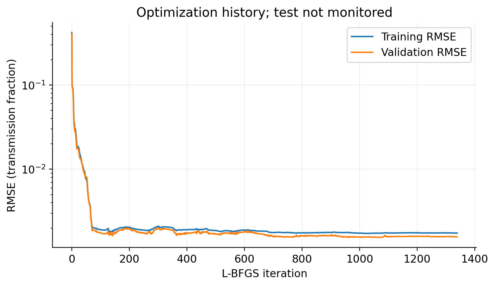
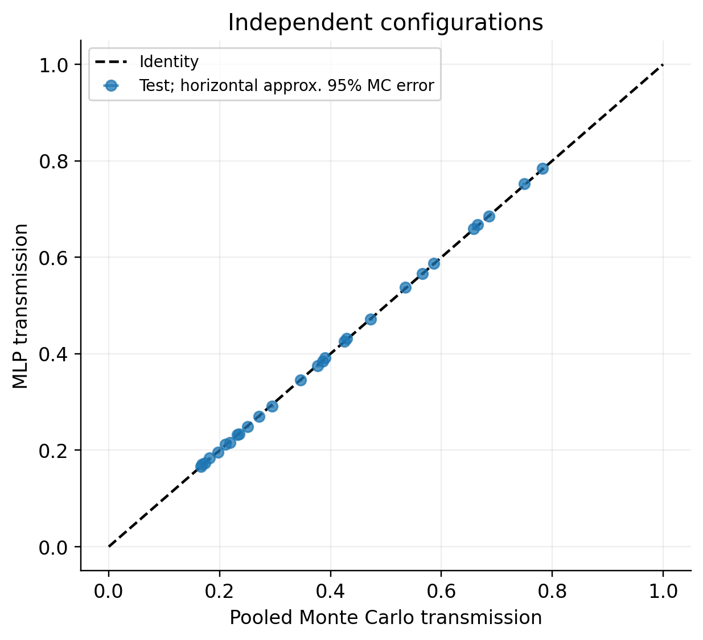
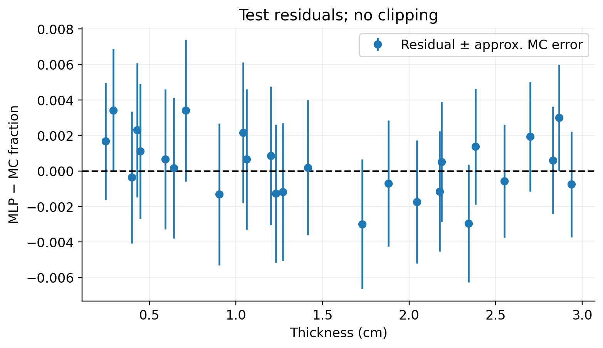
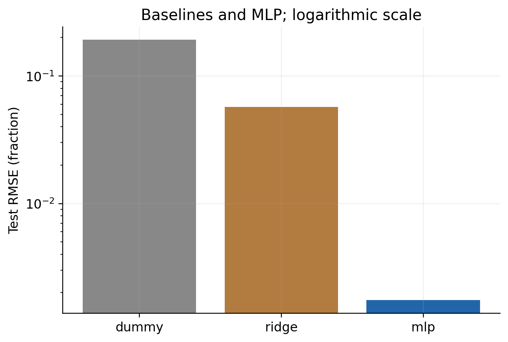
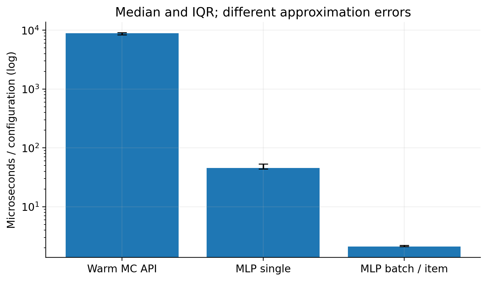
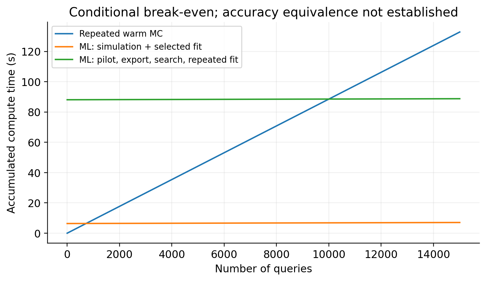

# HeliosMC: экспериментальная проверка MLP как суррогата учебного slab-симулятора

Дата: 13 ноября 2026 г. Версия эксперимента: `water_slab_surrogate_v1`.
Основные измерения: [benchmarks/results/ml_baseline/full](../benchmarks/results/ml_baseline/full/).
Малый сквозной эксперимент сохранён отдельно в `benchmarks/results/ml_baseline/quick/`.
Все приведённые ниже числа получены выполнением кода, а не заданы как ожидаемые результаты.

## 1. Постановка исследовательской задачи

Исследуется приближённое предсказание вероятности выхода нейтрона через правую
границу однородного неделящегося слоя в существующей математической модели
HeliosMC. Единственный входной признак — толщина слоя `thickness_cm` в сантиметрах.
Цель `escaped_right_fraction` — число вышедших справа историй, делённое на число
всех завершённых историй. Это безразмерная величина, включающая как прямой выход,
так и выход после рассеяний.

Практический вопрос: можно ли заменить повторные расчёты этого конкретного
симулятора небольшим регрессором для многочисленных запросов в известном
диапазоне? Работа не рассматривает деление, размножение, критичность или
проектирование реакторных конфигураций.

## 2. Гипотеза

Небольшая MLP может воспроизводить зависимость средней доли прохождения от
толщины на новых конфигурациях в диапазоне 0,05–3,00 см и после обучения выдавать
ответ быстрее повторного Monte Carlo. До основного обучения зафиксирован
учебный критерий: test RMSE не выше 0,01 абсолютной доли, то есть одного
процентного пункта. Это исследовательский допуск, не норматив точности
транспортного расчёта и не допуск для инженерного применения.

Отдельно проверяются обобщение по конфигурациям, сравнение с простыми моделями,
устойчивость к seed обучения и условная вычислительная окупаемость.

## 3. Исходная модель и предварительный аудит

Аудит охватил `physics.py`, `material.py`, существующие функции экспорта,
`docs/ARCHITECTURE_AUDIT.md`, тесты образовательной математики и существующие
benchmark-скрипты. Обнаружены готовые функции `create_slab_configuration`,
`run_slab_experiment`, `export_slab_experiment`, `load_slab_experiment`, а также
проверки баланса исходов, завершённости, схемы, checksum и согласованности
JSON/CSV/NPZ. Новая система транспорта или новый формат исходного экспорта
не создавались.

Использован один существующий reference-материал: вода, профиль
`jendl5_point_0p0253ev`, энергия 0,0253 эВ, температура 300 K, давление 100000 Па,
плотность 0,9965563072677796 г/см³. Полученные существующим адаптером скорости:
поглощение 0,022165776780709006 см⁻¹, рассеяние 2,149247245558249 см⁻¹.
Происхождение состава, плотности и сечений целиком сохранено в каждом
исходном экспорте и в шаблоне `experiment_config.json`.

Источник находится в x=0, начальный косинус направления равен 1. Слой один,
внешние границы допускают выход. Лимит — 1000 столкновений; незавершённые
истории не допускаются в исследовательские метки. Траектории не сохраняются.
Сохранены ограничения исходной модели: постоянные коэффициенты, свободный газ,
изотропное рассеяние в лабораторной системе, отсутствие изменения энергии и
связанного теплового рассеяния S(α,β). Неопределённости параметров материала
не распространены на результат.

**Разделение статусов данных.** Существующий `ml_record` намеренно оставляет
`eligible_for_training=False` для reference-расчётов. `split_slab_groups` допускает
только более узкий математически проверенный учебный набор. Эти функции и флаги
не изменены. Новая подсистема явно выполняет исследование **эмуляции симулятора**
с собственными проверками полноты и совместимости, а не включает reference-данные
в сертифицированный набор. Проверка источников параметров не является физической
валидацией транспортного приближения.

Постоянные материал, энергия, температура, плотность, направление и число
историй не превращены в искусственные признаки. Seed, идентификаторы, результаты,
интервалы, ошибки и время остаются метаданными. Физическое ядро и GUI в рамках
этой задачи не изменялись.

## 4. Подготовка датасета

Сначала выполнен quick-проход: 30 конфигураций, 3 повтора по 2000 историй,
всего 180000 историй; его test RMSE составил 0,005616. Это проверка процесса,
а не итоговый результат. Пространство кандидатов после quick не менялось.
Quick и full не рассматриваются как независимые статистические повторения:
они используют одну схему seed и один шаблон плана.

Перед каждым основным проходом выполняется пилот: 5 толщин по 3 повтора,
2000 историй в повторе. По его скорости выбран доступный максимальный объём
ограниченного плана — 180 конфигураций. Основные толщины получены стратифицированным
равномерным выбором: один случайный элемент в каждом из 180 равных интервалов.
Seed плана и разбиения — 20261113. Seed основного MC-запуска:
`100000 + 3 * configuration_index + repeat_index`, все 540 значений различны.

| Величина | Основной эксперимент |
|---|---:|
| Независимые физические конфигурации | 180 |
| Повторы на конфигурацию | 3 |
| Отдельные MC-наблюдения | 540 |
| Истории на повтор | 20000 |
| Истории на агрегированную метку | 60000 |
| Всего историй основного датасета | 10800000 |
| Train / validation / test, конфигураций | 126 / 27 / 27 |
| Исключённые записи | 0 |

Агрегирование выполняется суммированием числителей и знаменателей:
`p_hat = sum(escaped_right) / sum(n_histories)`. При равных размерах повторов
это совпадает со средним трёх долей. Для пула вычисляется стандартная ошибка
`sqrt(p_hat*(1-p_hat)/N)` и существующий маргинальный интервал Clopper–Pearson.
Отдельно сохраняется эмпирическая SEM трёх независимых повторов. Это разные
оценки MC-шума; три повтора дают неточную эмпирическую оценку разброса.

Устойчивый физический идентификатор взят из существующего `configuration.group_id`:
он не включает seed и число историй. В `dataset.csv` этот идентификатор называется
`configuration_id`; полный идентификатор отдельного запуска сохранён внутри
родного архива. Это различие предотвращает группировку по seed.

Каждый из 540 запусков экспортирован и повторно прочитан существующими API.
Три родных файла каждого запуска упакованы в один `experiments.zip`, чтобы не
создавать сотни отдельных каталогов. Формат содержимого не изменён. При чтении
извлекаются только три разрешённых имени во временный каталог; применяются
родные проверки checksum, счётчиков и статистик. NaN, Inf, несовместимый материал,
профиль, источник, незавершённые истории или повторный seed приводят к отказу,
а не численной подстановке. Ошибки генерации сохраняются с причиной; в основном
проходе исключений и исключённых наблюдений не было.

## 5. Архитектура MLP

Scikit-learn в окружении отсутствовал. Установка не выполнялась. Небольшая
полносвязная сеть реализована непосредственно на разрешённом NumPy, оптимизация
передана существующему SciPy. Это ограниченный регрессор, не универсальный
нейросетевой фреймворк. Аналитический градиент проверен конечными разностями
для одного и двух скрытых слоёв.

Выбрана архитектура **1–16–8–1**, всего 177 обучаемых весов и смещений.
Скрытые активации — tanh, выход линейный. Признак стандартизирован средним
1,5204752625095705 см и масштабом 0,8556052896307099 см, вычисленными только
по train. Target не масштабируется.

Минимизируется `0.5*mean((prediction-y)^2) + alpha/2*sum(W^2)`;
смещения не штрафуются, выбран `alpha=1e-6`. Оптимизатор L-BFGS-B использует
собственный поиск шага; отдельный Adam learning rate не требуется.
Ограничения: `maxiter=2000`, `maxfun=6000`, `ftol=1e-12`, `gtol=1e-7`, `maxls=40`.
Условия остановки и смысл `success` соответствуют
[документации SciPy](https://docs.scipy.org/doc/scipy/reference/optimize.minimize-lbfgsb.html).
Validation не участвует в градиенте или остановке отдельного fit: она служит
для выбора завершённой модели. Test не используется для выбора числа итераций.

## 6. Методология эксперимента

Разбиение сделано до обучения по уникальным физическим группам в пропорции
70/15/15. Самая малая и самая большая выбранные толщины переведены в train
обменом групп, используя только входы; это оставляет test внутри диапазона
обучающих конфигураций. Фактические крайние train-значения:
0,05301558829721692 и 2,9910216348978684 см. Узкие промежутки до заявленных
границ 0,05 и 3,00 см не проверены независимым тестом. CLI запрещает выход
за общий диапазон; точность у его самых крайних точек не гарантируется.

Все повторы предварительно агрегированы. Пересечения групп проверены;
идентификаторы всех трёх частей сохранены. Масштабирование и коэффициенты
каждой baseline-модели обучаются только на train. Валидационные метки доступны
для выбора кандидата, тестовые используются лишь после сохранения выбора и модели.

Сравниваются среднее train (Dummy), стандартизированная линейная/Ridge-регрессия
с `alpha ∈ {0, 0.01, 1}` и четыре MLP-варианта. Для каждого MLP использованы
заранее фиксированные seed 17, 29, 43. Критерий выбора — наименьшее среднее
validation RMSE по трём seed среди сошедшихся кандидатов. Основная модель всегда
имеет seed 17: лучший seed по результату не выбирался. Дополнительные seed
используются для анализа устойчивости, не для усреднения ответов.

Простая экспонента `exp(-Sigma_t*d)` предсказывает выход без столкновений.
Она не равна выбранному полному выходу справа при рассеянии. В существующем
проекте нет аналитического эталона этой полной величины для выбранного случая;
поэтому несопоставимая аналитическая строка в таблицу не включена.

Метрики: MAE, RMSE, R², максимальная абсолютная ошибка, среднее смещение и число
выходов за [0,1]. Clipping не применён. Бутстреп: 2000 выборок по тестовым
конфигурациям, seed 4815; параметры обученной модели фиксированы. Интервалы
условны на выбранном train/test и шумных MC-метках и не включают полную
неопределённость переобучения или физической модели.

## 7. Результаты обучения

| Скрытые слои | Alpha | Среднее validation RMSE по 3 seed | Сошлись |
|---|---:|---:|---:|
| 8 | 0,000001 | 0,00160624 | 3/3 |
| 16 | 0,000001 | 0,00162458 | 3/3 |
| 16, 8 | 0,000001 | 0,00156547 | 3/3 |
| 16 | 0,0001 | 0,00501266 | 3/3 |

Сохранены все 12 попыток, включая вариант с ухудшением качества при более
сильной регуляризации. Все завершились с `success=True`. Основная модель
завершила 1339 итераций по критерию относительного изменения целевой функции;
максимальный компонент градиента — 1,2891×10⁻⁷. Это численная сходимость
локальной оптимизации, не доказательство глобального минимума.

RMSE основной модели: train 0,00174317; validation 0,00157239;
test 0,00174760. Явного большого разрыва между train и test нет.
Преимущество двух слоёв над 8 нейронами невелико: статистически доказанного
превосходства этой архитектуры нет. Она выбрана по заранее фиксированному
правилу минимума validation, а не как универсально необходимая сложность.

Повторное обучение с теми же входами, seed и настройками дало максимальную
разность validation-предсказаний 0,0 в текущем окружении. После записи и загрузки
JSON предсказания также совпали. Межплатформенная побитовая воспроизводимость
не утверждается. Веса, scaler, порядок признаков, target, версии, группы,
конфигурация оптимизации и статус сохранены вместе.



Рисунок 1. RMSE на train и validation по итерациям L-BFGS. Регуляризованная
train loss отдельно сохранена в JSON; показанные RMSE не включают штраф.
Тест во время оптимизации не отслеживался.

## 8. Результаты независимого тестирования

| Модель | MAE | RMSE | R² | Обучение, с | Один predict, мкс |
|---|---:|---:|---:|---:|---:|
| Dummy | 0,16363783 | 0,19242385 | −0,00014656 | 0,0000163 | 18,048 |
| Linear/Ridge, alpha=0 | 0,05009971 | 0,05723318 | 0,91152072 | 0,0002724 | 26,519 |
| MLP 1–16–8–1 | 0,00144409 | 0,00174760 | 0,99991750 | 1,037074 | 45,447 |

Ridge-выбор `alpha=0` означает обычную линейную регрессию; это не скрытое
улучшение линейного baseline нелинейными признаками. Время обучения — один
выбранный fit без нормализации; время predict — медиана 7 серий, включая
проверку входа и нормализацию, для модели уже в памяти.

Для MLP максимальная абсолютная ошибка 0,00341519 (0,3415 процентного пункта),
смещение +0,00033383 (0,03338 процентного пункта). Выходов за [0,1] нет.
95%-е percentile bootstrap-интервалы:
MAE [0,00108359; 0,00182972], RMSE [0,00133108; 0,00212573],
смещение [−0,00031947; 0,00097543]. Интервал смещения включает ноль.

| Толщина, см | Test-конфигурации | RMSE | Смещение |
|---|---:|---:|---:|
| 0,05–1,0333 | 9 | 0,00196942 | +0,00122756 |
| 1,0333–2,0167 | 8 | 0,00151273 | −0,00028702 |
| 2,0167–3,00 | 10 | 0,00171016 | +0,00002617 |

Наибольшая ошибка наблюдается в группе меньших толщин; групп мало, поэтому
вывод о систематической зависимости смещения от толщины пока предварительный.
Test RMSE при seed 17 / 29 / 43: 0,00174760 / 0,00174172 / 0,00173926.
На этих трёх запусках чувствительность мала; это не универсальная гарантия.



Рисунок 2. Предсказание MLP и объединённая MC-оценка на новых конфигурациях.
Горизонтальные интервалы показывают приближение ±1,96 MC SE, не неопределённость MLP.



Рисунок 3. Остатки MLP−MC по толщине; полосы отражают только шум MC-метки.



Рисунок 4. Test RMSE на логарифмической шкале. Сравнение относится только
к выбранному набору признаков и одному фиксированному профилю.

## 9. Сравнение с Monte Carlo

Медиана объединённой MC SE на test — 0,00186096; RMS оценённых SE — 0,00183404.
Медиана эмпирической SEM повторов — 0,00160840. RMSE MLP относительно шумных
меток равна 0,00174760, то есть находится на сопоставимом масштабе. Все 27
предсказаний попали в маргинальные 95%-интервалы MC. Это не калибровка
предсказательных интервалов MLP и не доказательство отсутствия её смещения.
Отдельная случайная MC-оценка нигде не рассматривается как точная функция.

Измерения `perf_counter`, CPU, прогретый Numba, 7 повторов. Для одиночного
predict каждая серия содержит 1000 вызовов, для пакета — 500. Benchmark
выполнен до полного pytest, без параллельно запущенного исследовательского fit.
Фиксированная толщина временного сравнения — 1,5 см; для MC также сохранены
измерения на всех 27 тестовых толщинах. Время включает публичные проверки и
статистики API; отдельно приведено ядро транспорта. В predictor входят проверка
входа, scaler, преобразование сохранённых весов и прямой проход. Диск, GUI,
экспорт и рисунки исключены из этих времён.

| Операция | Медиана | Q25–Q75 |
|---|---:|---:|
| MC API, 20000 историй, 1,5 см | 8,85070 мс | 8,32380–9,07740 мс |
| Ядро MC, те же запуски | 4,62420 мс | 4,50840–4,97910 мс |
| MC API, 60000 историй | 43,05490 мс | 35,14370–50,11045 мс |
| MC API, 20000 историй, разные test-толщины | 8,50080 мс | 6,96945–10,70235 мс |
| MLP, один вход | 45,44670 мкс | 43,92590–53,24500 мкс |
| MLP, пакет 27 входов целиком | 56,98820 мкс | 56,61300–59,28980 мкс |
| Загрузка JSON-модели | 3,94180 мс | 3,84010–4,05485 мс |

В пакете приходится 2,11067 мкс на конфигурацию. Отношение одиночных времён
MC API / MLP — 194,75; ядро MC / весь predictor — 101,75. Эти отношения не
включают загрузку модели на каждый запрос. Они не означают ускорение всего
исследования. В серии 60000 историй заметен большой разброс; её нельзя считать
стабильной переносимой оценкой или обещанием линейного масштабирования.

Первый вызов полного research-wrapper пилота занял 2,43230 с, включая
компиляцию/инициализацию; из них transport timer — 1,85151 с. Это измерение
первого вызова в свежем процессе, а не отдельно выделенное чистое время компилятора.
Оно не использовано в ускорении относительно прогретой модели.



Рисунок 5. Медианы и IQR времени на конфигурацию, логарифмическая шкала.
Оценки MC и MLP имеют разную структуру ошибки.

## 10. Вычислительная окупаемость

Сумма `simulate_slab.total_seconds` для 540 запусков — **5,33625 с**, включая
проверки/статистики API; чистый транспорт — 2,84931 с. Wall time генерации с
конструированием конфигураций, экспортом, проверочным чтением и упаковкой —
**76,69383 с**. Последующее полное чтение собранного ZIP для агрегации в это
время не включено. Одна нормализация train — 0,0001038 с; выбранный fit —
**1,03707 с**; поиск всех MLP и линейных кандидатов — **7,54008 с**;
проверочное повторное обучение — 1,04076 с.

Для `T_MC > T_predict` использовано

`N_break_even = (T_dataset + T_train) / (T_MC - T_predict)`.

При стоимости подготовки только как суммы MC API + scaler + выбранный fit
получается 6,37342 с и **723,82 запроса**, то есть первый целый порог 724.
Консервативно учтены все train/validation/test-метки, а не только train.
При расширении числителя до измеренной генерации с экспортом, пилотных
вызовов, поиска моделей и повторного fit получается 88,08364 с и
**10003,53 запроса**, то есть 10004. Это расширенный, но всё ещё неполный
учёт wall time: финальное повторное чтение всего ZIP, построение рисунков,
pytest, подготовка отчёта, процессные импорты и труд разработчика не входят.
Полная стоимость всей работы не выдается за 88,08 с. На возобновлённом запуске
поле generation wall относится лишь к текущему вызову; опубликованный проход
выполнен без возобновления.

Обе оценки **условны**. Запросы должны иметь похожую стоимость, оставаться
в выбранном профиле и диапазоне, а модель должна переиспользоваться. Не доказано,
что MLP и MC с 20000 историями удовлетворяют одному строгому требованию к
ошибке на каждой конфигурации. Выполнение учебного критерия RMSE недостаточно
для заявления доказанной экономии при одинаковой точности.



Рисунок 6. Накопленные затраты для повторного прогретого MC и двух явно
описанных способов учёта подготовки ML. Пересечения — условные оценки.

## 11. Обсуждение

MLP существенно уменьшила ошибку относительно константного и линейного baseline.
Неожиданно небольшим оказалось различие между сетями с 8 нейронами и двумя
скрытыми слоями; сильная регуляризация ухудшила validation. После достижения
масштаба MC-шума дальнейшее усложнение трудно обосновать этим датасетом.
Сам по себе высокий R² также зависит от широкого диапазона значений target.

MLP уступает простым моделям по времени обучения, времени одиночного inference,
объяснимости и числу параметров. Для одномерной гладкой зависимости интерполяция
может быть более экономной альтернативой, однако в этой работе её превосходство
не измерялось. Применение MLP само по себе не заявляется научной новизной.

Ограничения: один материал и одна энергия, 27 тестовых конфигураций, одно
основное разбиение, три seed обучения, шумные метки и только три MC-повтора.
Бутстреп не учитывает все эти источники неопределённости. Высокая точность
эмуляции не исправляет приближения исходного симулятора. Вне 0,05–3 см CLI
отказывает; другие материалы, энергии, температуры, направления, многослойные
задачи и произвольная плотность не поддерживаются данной моделью.

## 12. Заключение

Гипотеза подтверждена **в узкой области эмуляции выбранного симулятора**:
на отложенных физических конфигурациях MLP достигла RMSE 0,00174760, прошла
заранее заданный учебный критерий 0,01 и после загрузки модели выполняла один
запрос значительно быстрее прогретого MC с 20000 историями. Устойчивость к трём
seed обучения и повторная сериализация проверены фактически.

Физическая валидность, универсальность, калиброванная неопределённость MLP и
окупаемость при строго одинаковой точности не установлены. Поэтому широкая
гипотеза о практической замене транспортных вычислений подтверждена лишь
частично. Результат — воспроизводимый исследовательский baseline, а не
валидированный расчёт реального материала.

## 13. Перспективы, воспроизведение и проверяемые артефакты

Следующие исследования: сравнить с интерполяцией и компактными нелинейными
регрессорами; проверить дополнительные разбиения; выполнить отдельный test
с большим числом историй для разделения MC-шума и ошибки аппроксимации;
проверить края диапазона и более строгий критерий эквивалентной точности;
повторить timing при контролируемой загрузке CPU. Расширение физической модели
потребует новой самостоятельной проверки её корректности и валидации.

Среда измерений: Windows 11 x64; Intel64 Family 6 Model 142 Stepping 10;
Python 3.14.4, NumPy 2.4.4, SciPy 1.18.1, Numba 0.67.0, Matplotlib 3.10.9.
`OMP_NUM_THREADS=1`, `OPENBLAS_NUM_THREADS=1`. CUDA не используется.
Все исходные core- и script-SHA256 сохранены в `experiment_config.json`.

Из корня проекта с доступным Python:

```powershell
$env:PYTHONDONTWRITEBYTECODE='1'
$env:OMP_NUM_THREADS='1'
$env:OPENBLAS_NUM_THREADS='1'
py -B -m benchmarks.ml_baseline quick --output benchmarks/results/ml_baseline/quick_new
py -B -m benchmarks.ml_baseline full --output benchmarks/results/ml_baseline/full_new
py -B -m benchmarks.ml_baseline evaluate --output benchmarks/results/ml_baseline/full
py -B -m benchmarks.ml_baseline predict --output benchmarks/results/ml_baseline/full --thickness 1.5
py -B -m pytest -q -p no:cacheprovider
```

В данном окружении alias `python` был недоступен; фактически использован
`C:\Users\user\AppData\Local\Python\pythoncore-3.14-64\python.exe`.
Никакие библиотеки не устанавливались. Импорт модуля не запускает исследование.
`evaluate` без `--dataset` повторно оценивает исходный held-out test, не создаёт
новые наблюдения и не переобучает модель. `--dataset` допускает другой каталог
с native-архивами, но запрещает пересечение с train/validation и несовместимые
профили. `predict` принимает только толщину для зафиксированного профиля.

Повторный full в завершённый каталог запрещён. После прерывания генерации можно
возобновить её при тех же хешах; уже готовые полные bundles не пересчитываются.
Повреждённые/частичные bundles и частично сохранённые модели автоматически не
перезаписываются: нужен новый каталог, прежний сохраняется для диагностики.
Для случайной порчи есть checksum; они не аутентифицируют внешнего автора.
JSON-модели содержат только данные, загрузка pickle не применяется.

| Артефакт в `full/` | Содержание |
|---|---|
| `experiments.zip` | 540 родных JSON/CSV/NPZ bundles, полные параметры и происхождение |
| `dataset.csv` | 180 агрегированных конфигураций, target, SE, CI, SEM повторов |
| `pilot.json`, `experiment_config.json`, `generation.json` | Пилот, замороженный план, группы, версии, хеши, время генерации |
| `mlp.json`, `ridge.json`, `dummy.json` | Сохранённые модели и scaler |
| `selection.json` | Все кандидаты, истории оптимизации, seed, выбранные параметры |
| `metrics.json`, `comparison.csv`, `test_predictions.csv` | Метрики, бутстреп, сравнение, индивидуальные test-ошибки |
| `timing.json` | Все временные повторы, медианы/IQR, условная окупаемость |
| `learning_curve.png`, `predicted_actual.png`, `residuals.png` | Рисунки 1–3, 220 dpi |
| `model_comparison.png`, `timing_comparison.png`, `break_even.png` | Рисунки 4–6, 220 dpi |
| `test_execution.json`, `cli_checks.json` | Фактические проверки тестов и CLI без переобучения |

Сырые ZIP сохранены локально и исключены из автоматического добавления в Git.
Каждая модель восстанавливалась реально, а не только записывалась на диск.
Полный набор тестов: **360 passed, 1 skipped, 2 subtests passed, 34,84 с**.
Пропущен существующий opt-in тест нативного GUI. Новых ML-тестов — 29; они
проверяют признаки/target, некорректные входы, разбиение, отсутствие утечки,
градиент, scaler, воспроизводимость, метрики, сериализацию, реальные reference
exports и неизменность core-файлов во время работы. Временные каталоги полного
прогона находились вне репозитория и удалены после завершения. Все шесть рисунков
визуально проверены. Полный Python-fallback и ручной GUI в этой задаче не запускались.

Созданы `benchmarks/ml_baseline.py`, `tests/test_ml_baseline.py`, этот отчёт
и фактические результаты quick/full. Обновлены README, `.gitignore` и существующий
архитектурный аудит. Удалённых файлов и добавленных зависимостей нет.
Предшествующие изменения пользователя сохранены. Commit и push не выполнялись.
