# Разработка открытого научного программного инструмента на Python для моделирования транспорта нейтронов методом Монте-Карло с использованием суррогатных моделей машинного обучения

## Многопараметрическая аппроксимация результатов Monte Carlo-моделирования методами машинного обучения

Исследовательский отчёт HeliosMC, версия 2. Дата выполнения: 19 ноября 2026 года.
Образовательный исследовательский проект РКНП.

Предыдущие одномерные модели и измерения сохранены в
`benchmarks/results/ml_baseline/full/`. Настоящий документ описывает
отдельный многопараметрический эксперимент `synthetic_slab_surrogate_v2`.
Одномерный отчёт доступен в истории Git: `d8c9d37:docs/ML_RESEARCH_REPORT.md`.
Значения v1 и v2 нельзя объединять: они относятся к разным постановкам и данным.

## Аннотация

Исследуется возможность ускорить повторные обращения к образовательному
Monte Carlo-симулятору HeliosMC с помощью регрессионной модели, обученной на его
результатах. Задача определяется тремя входами: толщиной слоя и постоянными
коэффициентами поглощения и рассеяния синтетической среды. Использованы
900 независимых конфигураций Latin Hypercube Sampling, по три
MC-повтора каждой конфигурации. Сравниваются константный регрессор, линейная
Ridge-регрессия, полиномиальная Ridge второй степени и MLP на NumPy/SciPy.
Test RMSE выбранной MLP равна 0.0084667243, полиномиальной
модели — 0.047221854 абсолютной доли.
При совпадающих тестовых входах отношение прогретого времени MC API к времени
одиночного MLP-predict составило 12.661. Вычислительная
окупаемость оценивается условно: эквивалентная точность MC и MLP для каждого
запроса не установлена. Отдельно выполнены исследования состава признаков,
объёма train, MC-шума и независимого набора с повышенным числом историй.
Работа проверяет свойства эмулятора конкретного учебного алгоритма; инженерная
и экспериментальная валидация реального материала не проводилась.

## 1. Введение

Метод Монте-Карло позволяет исследовать математическую модель через множество
случайных реализаций. В транспортной задаче каждая история представляет один
путь частицы со случайными расстояниями между взаимодействиями и случайными
исходами. Частота наблюдаемого исхода становится оценкой соответствующей
вероятности. Такой подход удобен, когда суммарное поведение складывается из
многих ветвящихся возможностей и прямое вычисление распределения затруднено.
Историческую постановку метода обсуждают Metropolis и Ulam [1].

Вычислительные затраты особенно заметны в серии запросов. Один расчёт может
занимать миллисекунды, однако при подборе учебных параметров, построении срезов
или повторном анализе приходится обращаться к модели многократно. Увеличение
числа историй уменьшает случайный разброс, но увеличивает стоимость каждого
обращения. Этот конфликт сохраняется даже после ускорения программного ядра.

Суррогатная модель строит приближение зависимости выхода симулятора от входов.
Сначала необходимо оплатить получение обучающих данных и настройку модели.
После этого новый ответ вычисляется прямым применением регрессора. Обзор Hong
и Zhang [2] описывает эту общую идею и различные семейства приближений. Само
применение MLP к результатам симуляции давно известно; оно не составляет
самостоятельного доказательства научной новизны настоящего проекта.

HeliosMC выбран как открытая образовательная среда с контролируемыми
допущениями. Программная модель достаточно компактна для проверки баланса
исходов, сохранения seed и исследования погрешностей. Учебная постановка
позволяет различать три вопроса: правильно ли работает программа, хорошо ли
регрессор воспроизводит её результаты и соответствует ли сама модель реальному
веществу. В данной работе проверяются первые два вопроса.

## 2. Постановка проблемы

Образовательная проблема состоит в том, что одиночный стохастический результат
легко принять за точный ответ. Небольшое расхождение двух расчётов может быть
обычным статистическим шумом. Аналогично, малую ошибку нейросети можно
переоценить, если в test попали повторные запуски уже известных конфигураций.
Проект должен делать происхождение данных, повторы и границы вывода видимыми.

Исследовательская проблема формулируется как компромисс между точностью,
обобщающей способностью и совокупной стоимостью вычислений. Нас интересует,
при каком составе признаков и числе обучающих конфигураций регрессор даёт
приемлемое приближение, а также сколько повторных запросов требуется для
амортизации подготовки. Быстрый ответ, не соответствующий нужной точности,
сам по себе не является вычислительным преимуществом для пользователя.

Объект исследования — существующая однородная slab-модель независимых историй
без размножения. Предмет — точность и стоимость её регрессионного приближения.
Работа не ставит целью создать инженерный аналог OpenMC, рассчитывать
критичность или переносить найденные коэффициенты на реальный материал.
Все изменяемые скорости взаимодействий заданы как синтетические учебные числа.

## 3. Цель, задачи и проверяемые гипотезы

Цель — построить воспроизводимый трёхпараметрический эксперимент, в котором
можно проверить условия полезности ML-суррогата. До основного обучения
зафиксированы области входов, метод выборки, критерий выбора модели, seed,
разбиение и исследования дополнительных факторов. Четвёртый признак source_mu
не включён: фиксированная постановка с тремя входами позволяет завершить
основное исследование без расширения его объёма.

H1: MLP точнее линейной модели на новых конфигурациях. Проверка — общий test
и парный бутстреп разности RMSE; дополнительно сравнивается полиномиальная
модель, способная описывать нелинейность и взаимодействия входов.

H2: увеличение числа train-групп в целом уменьшает ошибку до насыщения.
Проверка — вложенные подвыборки 20/40/60/80/100% при неизменном validation/test
и заранее выбранной архитектуре. Строгая монотонность каждой случайной кривой
не предполагается. Основной критерий сравнивает среднюю validation RMSE при
100% и 20%; по test оптимальный размер не выбирается.

H3: доступность разных входов неодинаково влияет на ошибку предиктора.
Проверка — одна толщина, толщина с поглощением, толщина с рассеянием, все три
признака. Это анализ информации, доступной конкретному регрессору, а не
оценка причинной значимости параметров реального вещества.

H4: при большом количестве запросов меньшая стоимость inference может
компенсировать подготовку модели. Проверяются знак разности времён и условная
точка окупаемости с двумя явно описанными способами учёта подготовки.

H5: шум MC-меток ограничивает интерпретацию ошибки ML. Проверка — независимые
повторы, несколько чисел историй и дополнительные конфигурации с более точными
MC-метками. Неопределённость самой физической модели этим не оценивается.

Основной учебный критерий до обучения: test RMSE ≤0,015 и максимальная ошибка
≤0,06 абсолютной доли. Эти пороги предназначены для данного исследования;
они не являются нормативами точности нейтронного транспорта.

## 4. Теоретическая основа

### 4.1. Независимые истории и статистическая оценка

Внутри слоя постоянны поглощение a и рассеяние s, оба в см⁻¹. Суммарная
скорость равна a+s. До следующего взаимодействия выбирается оптическое
расстояние τ=−ln(1−U), где U равномерно на [0,1). Геометрическое расстояние
в однородной среде равно τ/(a+s). Если раньше достигается граница, частица
выходит. При столкновении поглощение происходит с вероятностью a/(a+s),
иначе новое направление выбирается по существующему изотропному закону.
Энергия не изменяется; коэффициенты после рассеяния остаются прежними.

Пусть K из N завершённых историй вышли справа. Тогда p̂=K/N — оценка
вероятности этого исхода. При независимых историях K имеет биномиальную
модель, а plug-in стандартная ошибка равна sqrt(p̂(1−p̂)/N). Она характеризует
разброс оценок при повторении вычисления. Это не гарантированная граница
ошибки отдельного запуска и не неопределённость исходных коэффициентов.
Используемые интервалы Clopper–Pearson вычисляет существующая функция
summarize_binomial; описание биномиальных методов приведено в SciPy [9].

Полный выход справа включает рассеянные истории. При s>0 выражение
exp(−(a+s)d) соответствует только выходу без столкновений и не используется
как эталон полного прохождения. В отдельном предельном случае s=0,
нормальном входе и x=0 вероятность полного прохождения равна exp(−ad).
Этот случай позволяет проверять математическую реализацию независимо от ML.

Есть дополнительное свойство самой постановки: при фиксированном нормальном
входе её безразмерное поведение определяется оптическими произведениями ad
и sd. Одновременное изменение d, a и s, сохраняющее эти произведения,
даёт математически эквивалентную транспортную задачу. Следовательно, три
независимо выбираемых размерных входа не означают три независимых
безразмерных механизма. В основной модели сохранены именно запрошенные
исходные признаки; сравнение с регрессией по оптическим параметрам остаётся
отдельной возможностью дальнейшего исследования.

### 4.2. Регрессионные модели

Dummy предсказывает среднее y по train для любого входа. Если более сложная
модель не улучшает его результат, полезная зависимость не выявлена.
Линейная модель использует стандартизированные входы z и предсказывает
b+Σβⱼzⱼ. Ridge добавляет к сумме квадратов ошибок штраф αΣβⱼ²; свободный член
не штрафуется. В программе задача решается расширенным методом наименьших
квадратов, что допускает зависимые и постоянные столбцы без обращения
плохо обусловленной матрицы нормальных уравнений.

Полиномиальная модель второй степени использует z₁,z₂,z₃, их квадраты и
попарные произведения. Вместе со свободным членом получается десять
коэффициентов. Такая модель может описывать кривизну и взаимодействия
параметров при небольшой сложности. Сравнение с ней помогает избежать
преувеличения преимуществ MLP над слишком слабым линейным ориентиром.

MLP последовательно вычисляет hₗ=tanh(hₗ₋₁Wₗ+bₗ) в скрытых слоях и линейный
выход. Число входов берётся из схемы модели. Обучаемая цель:
L=mean((ŷ−y)²)/2+αΣ||Wₗ||²/2. Смещения не регуляризуются. Target остаётся
в исходных единицах доли. Ограничение ŷ∈[0,1] не навязывается, поэтому
выходы за границы измеряются явно и не скрываются clipping.

Аналитический backpropagation применяет цепное правило к этой функции.
Для tanh производная равна 1−h². Численный тест сравнивает весь вектор
градиента с конечными разностями в сетях с тремя входами, одним и двумя
скрытыми слоями. Успех такой проверки подтверждает согласованность кода
дифференцирования; он не устанавливает качество данных или полноту модели.

L-BFGS-B аппроксимирует информацию о кривизне, сохраняя ограниченную историю
изменений параметров. Оптимизатор получает значение цели и аналитический
градиент, выполняет поиск шага и проверяет условия остановки [4]. Его
success означает выполнение численного критерия, а не доказательство
глобального минимума. Достижение maxiter сохраняется как неуспешный исход.
Встроенной случайной validation-выборки у нашего fit нет: все группы
validation заданы вне оптимизатора.

### 4.3. Обобщение, метрики и интервалы

Стандартизация вычисляет среднее и стандартное отклонение каждого столбца
только по train. Постоянство определяется совпадением минимума и максимума;
его масштаб заменяется единицей, чтобы исключить деление на округлённый ноль.
Сохранённая модель содержит scaler и точный порядок признаков. Для числовой
матрицы порядок столбцов является контрактом вызывающего кода; по самим
числам распознать произвольную перестановку невозможно. Для именованного
ввода порядок проверяется явно.

На отложенных группах вычисляются MAE=mean(|ŷ−y|),
RMSE=sqrt(mean((ŷ−y)²)), максимальная абсолютная ошибка и Bias=mean(ŷ−y).
R²=1−Σ(ŷ−y)²/Σ(y−ȳ)² может быть отрицательным, если предиктор хуже
выборочного среднего. Доля ответов вне [0,1] хранится отдельно от их числа.
При постоянном y R² не определён и сохраняется как null. Формулы согласуются
с официальным описанием метрик [6]; библиотека scikit-learn не используется
в вычислительном pipeline и не устанавливалась.

Бутстреп повторно выбирает тестовые конфигурации с возвращением и оценивает
распределение метрик [3]. Все повторы одной конфигурации сначала объединены;
они не считаются независимыми наблюдениями для бутстрепа. Для разности RMSE
двух моделей применяются одни и те же bootstrap-индексы. Полученные интервалы
условны на обученных моделях, единственном разбиении и шумных MC-метках.
Они не включают всю изменчивость переобучения, проектирования выборки или
ошибку исходных математических допущений.

## 5. Архитектура HeliosMC

`material.py` задаёт MaterialDataset, единицы и проверки коэффициентов.
`physics.py` содержит simulate_slab, агрегированные статистики и родной
экспорт эксперимента. `numba_compat.py` предоставляет Numba/fallback.
`benchmarks/ml_baseline.py` вызывает эти API, строит датасет, обучает модели,
оценивает их и создаёт результаты. `tests/test_ml_baseline.py` проверяет
численную и программную корректность исследования. Существующие `gui.py`,
`simulation_worker.py` и `main.py` отвечают за интерактивное приложение;
обучение не выполняется в GUI или при импорте исследовательского модуля.


Модернизация повторно использует forward, objective и существующие API
экспорта. Размер входного слоя теперь задаётся схемой. Формат модели v2
отличается от v1; сохранённые водные модели не переименовываются в
трёхпараметрические. Загрузка проверяет единицы, порядок, области,
размеры scaler, веса, смещения и конечность чисел. JSON содержит данные;
pickle не применяется. Старые модели v1 по-прежнему читаются по их
собственной схеме и принимают только толщину.

Исходные bundles содержат experiment.json, results.csv и arrays.npz.
Они упакованы в ZIP без изменения внутренней схемы. При чтении извлекаются
только фиксированные допустимые члены во временный каталог и вызывается
родной валидатор. SHA256 защищает целостность, но не аутентифицирует автора.
Исходные MC-записи и агрегированные группы сохранены отдельно, чтобы
не потерять seed, счётчики, время и оценку неопределённости.

## 6. Методология

### 6.1. Окружение, признаки и фиксированные условия

**Таблица 1. Вычислительная система и программная среда.** Источник: `../benchmarks/results/ml_multivariate_v2/full/experiment_config.json: environment`.

<!-- TABLE_1_BEGIN -->
| parameter | value |
|---|---|
| python | 3.14.4 (tags/v3.14.4:23116f9, Apr  7 2026, 14:10:54) [MSC v.1944 64 bit (AMD64)] |
| numpy | 2.4.4 |
| scipy | 1.18.1 |
| numba | 0.67.0 |
| platform | Windows-11-10.0.26200-SP0 |
| processor | Intel64 Family 6 Model 142 Stepping 10, GenuineIntel |
| omp_threads | 1 |
| openblas_threads | 1 |
<!-- TABLE_1_END -->

Числа времени ниже относятся к этому окружению и его текущей нагрузке.
Потоки BLAS ограничены переменными процесса; GPU не требуется. Точная модель
ноутбука и его номинальный объём RAM не определялись, поэтому они не указаны.
Массивы обучения содержат сотни или тысячи строк, что ограничивает память;
общий RSS процесса в этой работе отдельно не измерялся.

**Таблица 2. Входные признаки и область применимости.** Источник: `../benchmarks/results/ml_multivariate_v2/full/experiment_config.json: feature_spec`.

<!-- TABLE_2_BEGIN -->
| position | name | unit | lower | upper | type |
|---|---|---|---|---|---|
| 0 | thickness_cm | cm | 0.1 | 3 | length |
| 1 | absorption_rate | 1/cm | 0.02 | 1.2 | rate |
| 2 | scattering_rate | 1/cm | 0 | 2 | rate |
<!-- TABLE_2_END -->

Диапазоны зафиксированы до пилота и test. Положительное поглощение
снижает риск очень долгих почти консервативных историй. Максимальная
суммарная оптическая толщина равна 9,6. Нулевое рассеяние допускается как
проверяемая граница, а положительные значения создают разнообразные пути
выхода. Эти области выбраны для численной управляемости и разнообразия
учебного отклика; они не являются диапазонами свойств какого-либо вещества.
Пилот проверяет пригодность фиксированной области, но не корректирует её
по неудобным результатам независимого тестирования.

**Таблица 3. Параметры основного Monte Carlo, все конфигурации.** Источник: `../benchmarks/results/ml_multivariate_v2/full/experiment_config.json; generation.json`.

<!-- TABLE_3_BEGIN -->
| parameter | value |
|---|---|
| histories_per_repeat | 8000 |
| repeats | 3 |
| source_mu | 1 |
| source_x | 0 |
| max_collisions | 1000 |
| backend | numba |
| groups | 900 |
| total_histories | 21600000 |
<!-- TABLE_3_END -->

Источник фиксирован на левой границе и направлен нормально внутрь
слоя. Ядерные сечения, плотность реального вещества, температура и энергия
не выступают входами этой синтетической задачи. Лимит столкновений является
вычислительной защитой; исчерпанные или численно незавершённые истории
не превращаются в допустимые метки. Каждое наблюдение проверяется на
баланс счётчиков, положительное число историй, конечность статистик,
совместимость материала и соответствие доли сохранённым числителю и знаменателю.

### 6.2. Проектирование данных и статистические повторы

Рассмотрены независимая равномерная выборка, структурированная сетка и LHS.
Независимые случайные точки просты, но могут оставлять незаполненные интервалы
каждого входа. Полная сетка удобна для двумерного среза, однако число её точек
растёт как произведение числа уровней по координатам. LHS стратифицирует
каждое одномерное распределение, не требуя полного декартова произведения [5].
Выбран scrambled LHS без оптимизации после выборки; его seed сохранён.
Сравнение вариантов проектирования здесь методологическое: их влияние на
ошибку не измерялось в отдельном конкурентном исследовании.

Пилот включает 15 конфигураций и три повтора по 2000 историй. Есть центральная
точка, изменения каждого входа к двум границам и дополнительные LHS-точки.
Различие крайних откликов проверяется относительно объединённой MC SE.
Это подтверждает различимость эффектов при выбранном числе историй,
не устанавливая причинной важности признаков в обученной сети.

Объём основного набора выбирается только по стоимости пилота и заданному
бюджету: quick — 60 групп по три запуска с 1000 историями, full — от 300
до 900 групп по три запуска с 8000 историями. При недостаточном бюджете
минимальный дизайн не запускается. Временной предел относится к отдельному
вызову основной генерации; конечные подборы моделей и диагностические
вычисления имеют отдельный фиксированный объём. Уже записанные полные
bundles могут использоваться при возобновлении с теми же хешами источников.

Группа задаётся существующим group_id, включающим все три параметра
математической конфигурации и источник, но исключающим seed, число историй
и вычислительный backend. Полный configuration_id каждого отдельного
запуска дополнительно сохранён в исходном bundle. Повторы используют
различные seed. Target пула равен сумме успешных исходов, делённой на
сумму историй. Вместе с ним хранятся Clopper–Pearson CI, plug-in SE и
эмпирическая SEM независимых повторов. Записи не очищаются подстановкой
удобных чисел; ошибка генерации записывается и останавливает стадию.

**Таблица 4. Разбиение по независимым физическим группам.** Источник: `../benchmarks/results/ml_multivariate_v2/full/splits.json; experiment_config.json`.

<!-- TABLE_4_BEGIN -->
| part | groups | runs | histories |
|---|---|---|---|
| test | 135 | 405 | 3240000 |
| validation | 135 | 405 | 3240000 |
| train | 630 | 1890 | 15120000 |
<!-- TABLE_4_END -->

Разбиение выполняется по уникальным группам до обучения и не
использует target. Нормализация каждого fit обучается только на его train,
включая отдельные fit на уменьшенных наборах. Validation и test остаются
одними и теми же для сравнительных исследований. Test передаётся только
в этап окончательной оценки: функция подбора обучается даже если вместо
test-данных ей передан недоступный объект, что проверяет unit-тест.

### 6.3. Выбор моделей и дополнительные исследования

Ridge и polynomial Ridge сравниваются по α=0, 0,01 и 1 на validation.
Четыре MLP-настройки проверяются на фиксированных seed 17, 29 и 43.
Основной кандидат должен сойтись на всех трёх seed; среди допустимых
выбирается минимальное среднее validation RMSE. Основная сохранённая
модель всегда имеет seed 17, что предотвращает выбор самого удачного seed.
Сходимость других попыток, число итераций и причина остановки сохраняются.

После выбора архитектуры выполняются вложенные размеры train и ablation.
Архитектура, штраф и алгоритм остаются общими; число входных нейронов
соответствует подмножеству признаков. Для полной выборки и всех входов
повторно используются уже обученные модели: идентичный fit не считается
новым независимым экспериментом. В неполных ablation-моделях неоднозначность
ответа возникает от скрытых входов, даже если оптимизация сошлась идеально.

Диагностический набор с другим seed LHS не пересекается с основными
конфигурациями и содержит повышенное число историй. Отдельная наблюдаемая
сетка фиксирует s=1 см⁻¹ и меняет d,a. На её рисунке показаны реальные
MC-метки, а не вымышленные данные плотной тепловой карты. В отдельном
noise-study несколько фиксированных конфигураций рассчитываются при
трёх числах историй, по восемь повторов. Эти данные не используются для
настройки или повторного выбора модели.

### 6.4. Измерение времени

Монотонный perf_counter измеряет API Monte Carlo, отдельный transport timer,
одиночный predict, пакет, загрузку JSON и подготовку материалов/признаков.
Для основного сравнения используются те же test-входы обеих моделей.
Сначала прогревается ядро; затем выполняются семь одинаково устроенных
серий. Внутри каждой MC-серии время усредняется по test-конфигурациям,
а медиана и IQR вычисляются между сериями. Это не распределение стоимости
одного произвольного входа; неоднородность входов сохранена отдельно.

В single-predict включены проверка схемы и области, нормализация, подготовка
численных весов из сохранённого объекта и прямой проход. При batch сообщается
время всего пакета и его размер. Загрузка файла измеряется отдельно.
Материалы для MC заранее созданы; экспорт, GUI и рисунки в чистые timing-серии
не входят. Первый wrapper-вызов пилота в свежем процессе содержит JIT и
инициализацию, поэтому приводится отдельно от прогретого сравнения.

## 7. Результаты

### 7.1. Подбор и проверка обучения

**Таблица 5. Архитектуры MLP; validation, три фиксированных seed.** Источник: `../benchmarks/results/ml_multivariate_v2/full/selection.json: trials; experiment_config.json: candidates`.

<!-- TABLE_5_BEGIN -->
| hidden | alpha | seeds | converged | validation_rmse_mean | iterations_min | iterations_max |
|---|---|---|---|---|---|---|
| [16] | 1e-06 | 3 | 2 | 0.0045486328 | 2221 | 2500 |
| [32] | 1e-06 | 3 | 1 | 0.0041771978 | 2466 | 2500 |
| [32, 16] | 1e-06 | 3 | 2 | 0.0029840045 | 2197 | 2500 |
| [32, 16] | 0.0001 | 3 | 3 | 0.0082989356 | 909 | 1202 |
<!-- TABLE_5_END -->

Выбранная архитектура: [3, 32, 16, 1], alpha=0.0001;
основной seed 17. Оптимизатор выполнил 1202
итераций, причина остановки: `CONVERGENCE: RELATIVE REDUCTION OF F <= FACTR*EPSMCH`. Максимальный компонент
градиента 6.356378e-06. Численный статус не заменяет test-оценку.
Все попытки, включая несошедшиеся, доступны в selection.json и сохранённом
checkpoint обучения. При расчёте таблицы 5 средние ошибки показаны для всех
попыток; статус допуска к выбору читается по столбцу converged.

RMSE основной модели: train 0.008436959, validation
0.0083313758, test 0.0084667243.
Соотношение этих величин позволяет оценить переобучение, но один случайный
split не характеризует его полную изменчивость. Повторный fit при одинаковых
данных и seed дал максимальную разность validation-предсказаний
0. Совпадение проверено в данном
окружении; межплатформенная побитовая воспроизводимость не утверждается.

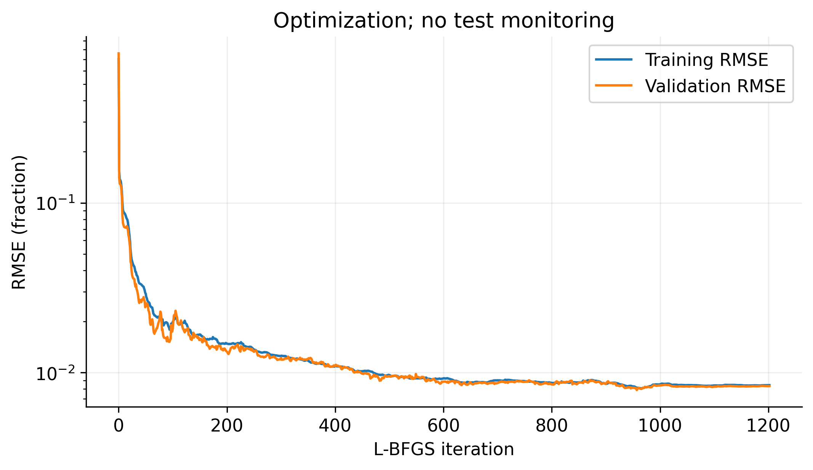

Рисунок 1. История RMSE на train и validation; test не отслеживается. Регуляризованная loss отдельно сохранена в learning_curves.csv.

### 7.2. Независимое сравнение моделей

**Таблица 6. Сравнение моделей на неизменном test; ошибки в долях.** Источник: `../benchmarks/results/ml_multivariate_v2/full/metrics.json; comparison.csv`.

<!-- TABLE_6_BEGIN -->
| model | n_test | mae | rmse | r2 | max_absolute_error | bias | outside_fraction | out_of_range_fraction |
|---|---|---|---|---|---|---|---|---|
| dummy | 135 | 0.20611543 | 0.24457871 | -0.018759436 | 0.65209815 | 0.033188889 | 0 | 0 |
| ridge | 135 | 0.081213736 | 0.10045904 | 0.8281251 | 0.29097293 | 0.011350436 | 19 | 0.14074074 |
| polynomial_ridge | 135 | 0.034139928 | 0.047221854 | 0.96202302 | 0.17212339 | 0.0059763619 | 16 | 0.11851852 |
| mlp | 135 | 0.0059517297 | 0.0084667243 | 0.99877914 | 0.048062059 | 0.00089630469 | 4 | 0.02962963 |
<!-- TABLE_6_END -->

Таблица сопоставляет модели на одном и том же наборе физических
конфигураций. Полиномиальная строка важна: она показывает, достаточно ли
второй степени для наблюдаемой зависимости, прежде чем объяснять результат
особым преимуществом нейросети. Отрицательный R² или выход за область
вероятностей сохраняется как результат. Для принятия учебного критерия
используются одновременно RMSE и максимальная ошибка, а не только R².

Для MLP bootstrap-интервал RMSE: [0.006637341735110716, 0.010638837977661967];
MAE: [0.005000192045701326, 0.006992941626788162]; Bias: [-0.0005920822335837639, 0.002209980618756939].
Парный 95%-интервал разности RMSE MLP−Ridge:
[-0.10421741891373143, -0.07866313116148603]; MLP−Polynomial Ridge:
[-0.04707163972325389, -0.030433356002107927]. Отрицательная разность означает
меньшую ошибку MLP. Интервалы рассчитаны на 2000 повторных выборках
конфигураций с seed 4815. Это условное статистическое сравнение обученных
моделей, не доказательство общего превосходства алгоритма на любых данных.
Результат проверки заранее заданного учебного критерия:
**выполнен на основном test**.

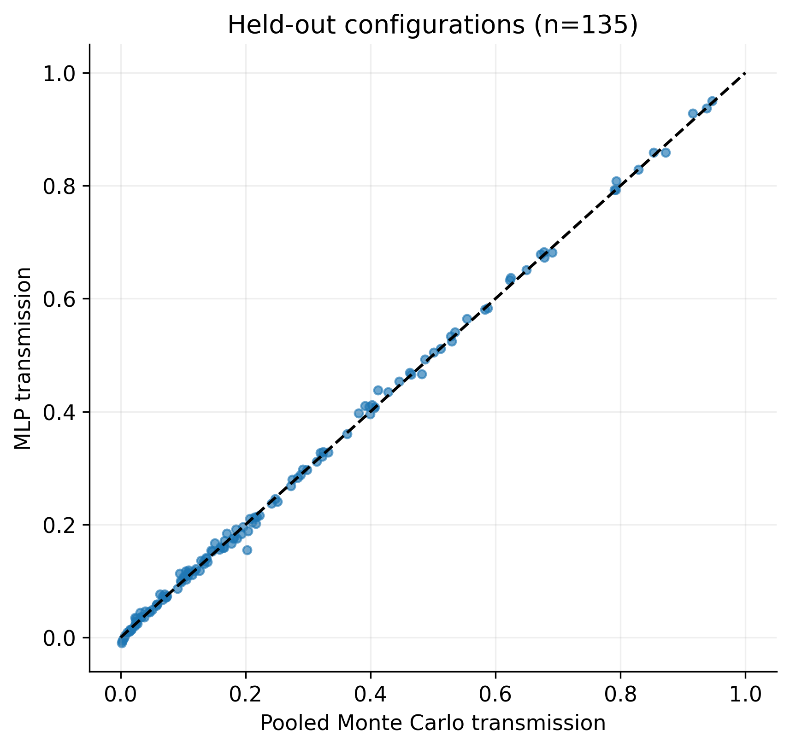

Рисунок 2. MLP и pooled MC на новых test-конфигурациях. Прямая соответствует идеальному совпадению.

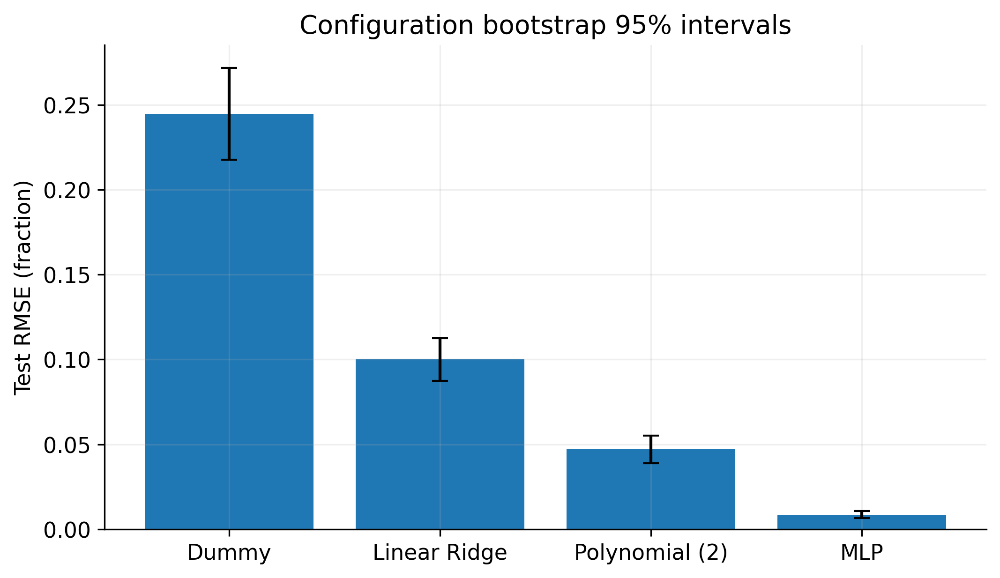

Рисунок 3. RMSE четырёх моделей с 95%-интервалами бутстрепа по конфигурациям.

**Таблица 7. Устойчивость основной архитектуры по seed; test.** Источник: `../benchmarks/results/ml_multivariate_v2/full/metrics.json: seed_sensitivity`.

<!-- TABLE_7_BEGIN -->
| seed | success | mae | rmse | r2 | max_absolute_error | bias | outside_fraction | out_of_range_fraction |
|---|---|---|---|---|---|---|---|---|
| 17 | да | 0.0059517297 | 0.0084667243 | 0.99877914 | 0.048062059 | 0.00089630469 | 4 | 0.02962963 |
| 29 | да | 0.005912282 | 0.0084243114 | 0.99879134 | 0.047867488 | 0.00091494403 | 4 | 0.02962963 |
| 43 | да | 0.0059004874 | 0.0084102156 | 0.99879538 | 0.047796404 | 0.00091688377 | 4 | 0.02962963 |
<!-- TABLE_7_END -->

В таблице 7 все seed были заданы до обучения. Основной ответ не
усредняется по трём сетям, и наиболее удачный seed не выбирается по test.
Наблюдаемый разброс характеризует лишь три локальные оптимизации одной
архитектуры; он не охватывает другие разбиения или способы генерации данных.

### 7.3. Вклад признаков и число обучающих конфигураций

**Таблица 8. Вклад признаков, три seed.** Источник: `../benchmarks/results/ml_multivariate_v2/full/ablation.csv`.

<!-- TABLE_8_BEGIN -->
| features | n_groups | histories | converged | attempts | validation_rmse_mean | test_rmse_mean | test_rmse_sd | training_seconds_mean |
|---|---|---|---|---|---|---|---|---|
| thickness_cm | 630 | 15120000 | 3 | 3 | 0.1445509 | 0.14115668 | 6.9477998e-06 | 3.7356331 |
| thickness_cm + absorption_rate | 630 | 15120000 | 3 | 3 | 0.095499927 | 0.09366574 | 6.2382956e-05 | 6.4667281 |
| thickness_cm + scattering_rate | 630 | 15120000 | 3 | 3 | 0.12519469 | 0.12890419 | 0.0001621902 | 6.4231641 |
| thickness_cm + absorption_rate + scattering_rate | 630 | 15120000 | 3 | 3 | 0.0082989356 | 0.0084337504 | 2.9413134e-05 | 5.0649695 |
<!-- TABLE_8_END -->

Потеря входа заставляет сеть приближать усреднённый ответ при
неизвестных значениях исключённых параметров. Поэтому рост ошибки не следует
трактовать как экспериментальное доказательство причинного влияния фактора
в реальном материале. При сравнении строк нужно также смотреть на converged:
ошибки несошедшихся fit остаются диагностическими. Все средние таблиц 8–9
включают выполненные попытки, а столбец converged показывает их численный
статус; на графиках для валидных моделей используются только сошедшиеся fit.

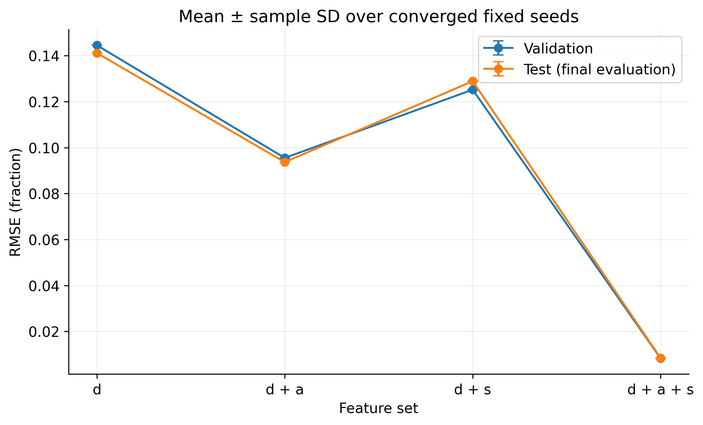

Рисунок 4. Ablation: d — толщина, a — поглощение, s — рассеяние. Среднее ± SD по сошедшимся seed; независимый test оценивается после обучения всех вариантов.

**Таблица 9. Размер train при неизменных validation/test, три seed.** Источник: `../benchmarks/results/ml_multivariate_v2/full/dataset_size_study.csv`.

<!-- TABLE_9_BEGIN -->
| features | n_groups | histories | converged | attempts | validation_rmse_mean | test_rmse_mean | test_rmse_sd | training_seconds_mean |
|---|---|---|---|---|---|---|---|---|
| thickness_cm + absorption_rate + scattering_rate | 126 | 3024000 | 3 | 3 | 0.013723075 | 0.018300904 | 0.0015275624 | 50.349374 |
| thickness_cm + absorption_rate + scattering_rate | 252 | 6048000 | 3 | 3 | 0.0093926394 | 0.010234557 | 0.00022402457 | 8.6657434 |
| thickness_cm + absorption_rate + scattering_rate | 378 | 9072000 | 3 | 3 | 0.0091055111 | 0.009236505 | 4.2156937e-05 | 4.1637402 |
| thickness_cm + absorption_rate + scattering_rate | 504 | 12096000 | 3 | 3 | 0.0084126149 | 0.0086028709 | 2.8784747e-05 | 3.6049786 |
| thickness_cm + absorption_rate + scattering_rate | 630 | 15120000 | 3 | 3 | 0.0082989356 | 0.0084337504 | 2.9413134e-05 | 5.0649695 |
<!-- TABLE_9_END -->

Подвыборки вложены друг в друга по одной фиксированной перестановке
train-групп. Каждая использует собственный scaler. Изменение test-ошибки
показано после фиксации протокола и не использовано для выбора размера.
Немонoтонность допустима из-за ограниченности данных, шума и локальной
оптимизации. По одному небольшому улучшению нельзя надёжно определить
универсальный оптимальный объём; оно требует повторных проектов выборки.

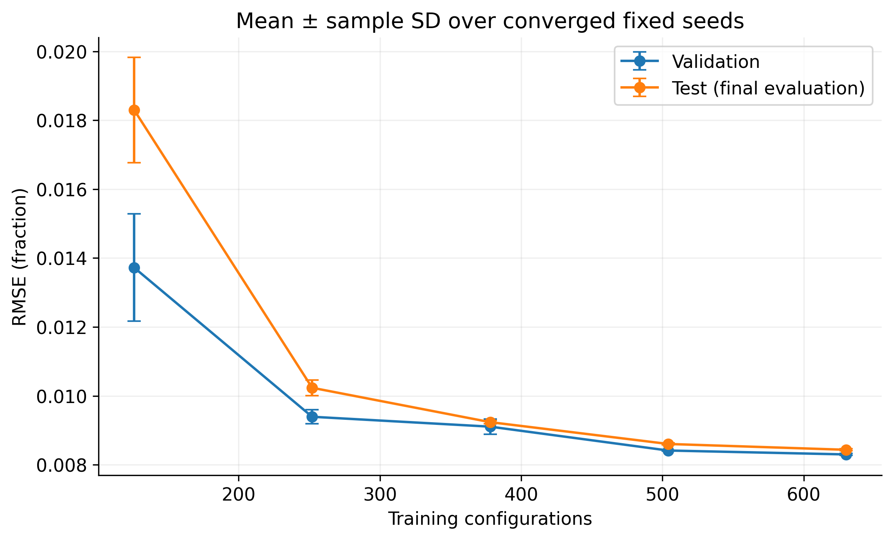

Рисунок 5. RMSE от числа train-конфигураций; validation и test фиксированы. Полосы — SD трёх сошедшихся seed, а не доверительный интервал по всем источникам неопределённости.

### 7.4. Распределение ошибок в пространстве входов

**Таблица 10. Ошибка MLP по областям каждого признака; test.** Источник: `../benchmarks/results/ml_multivariate_v2/full/error_regions.csv`.

<!-- TABLE_10_BEGIN -->
| feature | lower | upper | n | mae | rmse | r2 | max_absolute_error | bias | outside_fraction | out_of_range_fraction |
|---|---|---|---|---|---|---|---|---|---|---|
| thickness_cm | 0.1 | 1.0666667 | 39 | 0.0053222749 | 0.0067444516 | 0.99921245 | 0.014808968 | 0.001769595 | 0 | 0 |
| thickness_cm | 1.0666667 | 2.0333333 | 49 | 0.0043445101 | 0.0058092659 | 0.99866014 | 0.015991676 | -0.00022967802 | 0 | 0 |
| thickness_cm | 2.0333333 | 3 | 47 | 0.0081496551 | 0.011531533 | 0.99216443 | 0.048062059 | 0.0013455564 | 4 | 0.085106383 |
| absorption_rate | 0.02 | 0.41333333 | 45 | 0.0090899074 | 0.012227577 | 0.99771188 | 0.048062059 | 0.0034248202 | 0 | 0 |
| absorption_rate | 0.41333333 | 0.80666667 | 38 | 0.0035510292 | 0.0046755174 | 0.99933959 | 0.013244753 | 0.0012348692 | 0 | 0 |
| absorption_rate | 0.80666667 | 1.2 | 52 | 0.004990357 | 0.0063831522 | 0.99919036 | 0.015220542 | -0.0015392462 | 4 | 0.076923077 |
| scattering_rate | 0 | 0.66666667 | 48 | 0.0058413945 | 0.0077614207 | 0.99920057 | 0.026080496 | 0.00090016537 | 0 | 0 |
| scattering_rate | 0.66666667 | 1.3333333 | 39 | 0.0060222524 | 0.0081019839 | 0.99881044 | 0.018929789 | 0.0032839446 | 1 | 0.025641026 |
| scattering_rate | 1.3333333 | 2 | 48 | 0.0060047651 | 0.0093830355 | 0.99736237 | 0.048062059 | -0.0010475134 | 3 | 0.0625 |
<!-- TABLE_10_END -->

Каждый вход разделён на три заранее одинаковых по ширине интервала;
остальные координаты в этих строках не фиксируются. Число test-точек в
интервале указано в n. Сравнение локальных RMSE описывает наблюдаемый набор,
но не даёт гарантии на каждую точку внутри ячейки. Отдельный двумерный срез
ниже действительно фиксирует рассеяние и использует дополнительные MC-расчёты.

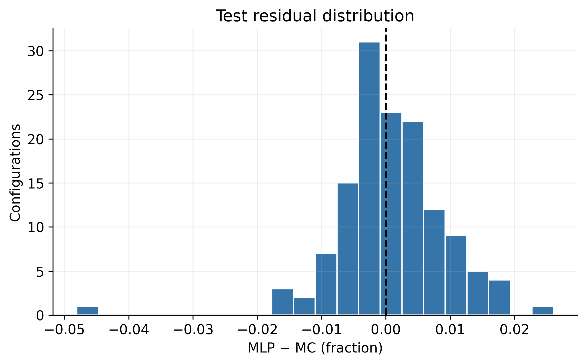

Рисунок 6. Распределение test-остатков MLP−MC; clipping не применяется.

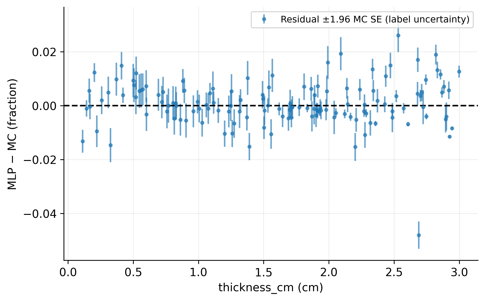

Рисунок 7. Остаток по толщина слоя, cm. Полосы ±1,96 MC SE относятся только к шуму метки.

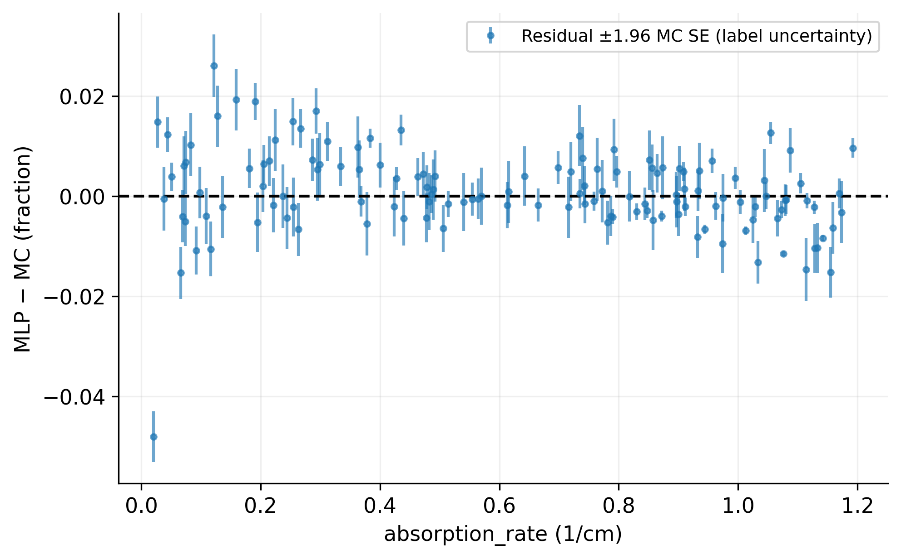

Рисунок 8. Остаток по коэффициент поглощения, 1/cm. Полосы ±1,96 MC SE относятся только к шуму метки.

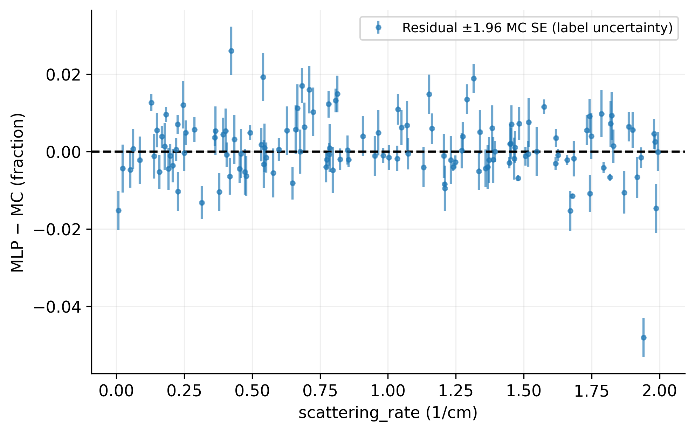

Рисунок 9. Остаток по коэффициент рассеяния, 1/cm. Полосы ±1,96 MC SE относятся только к шуму метки.

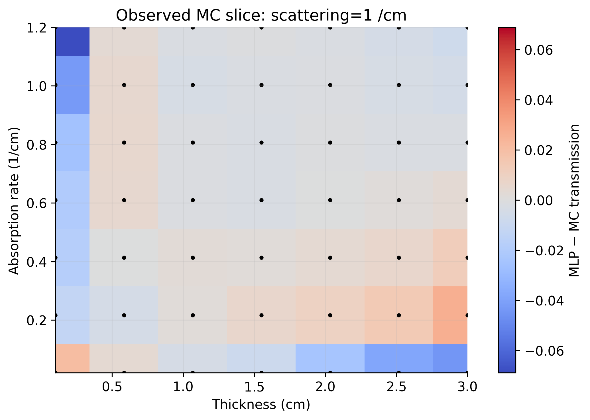

Рисунок 10. Ошибка на отдельном вычисленном MC-срезе при s=1 см⁻¹. Чёрные точки — реально рассчитанные конфигурации; между ними нет дополнительных MC-наблюдений.

### 7.5. Скорость и условная окупаемость

**Таблица 11. Время, секунды: совпадающие test-конфигурации, семь прогретых серий.** Источник: `../benchmarks/results/ml_multivariate_v2/full/timing.json`.

<!-- TABLE_11_BEGIN -->
| model | operation | n_configurations | median_seconds | q25_seconds | q75_seconds |
|---|---|---|---|---|---|
| dummy | single_predict | 1 | 3.3012815e-05 | 3.0601296e-05 | 3.5311704e-05 |
| dummy | batch_predict | 135 | 4.5843e-05 | 3.50225e-05 | 5.59995e-05 |
| dummy | load | 1 | 0.00087440002 | 0.00085759998 | 0.0011732 |
| ridge | single_predict | 1 | 5.2834e-05 | 3.967837e-05 | 5.3837111e-05 |
| ridge | batch_predict | 135 | 9.0215e-05 | 8.7535e-05 | 9.8957e-05 |
| ridge | load | 1 | 0.00092060002 | 0.00079604998 | 0.00095649998 |
| polynomial_ridge | single_predict | 1 | 7.8554963e-05 | 6.2790889e-05 | 8.9873296e-05 |
| polynomial_ridge | batch_predict | 135 | 8.9752e-05 | 8.7366e-05 | 9.9422e-05 |
| polynomial_ridge | load | 1 | 0.00075030001 | 0.00073179998 | 0.00084010002 |
| mlp | single_predict | 1 | 0.00012617244 | 0.00011351019 | 0.00013389781 |
| mlp | batch_predict | 135 | 0.000288119 | 0.0002677165 | 0.000299404 |
| mlp | load | 1 | 0.0116932 | 0.0108434 | 0.01337185 |
| Monte Carlo | mc_api | 135 | 0.0015974563 | 0.0015379426 | 0.0016486978 |
| Monte Carlo | mc_transport | 135 | 0.0011515096 | 0.0010928015 | 0.0011729733 |
<!-- TABLE_11_END -->

Одиночный прогретый MLP-predict имеет медиану
0.00012617244 с; MC API на тех же
test-входах — 0.0015974563 с. Отношение составляет
12.6609; отношение transport timer к полному predictor —
9.12647. Это ускорение одного обращения к уже
загруженной модели. Первый wrapper-вызов пилота занял 4.0816141 с
с возможной JIT-компиляцией и инициализацией. Он не участвует в этом отношении.
Генерация основных данных с экспортом заняла 332.98108 с,
последующее проверочное чтение/агрегация — 179.19095 с.
Сумма MC API-времён — 11.738052 с.
Поиск гиперпараметров — 93.280442 с,
дополнительные fit исследований — 250.24648 с.
Различие этих затрат показывает, почему скорость прямого прохода недостаточна
для оценки стоимости всей работы.

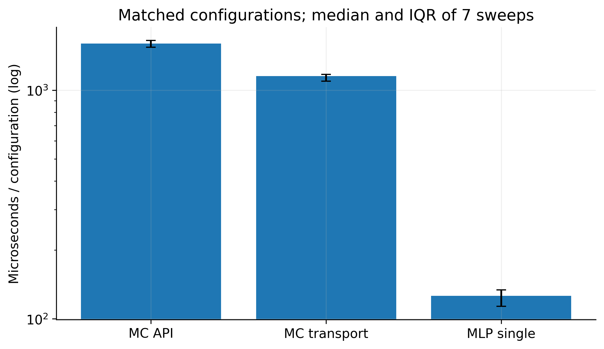

Рисунок 11. Прогретые измерения на совпадающих test-конфигурациях; медиана и IQR семи серий, логарифмическая шкала времени.

Пусть S — стоимость подготовки, t_MC — среднее время запроса к MC,
а t_ML — время запроса к загруженному predictor. Тогда накопленные затраты
равны T_MC(N)=N·t_MC и T_ML(N)=S+N·t_ML. При t_MC>t_ML их пересечение:
N*=S/(t_MC−t_ML). Если разность неположительна, конечной окупаемости по
этому способу расчёта нет; такое поле сохраняется как null.

Deployment включает сумму MC API-времён основного датасета, нормализацию,
один выбранный fit и одну загрузку модели. Это нижняя вычислительная оценка:
она не включает все операции хранения и контроля. Для консервативности
оплачиваются метки всех трёх частей датасета, а не только train.
Research включает wall time пилота и генерации с экспортом, проверочное
чтение, все поисковые fit, повторный fit воспроизводимости, дополнительные
ablation/size-fit и отдельные диагностические вычисления. Время самого
timing-бенчмарка, графиков, отчёта, тестов и работы человека не включено.
Следовательно, research-оценка расширенная, но не полная стоимость проекта.

**Таблица 12. Условная окупаемость при усреднённой стоимости test-запроса.** Источник: `../benchmarks/results/ml_multivariate_v2/full/timing.json`.

<!-- TABLE_12_BEGIN -->
| accounting | setup_seconds | queries | conditional |
|---|---|---|---|
| Deployment | 17.93766 | 12191.842 | да |
| Research | 918.01463 | 623954.81 | да |
<!-- TABLE_12_END -->

В обоих вариантах предполагаются повторные запросы из похожего
распределения и многократное использование модели в памяти. Численная
приемлемость среднего test RMSE не доказывает эквивалентность ошибок MC и MLP
для каждого запроса. Поэтому таблица 12 описывает условную амортизацию времени,
а не установленную равноточную замену транспортного расчёта. Полная серия
request может иметь другие толщины и число столкновений, что изменит порог.

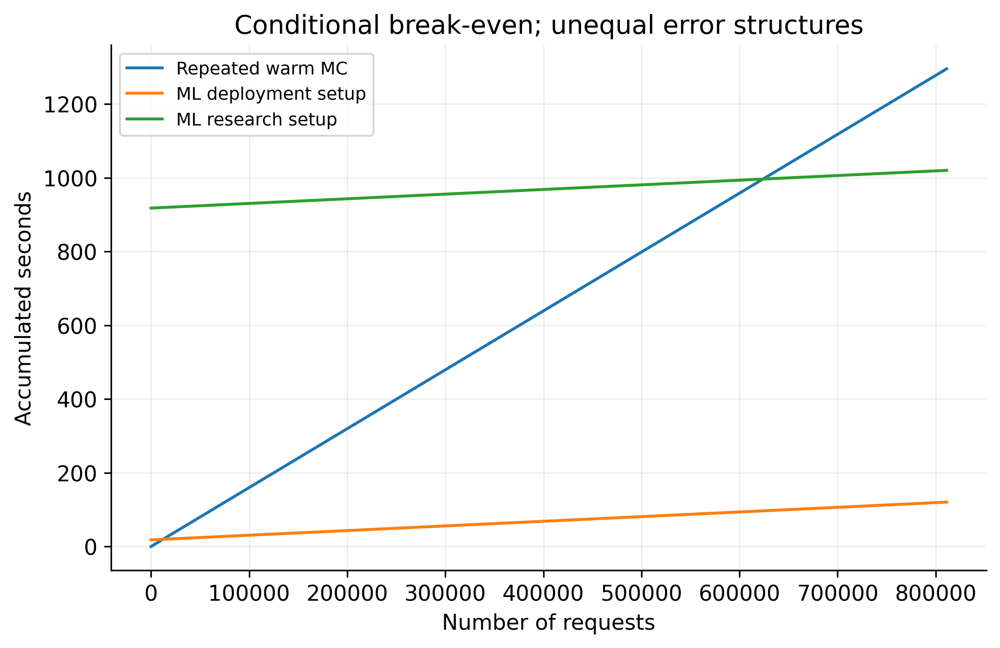

Рисунок 12. Условные накопленные затраты; кривые построены по измеренным временам, эквивалентная точность не установлена.

### 7.6. MC-шум и независимая диагностика

**Таблица 13. Шум Monte Carlo и независимые более точные метки.** Источник: `../benchmarks/results/ml_multivariate_v2/full/metrics.json: label_noise; diagnostics.json`.

<!-- TABLE_13_BEGIN -->
| quantity | value |
|---|---|
| pooled_se_median | 0.0023649343 |
| pooled_se_rms | 0.0023650547 |
| replicate_sem_median | 0.0018615257 |
| mc95_coverage | 0.45925926 |
| main_test_mlp_rmse | 0.0084667243 |
| independent_lhs_mlp_rmse | 0.01437616 |
| independent_lhs_se_median | 0.0012191326 |
| replicate_sd_at_500_histories | 0.019083229 |
| replicate_sd_at_2000_histories | 0.007609359 |
| replicate_sd_at_8000_histories | 0.0037219187 |
<!-- TABLE_13_END -->

Дополнительный независимый LHS содержит 24
конфигураций с 100000 историями в каждой.
Его MLP RMSE равна 0.01437616,
медианная SE меток — 0.0012191326. Этот набор
помогает оценить ошибку относительно более точных, но всё ещё случайных меток.
Он генерируется после замораживания моделей; его результаты не возвращаются
в обучение. Различие с обычным test одновременно зависит от меньшего шума и
других конфигураций, поэтому не может быть целиком приписано изменению N.

Noise-study сохраняет все восемь seed на каждом числе историй, а также
эмпирический SD и среднюю plug-in SE. Для независимых биномиальных историй
ожидается масштаб N^−1/2, но восемь повторов дают заметно случайную оценку
SD. Более точная MC-метка не устраняет смещение аппроксимации нейросети.
Отдельные проверки s=0 сравниваются с exp(−ad) через уже существующий
предварительно заданный exact-binomial протокол. Их численные результаты
и статусы сохранены в diagnostics.json, а не заменены заявлениями о
физической валидации.

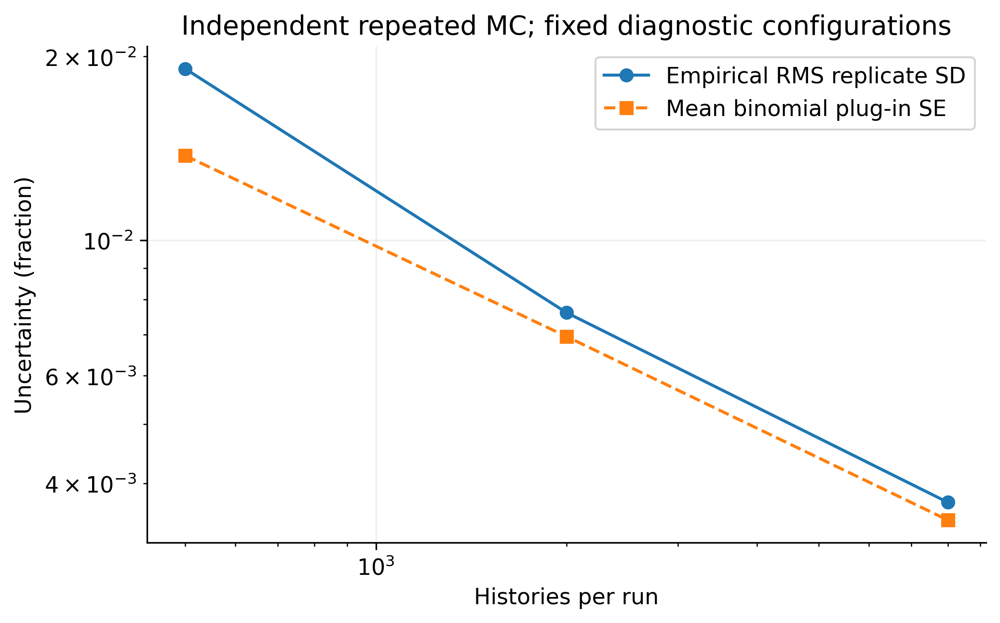

Рисунок 13. Изменение эмпирического разброса повторных MC-оценок и биномиальной SE с числом историй; набор конфигураций фиксирован.

## 8. Обсуждение и оценка гипотез

H1: парное сравнение с линейной моделью поддерживает гипотезу:
**да**. Аналогичное сравнение с полиномиальной моделью поддерживает
преимущество MLP: **да**. Эти решения следуют из верхней границы
95%-интервала разности RMSE. Существенно, что полином учитывает взаимодействия;
его результат делает сравнение содержательнее, чем исходный одномерный
эксперимент только с линейной зависимостью.

H2: среднее validation RMSE при полном train меньше, чем при 20%: **да**.
Значения 0.0082989356 и 0.013723075
получены на одном фиксированном validation. Если промежуточные ступени не
монотонны, это не скрывается. Одной последовательности вложенных подвыборок
недостаточно для строгого вывода о точке насыщения или оптимальном объёме.

H3: все три заранее определённых сокращения признаков дают большую среднюю
validation RMSE, чем полный вход: **да**. Степень ухудшения различается
между строками таблицы 8. Важность зависит от выбранного распределения входов,
архитектуры и доступности остальных параметров. В однородной математической
модели также есть безразмерная избыточность: ad и sd могут быть более
экономным представлением, что пока не исследовано в конкурентном fit.

H4: разность прогретых времён положительна:
**да**. Условные пороги приведены
в таблице 12. Это подтверждает возможность амортизировать измеренные
вычислительные затраты при заданных предпосылках, но не устанавливает
практическую экономию при общем требовании к точности.

H5: отношение test RMSE к RMS биномиальных SE равно 3.57993;
на независимом более точном LHS отношение RMSE к медианной SE равно
11.7921. Эмпирический RMS разброса при увеличении числа
историй от 500 до 8000 уменьшился
в 5.12726 раза; ожидаемое соотношение по закону N^−1/2 равно
4. Эти числа подтверждают наличие статистического
ограничения меток, но не позволяют приписать ему весь остаток MLP.
Чем сильнее RMSE превышает SE, тем заметнее дополнительная ошибка
аппроксимации/обобщения. Сопоставимость величин затрудняет её отделение от
MC-шума. Универсальный вывод о шуме как единственном или основном
ограничении не принимается; сравнение двух наборов также зависит от входов.

Нелинейный характер отклика объясняется тем, что d,a,s совместно определяют
не только прямое ослабление, но и длины случайных путей и вероятности
повторного изменения направления. Полином второй степени ограничивает
форму зависимости, а MLP допускает более гибкую композицию. Эта гибкость
увеличивает стоимость обучения и риск локальных минимумов. Простая модель
может быть предпочтительна, если её ошибка уже удовлетворяет задаче,
поскольку время fit, размер артефакта и интерпретируемость тоже имеют значение.

Скорость оправдывает применение только после определения приемлемой ошибки.
Для иллюстративного исследования параметров может быть достаточно среднего
учебного допуска; для решения с жёсткой гарантией по каждому входу этого
недостаточно. У MLP здесь нет проверенных предсказательных интервалов.
Расхождение на новых комбинациях, особенно у краёв области, должно оцениваться
независимыми MC-расчётами; обычный inference отказывает за пределами схемы.

### 8.1. Наблюдаемые нарушения и предел учебного критерия

На основном test 4 из
135 ответов MLP оказались вне [0,1]; доля
таких ответов равна 0.02962963.
Выполнение порогов RMSE и Max Error на этом test не означает выполнения
всех требований к вероятностному предиктору. Линейный выход допускает
некорректные вероятности; clipping сознательно не применялся при оценке.

На отдельном более точном LHS максимальная ошибка достигла
0.066938388;
на наблюдаемом срезе s=1 см⁻¹ RMSE равна
0.016995124, максимальная ошибка —
0.068845491.
Эти независимые результаты нужно сопоставлять с исходными порогами 0,015
и 0,06. Поэтому принятие основного test не даёт гарантии приемлемой ошибки
по всей заявленной области и не подтверждает равноточную замену MC.

В этой постановке отношение RMSE к MC SE и наблюдаемые локальные отклонения
показывают, что одного увеличения числа историй недостаточно для устранения
ошибки суррогата. Причины необходимо искать также в аппроксимации и обучении.
Скорость inference не устраняет эти нарушения; применение модели оправдано
лишь в задаче с явно допустимыми ошибками и большим числом повторных запросов.
Источник этих чисел — metrics.json и diagnostics.json; дополнительной
настройки модели после их просмотра не выполнялось.

## 9. Ограничения исследования

Синтетические коэффициенты не являются измеренными сечениями реального
вещества. Модель не переносит энергию, не учитывает связанные состояния,
спектральные изменения и микроскопическую структуру материала. Проверка
предельного случая подтверждает математическую согласованность программы,
но не заменяет сравнение с экспериментом или независимо валидированным кодом.

Исследовано одно распределение LHS, одно основное разбиение и три seed
обучения. Полученные доверительные интервалы не отражают вариацию между
проектами выборки. Уменьшенные train-наборы вложены и статистически зависимы;
ошибки на последовательных ступенях нельзя интерпретировать как независимые
эксперименты. Диагностическая сетка двумерна и фиксирует только один уровень s.

Биномиальные SE и CI охватывают случайный разброс независимых историй.
Источник коэффициентов, ошибка математического приближения, оптимизация
и численная арифметика имеют иной смысл. Три MC-повтора основного набора
дают ограниченную эмпирическую оценку SEM. Бутстреп выполняется по группам,
но использует уже шумные target и не создаёт точного ground truth.

Сравнение алгоритмов ограничено четырьмя семействами и небольшим числом
гиперпараметров. Интерполяция, регрессия по оптическим параметрам, Gaussian
process и другие методы не тестировались. Их возможное преимущество или
проигрыш нельзя утверждать по настоящим результатам. Наличие трёх входов
само по себе не делает MLP необходимой.

Времена зависят от CPU, фоновой нагрузки, версий библиотек и размера пакета.
Ограничение потоков не гарантирует неизменной частоты процессора.
Расчёт break-even предполагает известное распределение будущих запросов и
не включает время человека. Программа не выдаёт инженерной гарантии
качества вне обученного домена, а сведения о производительности не являются
экономическим обоснованием применения в реальных ядерных установках.

## 10. Заключение

Выполнено воспроизводимое исследование трёх независимо задаваемых
учебных входов. На 135 отложенных конфигурациях
выбранная MLP получила MAE 0.0059517297, RMSE
0.0084667243, R² 0.99877914 и
максимальную ошибку 0.048062059.
Численные сравнения, ablation, размеры train и MC-повторы сохранены
раздельно и доступны для независимой проверки. Ускорение прогретого
одиночного обращения составило 12.6609 при обозначенной
структуре ошибки и фиксированном распределении входов.

Практический результат состоит в проверяемой методике: пригодность
суррогата определяется требуемой точностью, полнотой входов, доступным
числом обучающих групп и повторным использованием модели. Полученные
пороги времени условны; физическая валидность и равноточная инженерная
замена MC не установлены. Следующее исследование целесообразно посвятить
сравнению с оптическими признаками и интерполяцией, повторным разбиениям,
более точным меткам и контролю ошибки у границ.

Использование NumPy, SciPy или MLP не заявляется как новизна. Самостоятельный
вклад проекта — реализация воспроизводимого образовательного инструмента
и конкретный экспериментальный анализ компромиссов на его математической
модели. Утверждение о приоритете относительно литературы здесь не делается.

## 11. Литература

Источники проверены 19 ноября 2026 года. Для официальной документации указан
URL, а не вымышленный автор или год публикации.

1. Metropolis N., Ulam S. (1949). *The Monte Carlo Method*. Journal of the
American Statistical Association, 44(247), 335–341.
[DOI: 10.1080/01621459.1949.10483310](https://doi.org/10.1080/01621459.1949.10483310).
2. Hong L. Jeff, Zhang Xiaowei (2021). *Surrogate-Based Simulation Optimization*.
arXiv:2105.03893, версия 2. [Текст и библиография](https://arxiv.org/abs/2105.03893).
[DOI: 10.48550/arXiv.2105.03893](https://doi.org/10.48550/arXiv.2105.03893).
3. Efron B. (1979). *Bootstrap Methods: Another Look at the Jackknife*.
The Annals of Statistics, 7(1), 1–26.
[DOI: 10.1214/aos/1176344552](https://doi.org/10.1214/aos/1176344552).
4. SciPy. *minimize(method='L-BFGS-B')*: условия остановки и статус оптимизации.
[Официальная документация](https://docs.scipy.org/doc/scipy/reference/optimize.minimize-lbfgsb.html).
5. SciPy. *scipy.stats.qmc.LatinHypercube*: описание LHS и ссылки на исходные
публикации по планированию эксперимента.
[Официальная документация](https://docs.scipy.org/doc/scipy/reference/generated/scipy.stats.qmc.LatinHypercube.html).
6. scikit-learn. *Metrics and scoring: regression metrics*.
[Официальная документация определений](https://scikit-learn.org/stable/modules/model_evaluation.html#regression-metrics).
Библиотека используется как справочный источник; вычисления реализованы на NumPy.
7. NumPy. *numpy.linalg.lstsq*: решение задачи наименьших квадратов.
[Официальная документация](https://numpy.org/doc/stable/reference/generated/numpy.linalg.lstsq.html).
8. Matplotlib. *Figure.savefig*: сохранение научных рисунков и разрешение.
[Официальная документация](https://matplotlib.org/stable/api/_as_gen/matplotlib.figure.Figure.savefig.html).
9. SciPy. *BinomTestResult.proportion_ci*: биномиальные интервалы.
[Официальная документация](https://docs.scipy.org/doc/scipy/reference/generated/scipy.stats._result_classes.BinomTestResult.proportion_ci.html).

## 12. Приложения

### 12.1. Настройки, seed и схемы

Полный frozen-план находится в experiment_config.json. Планирование и split:
seed 20261119; основной MC: 800000+3·i+r; subset train: 1942;
bootstrap: 4815; seed обучения: 17,29,43. Диагностика использует независимые
диапазоны seed 1200000+, 1400000+ и 1600000+; timing — 1700000+.
Истории используют исходный PCG64 движка, а не отдельную реализацию
случайного транспорта в ML-коде.

Запись mc_records.csv содержит три входа, group_id, run_configuration_id,
seed, target, successes, histories, SE, CI, status, timing и версию алгоритма.
Исходные bundles дополнительно содержат полный материал, кодовые хеши,
параметры, предупреждения и provenance. dataset.csv объединяет только повторы
одной группы; в нём сохраняются pooled successes/histories и replicate SEM.
splits.json хранит имена частей и все group_id.

В mlp.json записаны схема v2, упорядоченная feature_spec, единицы и домены,
scaler, widths, численные theta, optimizer/options, seed, статус и metadata
обучения. Все весовые матрицы и смещения восстанавливаются из theta по widths.
Для полинома сохранён порядок квадратов и взаимодействий, определённый
polynomial_design. Загрузка отклоняет несовместимую схему или нечисловые веса.
Теоретически невозможно обнаружить перестановку столбцов голой числовой
матрицы без имён; CLI формирует строку из именованных аргументов, и этот
контракт документирован.

### 12.2. Воспроизведение и контроль артефактов

Подробные команды и правила возобновления:
[ML_REPRODUCIBILITY.md](ML_REPRODUCIBILITY.md). Режим evaluate читает готовую
модель, заново валидирует native-датасет и оценивает исходный test без fit.
Дополнительный --dataset допускает только новые совместимые конфигурации
и запрещает пересечение с train/validation. Predict требует именованных
толщины, поглощения и рассеяния; за пределами домена применяется отказ.

Каждая из 13 таблиц сгенерирована из JSON/CSV, а не перепечатана вручную.
report_tables.json хранит их машинный вид и источник; report_consistency.json
подтверждает точное совпадение табличных блоков отчёта и comparison.csv
с metrics.json. manifest.json перечисляет артефакты, размеры и SHA256.
Он служит проверке целостности; любой внешний автор может заменить файл
и его checksum, поэтому аутентификация этим механизмом не заявляется.

### 12.3. Перечень результатов

experiment_config.json, pilot.json, splits.json, dataset.csv, mc_records.csv,
experiments.zip, generation.json и generation_progress.json описывают
план и данные. dummy.json, ridge.json, polynomial_ridge.json и mlp.json —
модели. selection.json и training_trials.json сохраняют все попытки;
learning_curves.csv — историю выбранного fit. study_models.json,
ablation.csv и dataset_size_study.csv содержат дополнительные fit.
metrics.json, comparison.csv, test_predictions.csv и error_regions.csv —
основную оценку. diagnostic_experiments.zip, diagnostics.json,
diagnostic_predictions.csv и noise_study.csv — независимую диагностику.
timing.json содержит отдельные повторы времени и способы учёта setup.
figures/ содержит 13 PNG, 300 dpi. manifest.json, report_tables.json,
report_consistency.json, cli_checks.json и test_execution.json фиксируют
проверки по мере их фактического выполнения.

Сырые ZIP и большие checkpoint-модели сохраняются локально и исключены
из автоматического добавления в Git. В публичном репозитории доступны
JSON-модели, сводные данные, метрики и рисунки. Predict использует JSON-модель;
evaluate требует также native-архив experiments.zip.

### 12.4. Хеши кода

- `physics.py`: `34a53f4cf630c7ddb96f5234dc3e7ff72e2f8fffb7b8a73f6a02f84ab813307b`
- `material.py`: `94139a12394619b6a0caf4cb4f2d2669aa7dcbd3de3597de0fe7d75facfdaffe`
- `numba_compat.py`: `7048420c8bbf0ceba8f7b1822971f11800f3082a133f46c2f9a798b9ac4e0426`
- `benchmarks/ml_baseline.py`: `e48561e61fd35cb73a82a9f38e3b604932efb35d8e7ba77fe7aa7dc6133cc152`

Указанные хеши относятся к выполненным расчётам. Первичная постобработка рисунков и пояснений записана в postprocessing_revision.json. Последующая редакционная чистка комментариев и документации описана в ML_REPRODUCIBILITY.md; текущие исходники могут иметь другие хеши. Веса, данные и численные метрики сохранены.

### 12.5. Фактически выполненная проверка

```json
{
  "exit_code": 0,
  "wall_seconds": 104.28941610001493,
  "passed_test_calls": 398,
  "failed_test_calls": 0,
  "skipped": 1,
  "scope": "full repository suite; native GUI opt-in remains separate",
  "command": "pytest -q -p no:cacheprovider --basetemp <external TemporaryDirectory>",
  "dependencies_added": [],
  "passed_tests": 396,
  "passed_subtests": 2,
  "pytest_reported_seconds": 103.11,
  "passed_test_calls_note": "includes two successful subtest reports",
  "pytest_summary": "396 passed, 1 skipped, 2 subtests passed"
}
```

Тесты устанавливают программную корректность в указанном объёме; инженерная валидация из их прохождения не следует.
